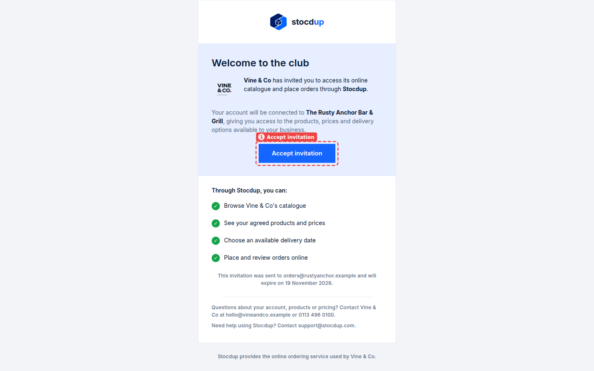
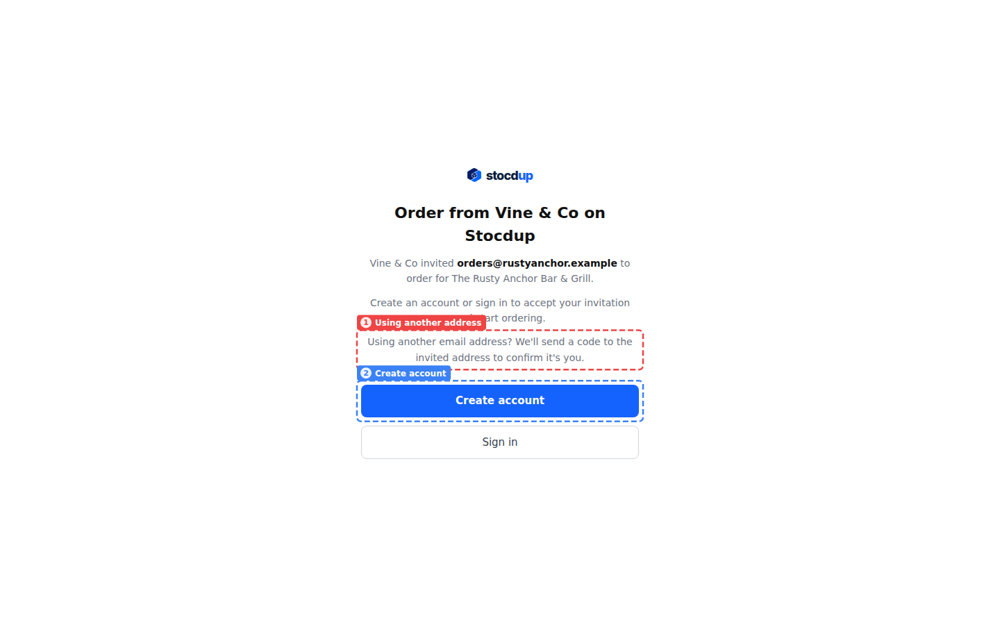
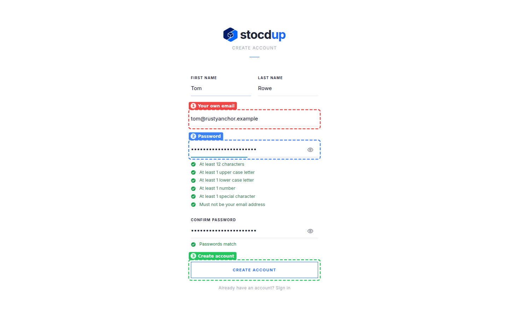
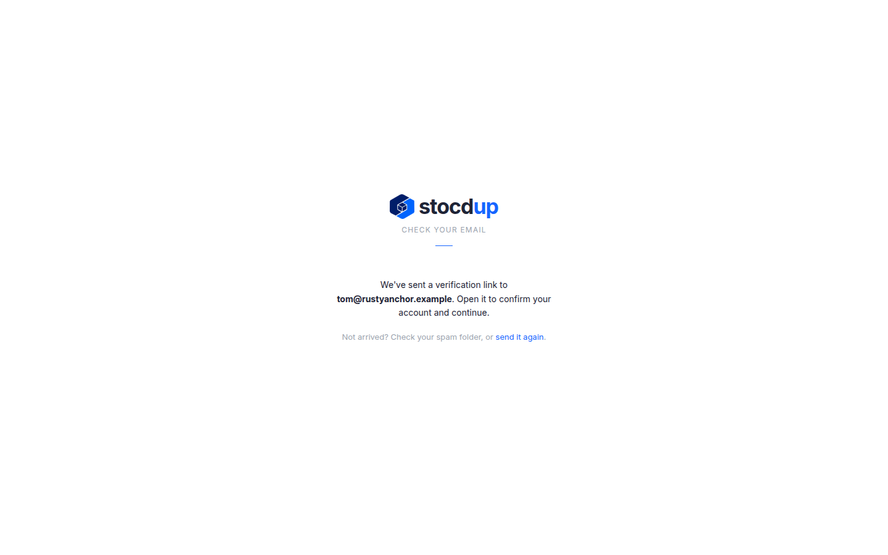
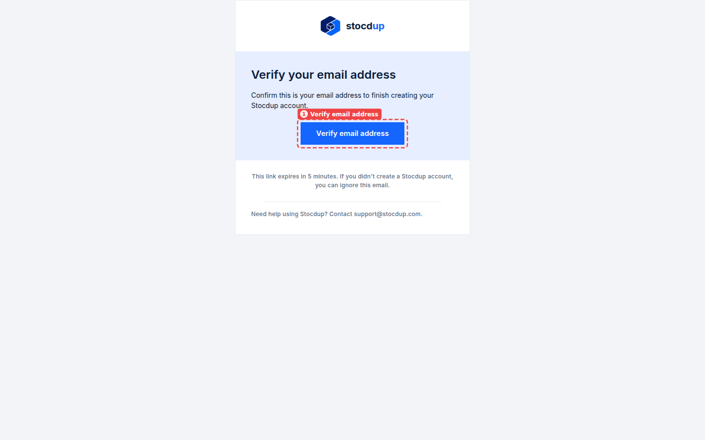
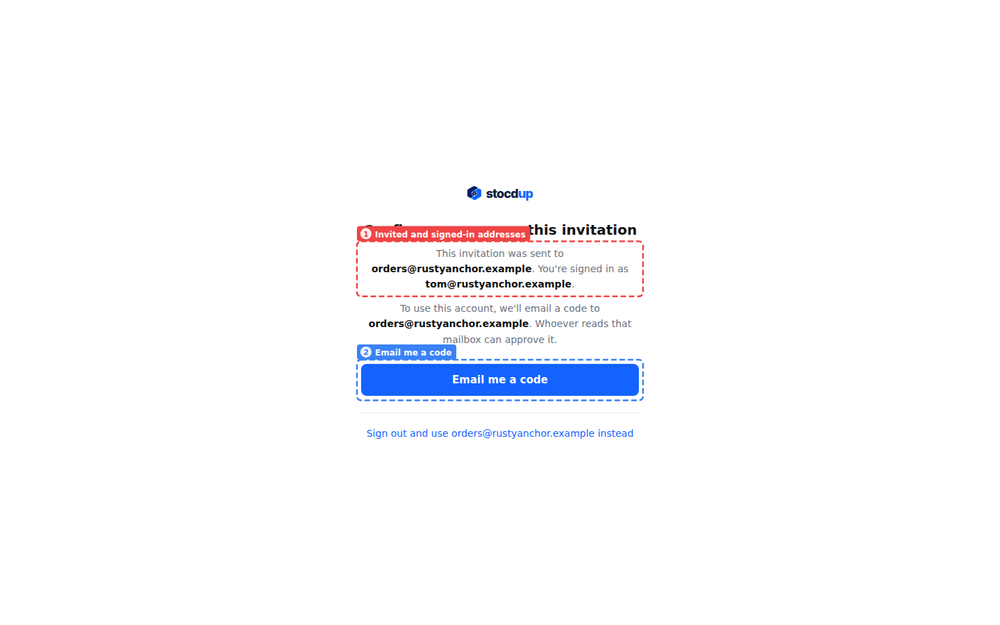
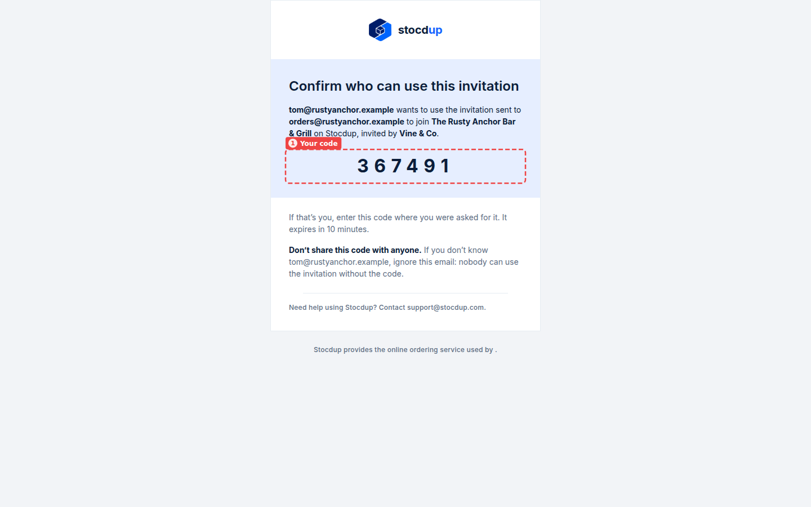
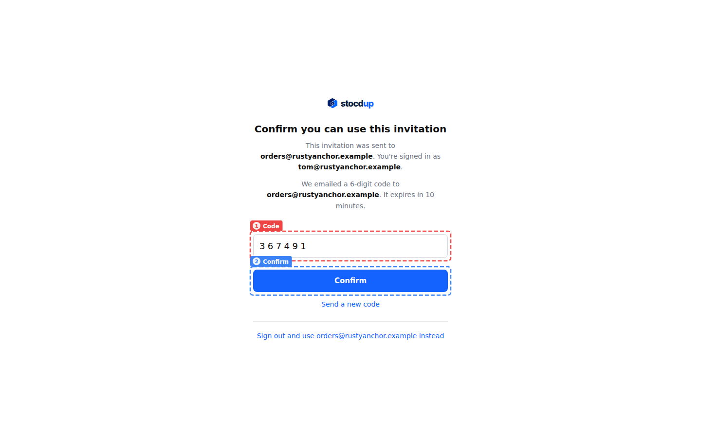
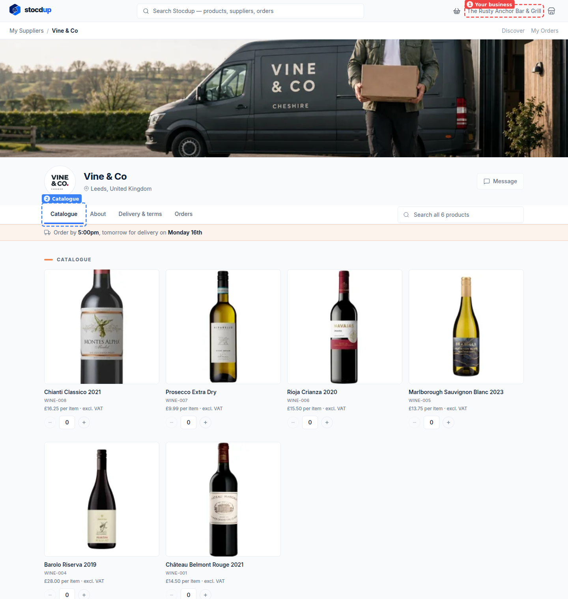

{/* Generated by scenario-docs from documentation/scenarios/accept-portal-invitation-with-another-address.md. Edit the scenario and regenerate; changes here are overwritten. */}

In this task you'll accept an invitation that was sent to a shared address, such as your
business's orders inbox, with a login in your own name: you'll create your account with
your own email address, confirm it, then enter the code sent to the invited address.

## About accepting with a different address

An invitation is sent to one email address, often a shared one. You can accept it with a
login under a different address, but because the link alone could have been forwarded to
anyone, Stocdup asks whoever reads the invited mailbox to approve it: it emails a 6-digit
code there, naming the login that asked for it. The code works only for that login and
that invitation, for 10 minutes, and allows 5 wrong tries; after that, send a new code.
Once you're in, the invited address gets an email saying who joined, so an unexpected
sign-up is noticed.

## Before you start

- You'll need the invitation email your supplier sent through Stocdup, and access to the
  mailbox it was sent to (or someone who reads it), to get the code.

## 1. Open the invitation email and accept it

Open the email from your supplier, here **Vine & Co**, sent to
**orders@rustyanchor.example**. Select **Accept invitation** (1).

## 2. Choose to create an account

Stocdup opens and shows who invited you and the address the invitation was sent to. Below
it, a note (1) says that if you use another email address, a code is sent to the invited
address to confirm it's you. Select **Create account** (2).

## 3. Enter your details with your own email address

Enter your **First name** and **Last name**, here **Tom** and **Rowe**.

**Work email** (1) is filled in with the invited address. Replace it with your own, here
**tom@rustyanchor.example**.

Choose a password and enter it in **Password** (2) and **Confirm password**. As you type,
the form ticks off each rule: at least 12 characters, with an upper case letter, a lower
case letter, a number and a special character, and not your email address.

Then select **Create account** (3).

## 4. Confirm your own email address

Stocdup tells you it has sent a verification link to your address,
**tom@rustyanchor.example**.

Open the email **Verify your email address for Stocdup** in your own mailbox and select
**Verify email address** (1). If it hasn't arrived, check your spam folder or select
**send it again** on the Check your email page.

## 5. Ask for a code to be sent to the invited address

Stocdup shows that the invitation was sent to **orders@rustyanchor.example** and that
you're signed in as **tom@rustyanchor.example** (1). Select **Email me a code** (2).

If you'd rather accept with the invited address itself, select **Sign out and use
orders@rustyanchor.example instead** and follow
[Accept an invitation to order online](./accept-portal-invitation.mdx).

## 6. Enter the code from the email to the invited address

Open the email **Confirm who can use this invitation** sent to
**orders@rustyanchor.example**, or ask whoever reads that mailbox for it. It names the
login that asked for the code, here **tom@rustyanchor.example**, and shows the code (1).

:::warning
Don't share the code with anyone. If the email names a login you don't know, ignore it:
nobody can use the invitation without the code.
:::

Back in Stocdup, enter the code in **Code** (1) and select **Confirm** (2). If it has
expired or you've used up your tries, select **Send a new code**.

## 7. Arrive at your supplier's catalogue

You're signed in, on your supplier's page in the portal, on the **Catalogue** tab (2),
with your prices. The business you're ordering for, **The Rusty Anchor Bar & Grill**,
shows at the top right (1). The invited address gets an email saying you joined.

## Related

- [Accept an invitation to order online](./accept-portal-invitation.mdx)
- [Place an order](../ordering/place-order.mdx)
