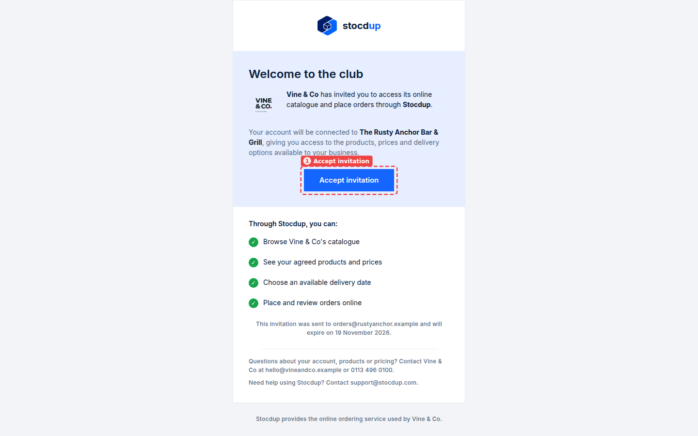
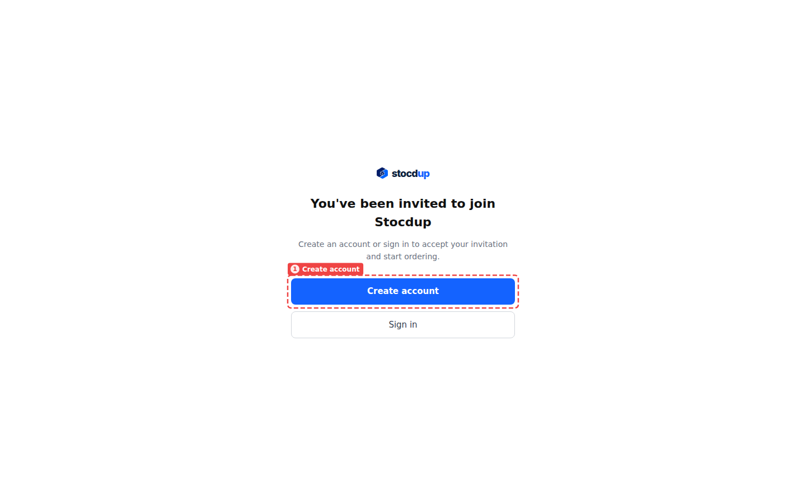
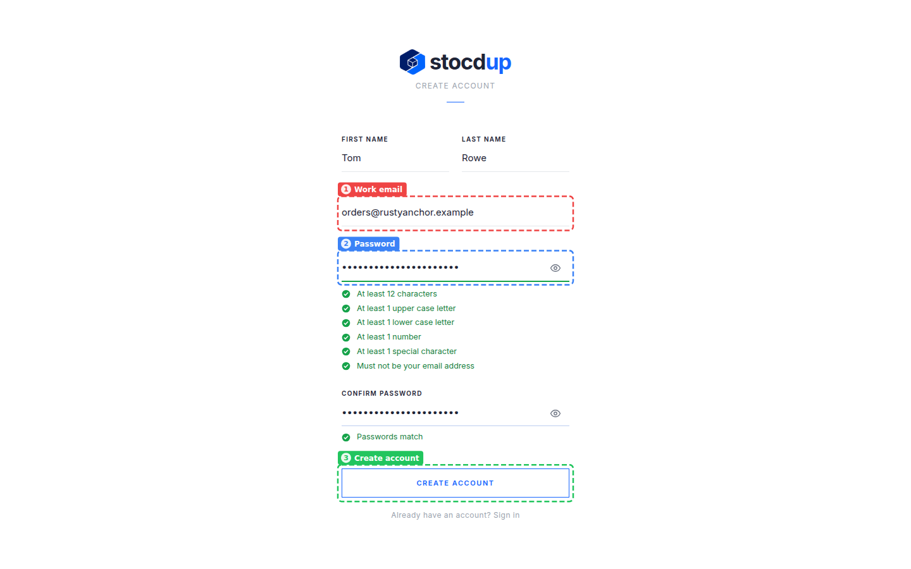
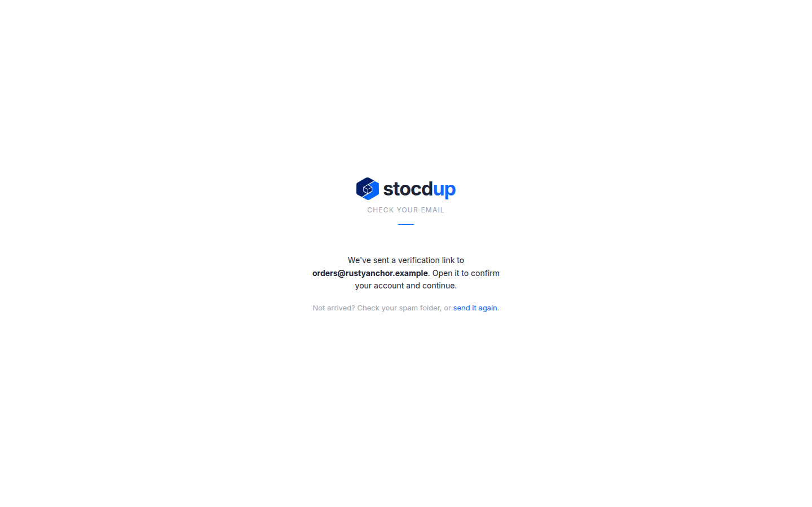
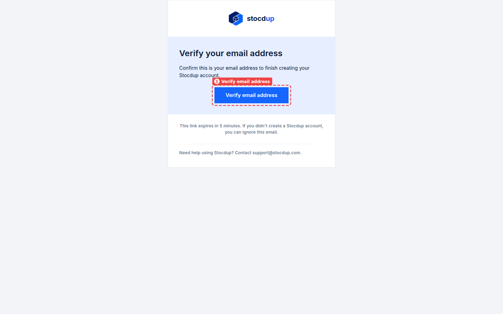
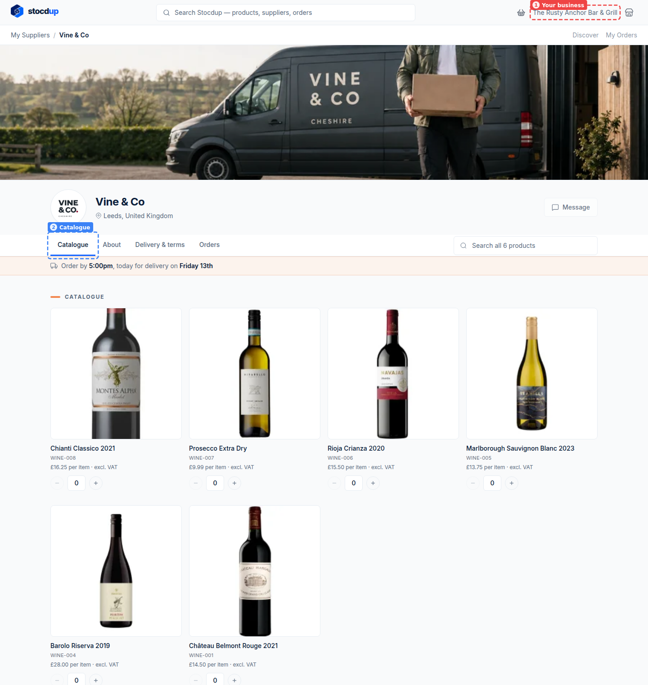

{/* Generated by scenario-docs from documentation/scenarios/accept-portal-invitation.md. Edit the scenario and regenerate; changes here are overwritten. */}

In this task you'll accept your supplier's invitation: you'll create your Stocdup login
from the invitation email, confirm your email address, and arrive at their catalogue
ready to order.

## About invitations

Your supplier invites your business to order from them online by sending an invitation
to your email address. Accepting it creates your login and connects it to your business
on their account, so you see the products in your catalogue, at your prices, and the
delivery days they offer you. The invitation only works for the email address it was
sent to, and its link lasts 7 days; after that, ask your supplier to send a new one.

## Before you start

- You'll need the invitation email your supplier sent you through Stocdup.

## 1. Open the invitation email and accept it

Open the email from your supplier, here **Vine & Co**. It names the business your account
will be connected to, and the date the invitation expires. Select **Accept invitation**
(1).

## 2. Choose to create an account

Stocdup opens and asks whether to create an account or sign in. Select **Create account**
(1).

## 3. Enter your details

Enter your **First name** and **Last name**, here **Tom** and **Rowe**.

In **Work email** (1), enter the address the invitation was sent to, here
**orders@rustyanchor.example**. Use exactly that address: the invitation can't be
accepted with any other.

Choose a password and enter it in **Password** (2) and **Confirm password**. As you
type, the form ticks off each rule. Your password needs:

- at least 12 characters
- at least 1 upper case letter
- at least 1 lower case letter
- at least 1 number
- at least 1 special character
- not to be your email address

Then select **Create account** (3).

## 4. Confirm your email address

Stocdup tells you it has sent a verification link to your email address.

Open the email **Verify your email address for Stocdup** and select **Verify email
address** (1). The link expires 5 minutes after the email is sent; if it has expired, or
the email hasn't arrived, check your spam folder or select **send it again** on the
Check your email page.

## 5. Arrive at your supplier's catalogue

You're signed in, on your supplier's page in the portal, on the **Catalogue** tab (2),
with your prices. The business you're ordering for, **The Rusty Anchor Bar & Grill**,
shows at the top right (1).

## Related

- [Place an order](../ordering/place-order.mdx)
- [Track an order](../ordering/track-an-order.mdx)
- [Invite a customer to the portal](../../distributors/customers/invite-customer-to-portal.mdx) (for suppliers)
