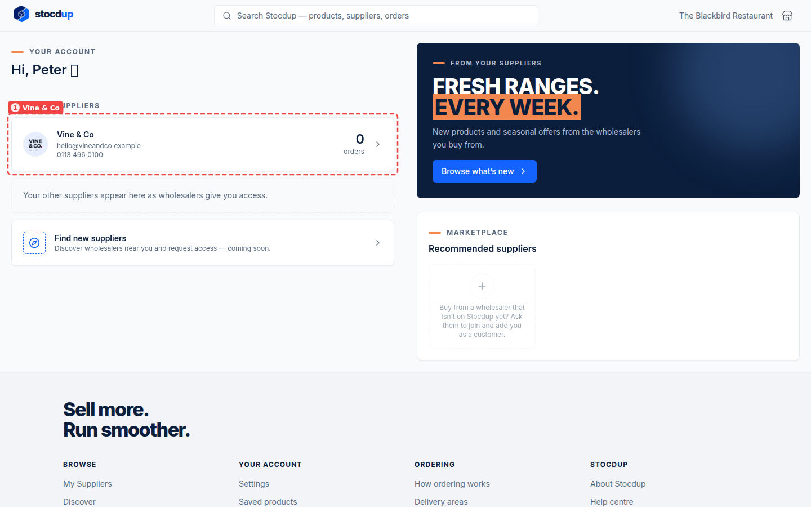
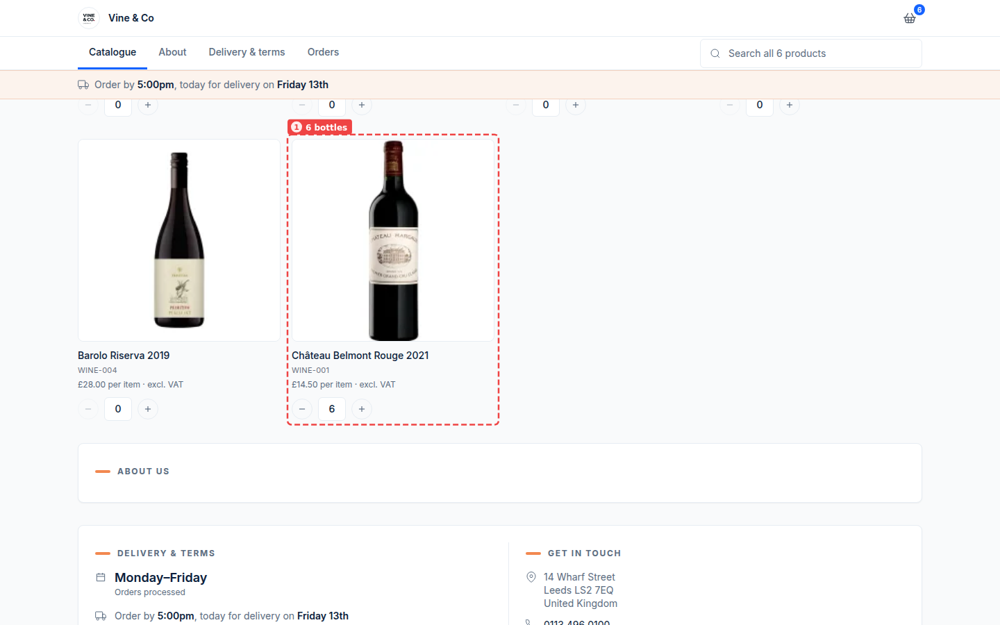
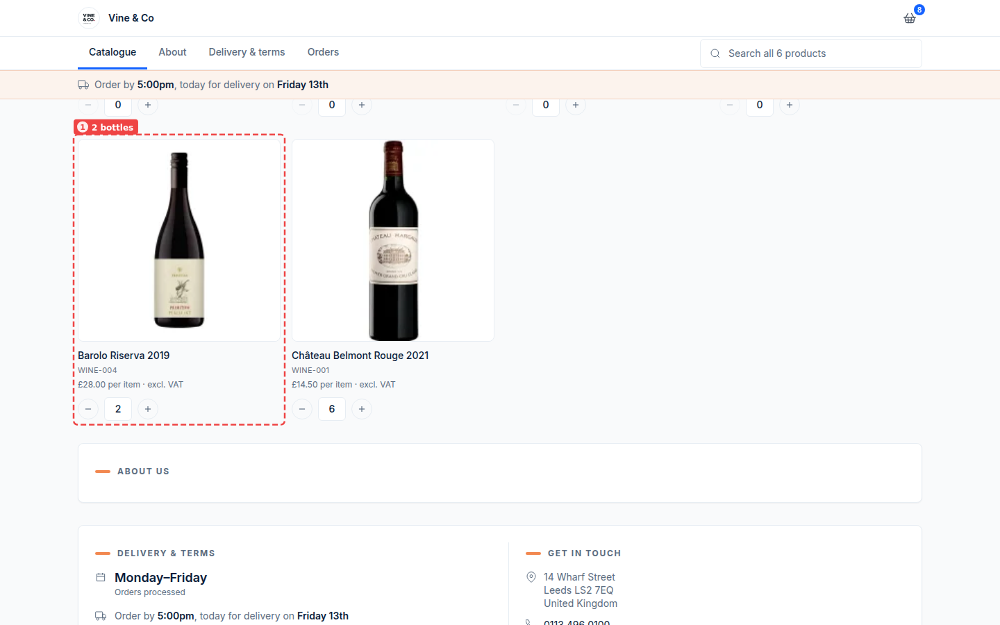
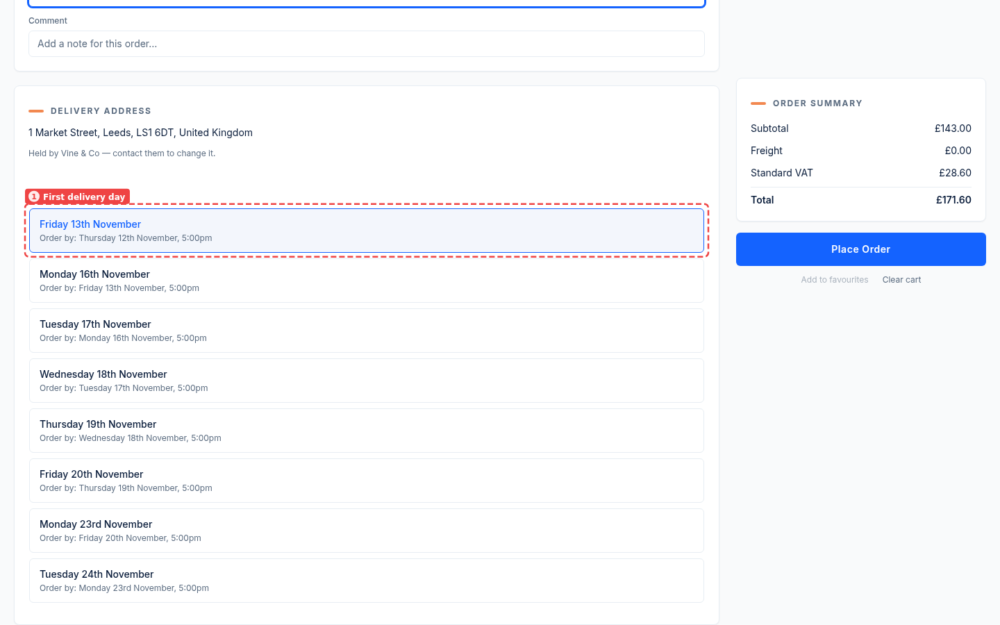
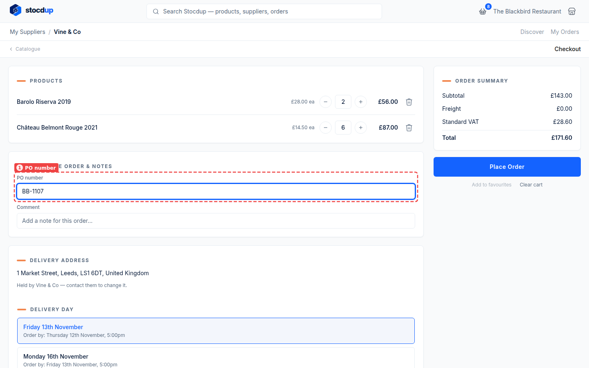
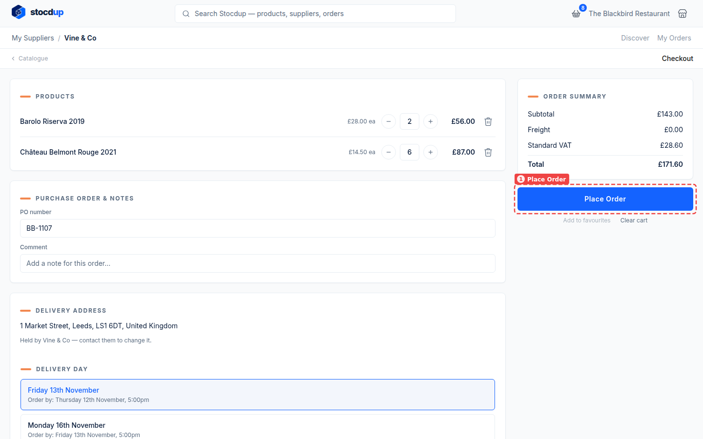
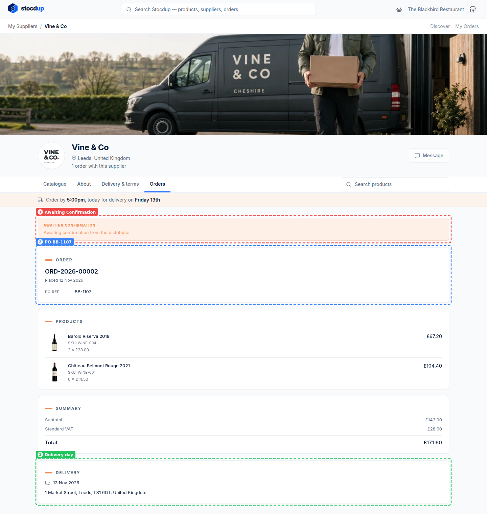

{/* Generated by scenario-docs from documentation/scenarios/place-order.md. Edit the scenario and regenerate; changes here are overwritten. */}

In this task you'll add products from your supplier's catalogue to your basket, choose a
delivery day and place the order.

## About ordering

Your supplier decides which products you see and what you pay: the portal shows the
catalogues they've given you, at your prices. You can only choose delivery days your
supplier delivers to you, each with an order-by time, and if they set a minimum order
value, your order has to reach it before you can place it. When you place an order, your
supplier reviews and confirms it, or it's confirmed straight away if they accept orders
automatically.

## Before you start

- You'll need a trade customer account with a supplier on Stocdup.

## 1. Open your supplier's catalogue

On the portal's home page, under your suppliers, select your supplier's card, here
**Vine & Co** (1).

Their page opens on the **Catalogue** tab, with every product you can order and its price.

## 2. Add 6 bottles of Château Belmont Rouge 2021 to the basket

Find **Château Belmont Rouge 2021** (1) and enter **6** in its quantity box, or select
**+** six times. The basket icon at the top right shows how many items you've added.

The bar under the tabs shows the time to order by for the next delivery day.

## 3. Add 2 bottles of Barolo Riserva 2019

In the same way, enter **2** in the quantity box of **Barolo Riserva 2019** (1). The
basket now shows 8 items.

## 4. Go to checkout and choose the first available delivery day

Select the basket icon at the top right to open **Checkout**. It lists your products, the
delivery address your supplier holds for you, and the delivery days you can choose.

Under **Delivery day**, select the first day in the list (1). Each day listed is one your
supplier delivers to you, with **Order by:** the last moment to place an order for it;
days whose order-by time has passed aren't shown. If no days are listed, contact your
supplier.

## 5. Add the PO number BB-1107

Under **Purchase order & notes**, enter **BB-1107** in **PO number** (1). It's optional;
your supplier sees it on the order. Use **Comment** for anything else they should know.

## 6. Place the order

Check the **Order summary**, then select **Place Order** (1).

## Result

The order's page opens. It shows **Awaiting Confirmation** (1): your supplier hasn't
confirmed it yet. It also shows the order number with your PO reference (2), the products
and totals, and the delivery day and address (3).

:::note

Until your supplier confirms the order, you can cancel it with **Cancel Order** at the
bottom of its page. Once they've confirmed it, you can't cancel it yourself.

:::

## Related

- [Accept an invitation to order online](../getting-started/accept-portal-invitation.mdx)
- [Track an order](./track-an-order.mdx)
