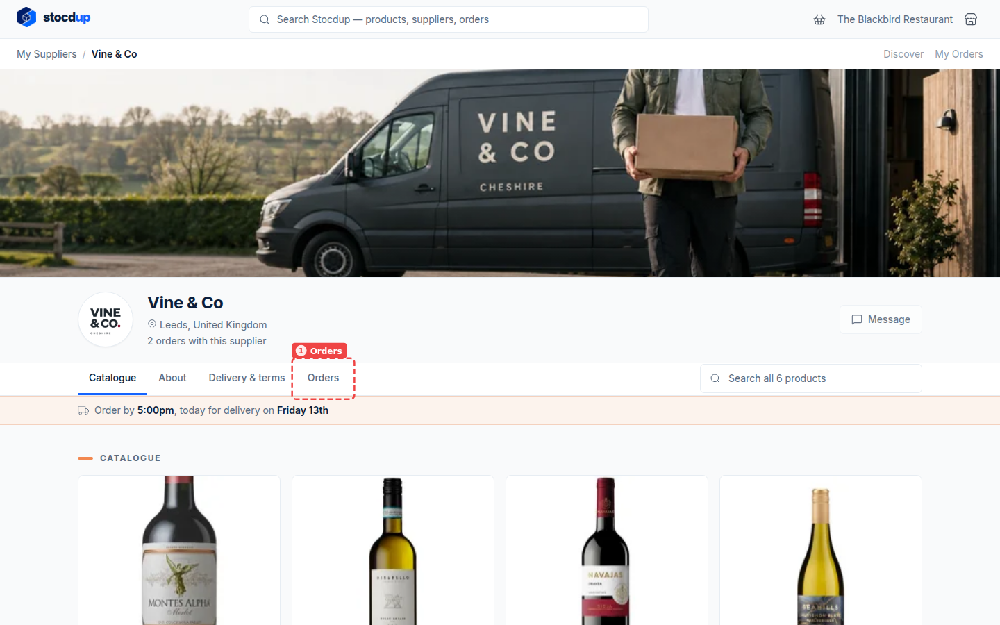
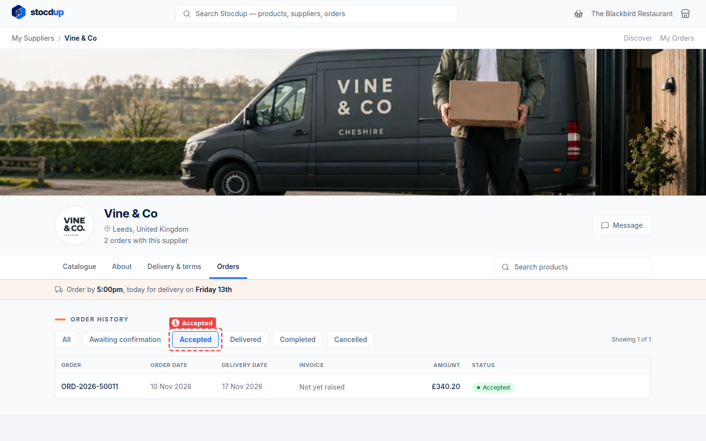
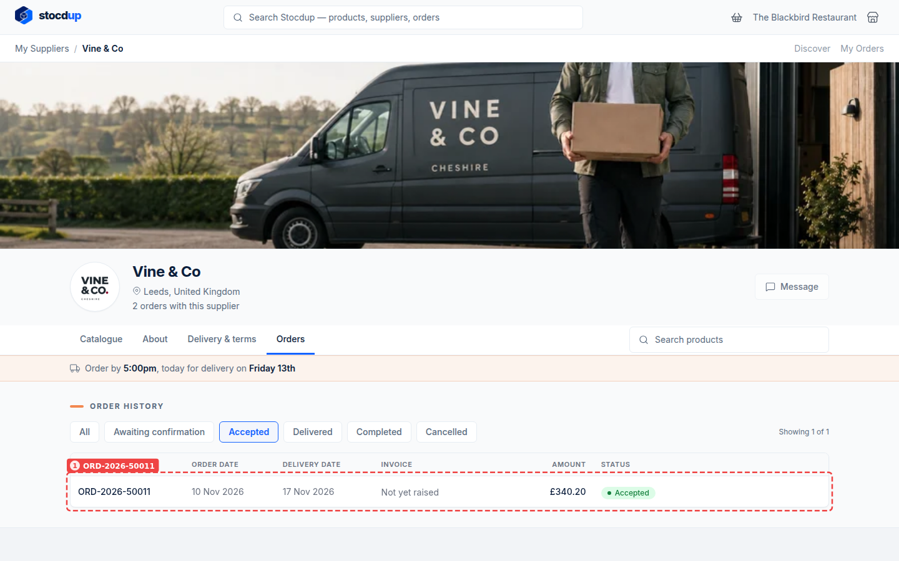
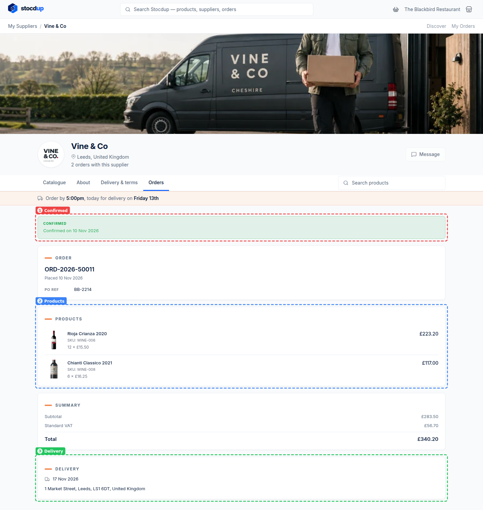

{/* Generated by scenario-docs from documentation/scenarios/track-an-order.md. Edit the scenario and regenerate; changes here are overwritten. */}

In this task you'll check your orders with a supplier: which ones they've confirmed, and
when each will be delivered.

## About tracking orders

Each order you place goes to your supplier to confirm. Until they do, it's awaiting
confirmation and you can still cancel it yourself; once they've confirmed it, it's on its
way to being delivered on the day you chose. Your orders list shows every order's status
and delivery date, so you can check before chasing your supplier.

## Before you start

- You'll need a trade customer account with a supplier on Stocdup, and at least one order
  with them.

## 1. Open your orders with Vine & Co

From the portal's home page, select your supplier's card, here **Vine & Co**. On their
page, select the **Orders** tab (1).

**Order history** lists every order you've placed with them: its order date, delivery
date, invoice, amount and status. In the **Status** column, **Awaiting confirmation**
means your supplier hasn't confirmed the order yet, so you can still cancel it from its
page; **Accepted** means they've confirmed it and it will be delivered on the day you
chose. Under **Invoice**, **Not yet raised** means your supplier hasn't created an invoice
for the order yet.

## 2. Show only the orders Vine & Co has accepted

Select the **Accepted** filter (1). The list shows only the orders your supplier has
confirmed. Use **All** to see every order again.

## 3. Open the order with PO reference BB-2214

The list doesn't show PO references, so find the order by its number or delivery date.
Select its row, here **ORD-2026-50011** (1).

## Result

The order's page shows **Confirmed** with the date your supplier confirmed it (1). Below
are the order number and your PO reference **BB-2214**, the products and quantities (2),
the totals, and the delivery date and address (3).

:::note

An order that's still **Awaiting confirmation** has a **Cancel Order** button at the
bottom of its page. Once your supplier has confirmed it, you can't cancel it yourself.

:::

## Related

- [Place an order](./place-order.mdx)
