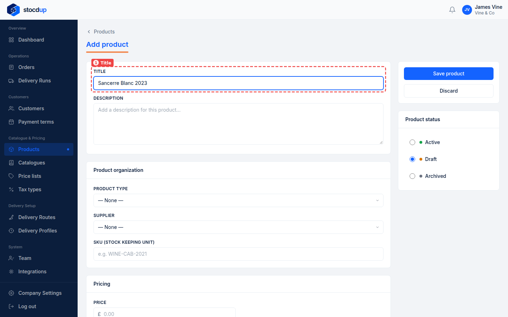
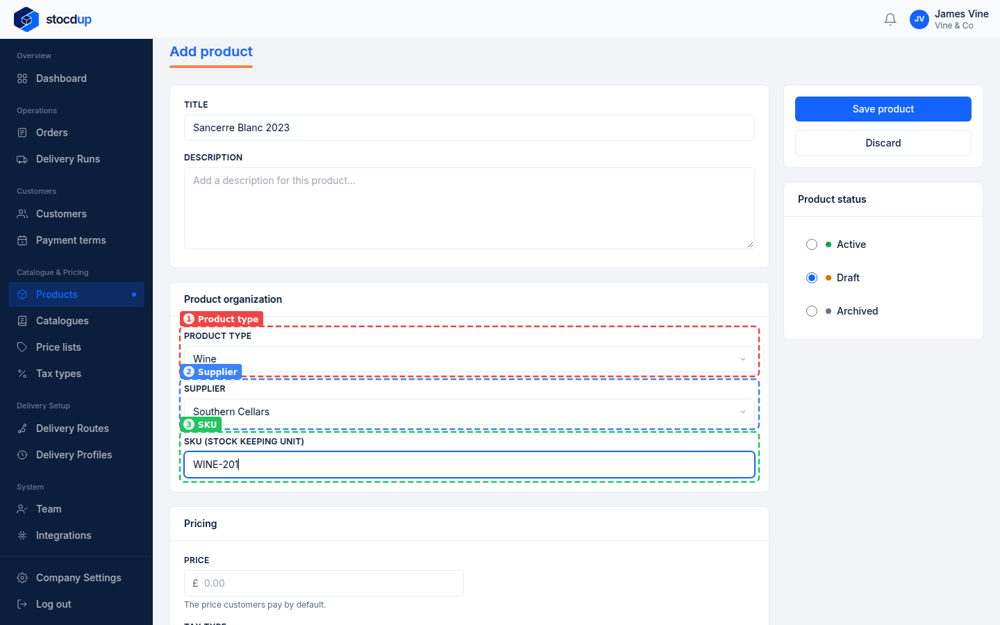
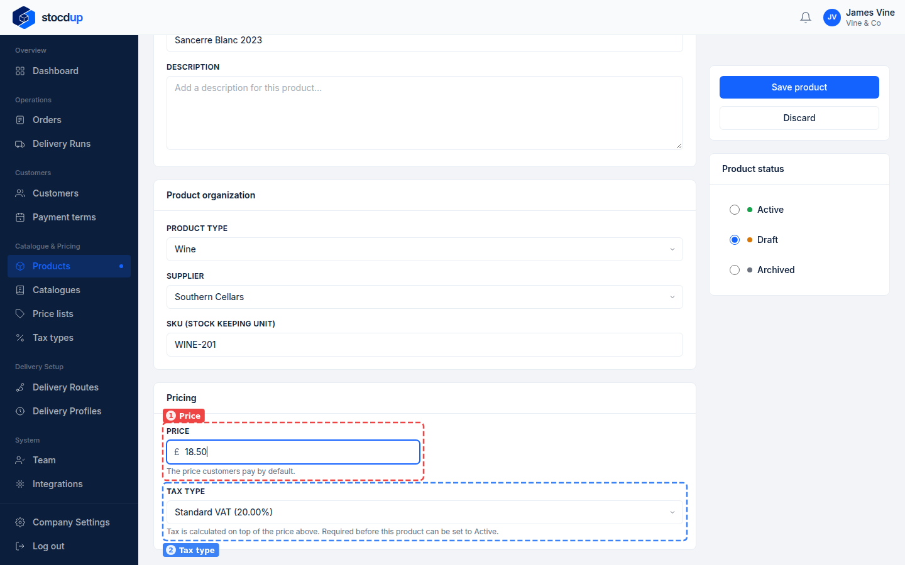
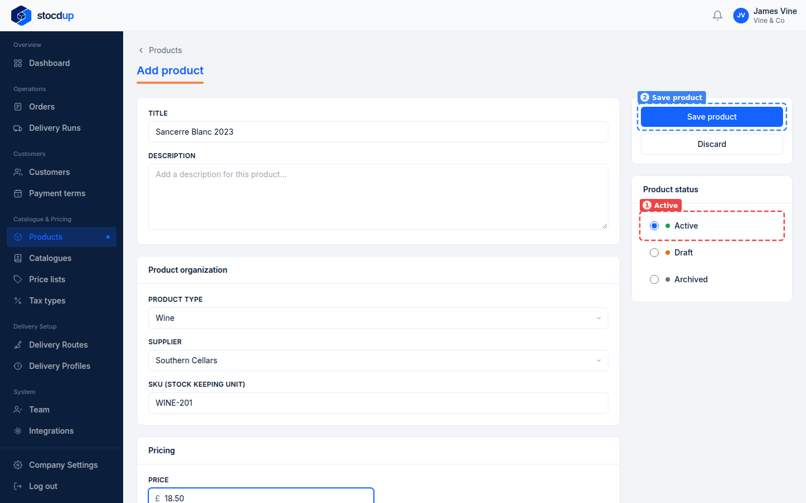
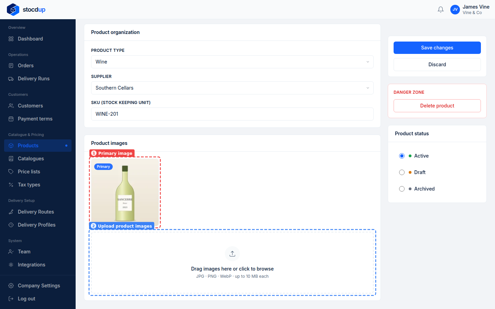
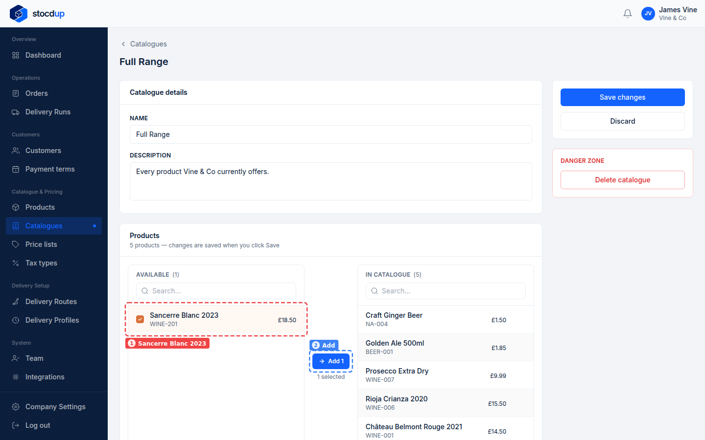
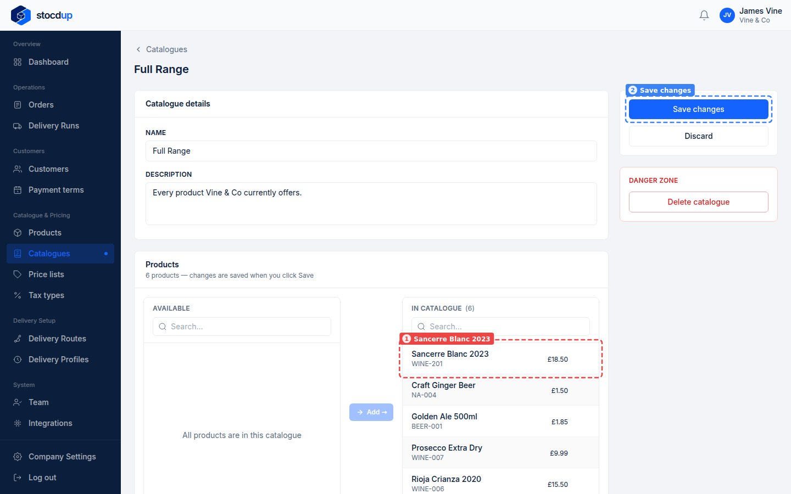
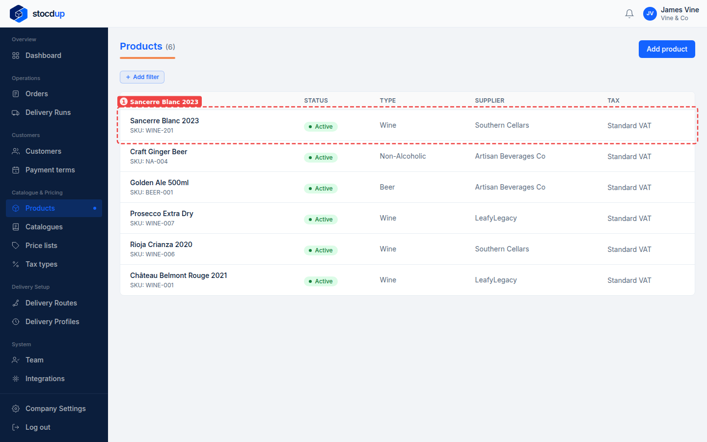
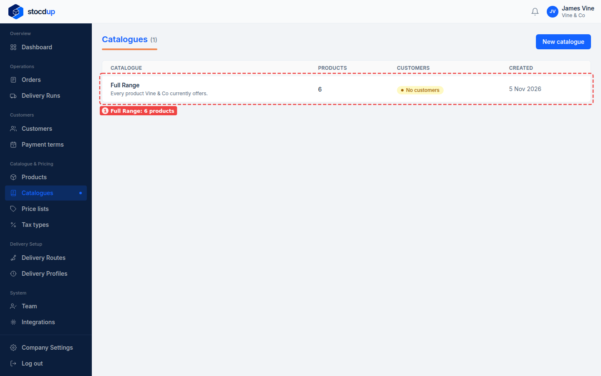

{/* Generated by scenario-docs from documentation/scenarios/add-product.md. Edit the scenario and regenerate; changes here are overwritten. */}

In this task you'll add a new product with its SKU, price and tax type, add a photo, and
put it in a catalogue so your customers can order it.

## About products

A product is something your customers can order, with a SKU, a default price and a tax
type. A product is Draft, Active or Archived, and customers only see Active products, and
only those in one of their catalogues. A new product isn't in any catalogue until you add
it. A product needs a tax type before it can be Active. Its price is the default; a
customer's price list can set a different price for them. Photos can be added once the
product has been saved.

## Before you start

- You'll need an Owner account.

## 1. Start a new product called Sancerre Blanc 2023

Go to **Products** and select **Add product**. In **Title** (1), enter
**Sancerre Blanc 2023**. The description is optional.

## 2. Give it the SKU WINE-201, product type Wine and supplier Southern Cellars

Under **Product organization**, choose **Wine** as the **Product type** (1) and
**Southern Cellars** as the **Supplier** (2). In **SKU (Stock Keeping Unit)** (3), enter
**WINE-201**.

## 3. Set its price to £18.50 and its tax type to Standard VAT (20%)

Under **Pricing**, enter **18.50** as the **Price** (1). This is the price customers pay by
default. Choose **Standard VAT (20.00%)** as the **Tax type** (2). Tax is calculated on top
of the price.

:::note

A product can't be Active without a tax type.

:::

## 4. Make it Active and save it

New products start as **Draft**. Under **Product status**, select **Active** (1), so
customers can see it in their catalogues and order it, then select **Save product** (2).
**Draft** and **Archived** both keep it hidden from customers: Draft is where new products
start while you set them up.

You're taken back to **Products**, where Sancerre Blanc 2023 is listed as **Active**.

If you aren't ready for customers to see the product yet, leave it as **Draft** and
finish it later: customers don't see Drafts.

## 5. Add a photo of the bottle

Select **Sancerre Blanc 2023** on the **Products** page to open it. Under
**Product images**, drag your photo onto **Drag images here or click to browse** (2), or
click it and choose the file. Images can be JPG, PNG or WebP, up to 10 MB each.

The photo is uploaded straight away, with no need to save. The first photo is marked
**Primary** (1).

:::note

Photos can only be added after the product is saved.

:::

The product's **Pricing** tab is where you can set prices for particular price lists,
under **Price list overrides**.

## 6. Add it to the Full Range catalogue

Go to **Catalogues** and select **Full Range**. Under **Products**, tick
**Sancerre Blanc 2023** (1) in the **Available** list, and select **Add** (2).

The product moves to **In catalogue** (1). The change is only kept once you save, so
select **Save changes** (2).

## Result

Sancerre Blanc 2023 is on the **Products** page as **Active**, with its SKU, type, supplier
and tax type (1).

On the **Catalogues** page, **Full Range** now has one more product (1). Customers with
the Full Range catalogue can order it.

## Related

- [Create a catalogue](./create-catalogue.mdx)
- [Create a price list](./create-price-list.mdx)
