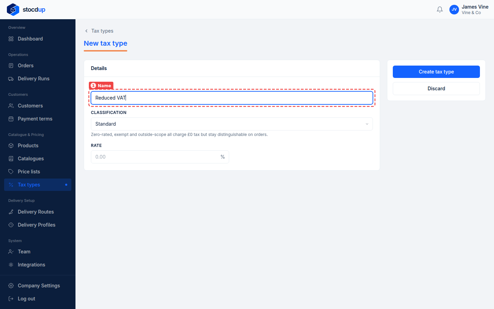
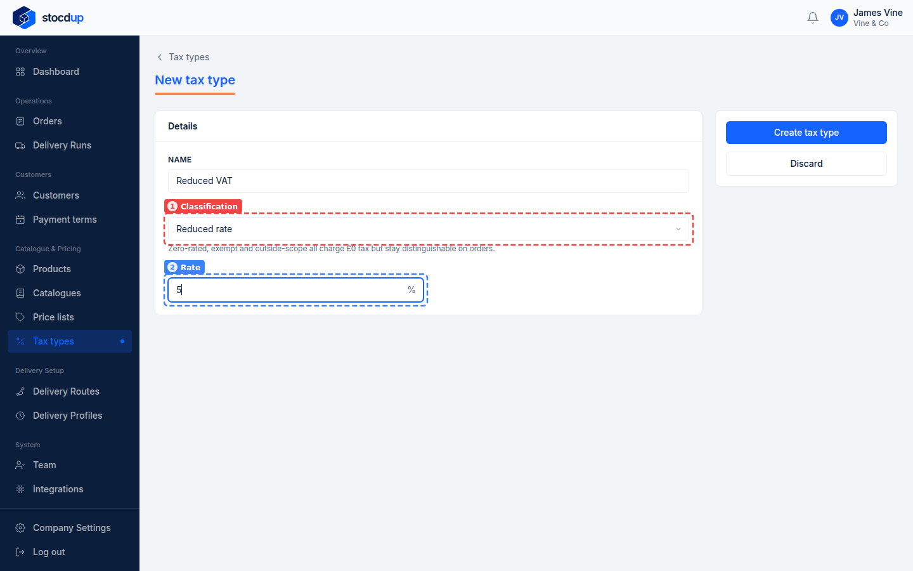
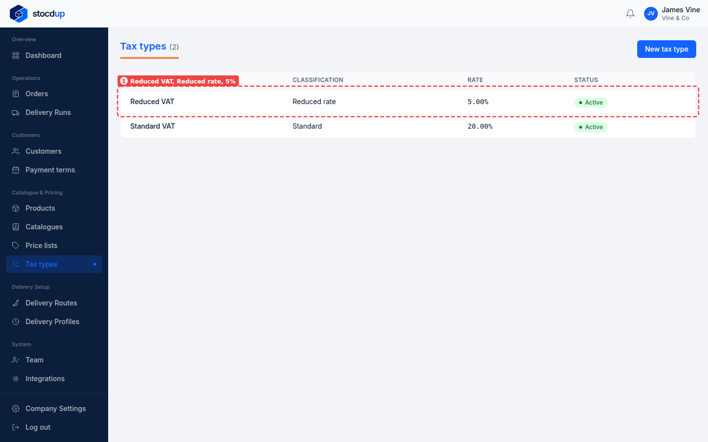

{/* Generated by scenario-docs from documentation/scenarios/add-tax-type.md. Edit the scenario and regenerate; changes here are overwritten. */}

In this task you'll add a tax type with its classification and rate, so you can give it
to your products.

## About tax types

A tax type is the tax a product is sold with, such as standard-rate VAT at 20%. Every
product needs one before you can make it Active (visible to customers), so customers never see a product that
has no tax set. Its classification says what kind of tax it is: zero-rated, exempt and
outside the scope of tax all charge £0, but stay distinguishable on orders. When an
order is placed, its lines keep the rate they were ordered at.

## Before you start

- You'll need an Owner account.

## 1. Start a new tax type called Reduced VAT

Go to **Tax types** and select **New tax type**. In **Name** (1), enter **Reduced VAT**.

## 2. Set its classification to Reduced rate and its rate to 5%

Choose **Reduced rate** as the **Classification** (1), and enter **5** as the
**Rate** (2). The classification says what kind of tax this is: **Standard**,
**Reduced rate**, **Zero-rated**, **Exempt** or **Outside the scope of tax**. It's shown on
the tax type and on order lines; the tax charged always comes from the **Rate**.

:::note

Zero-rated, Exempt and Outside the scope of tax all charge £0 tax. Choose the one that
describes the product, so orders show why no tax was charged.

:::

## 3. Create the tax type

Select **Create tax type**. The new tax type opens, where you can change it later.

## Result

Go back to **Tax types**. **Reduced VAT** is listed with the **Reduced rate**
classification and a **5.00%** rate (1), and is **Active**.

You can now choose it as the **Tax type** of a product. A product can't be made Active
until it has a tax type.

## Related

- [Add a product](./add-product.mdx)
