{/* Generated by scenario-docs from documentation/scenarios/create-catalogue.md. Edit the scenario and regenerate; changes here are overwritten. */}

In this task you'll create a catalogue, choose its products, and give it to a customer.
There are two ways to do it: from the **Catalogues** page, or straight from the customer's
record.

## About catalogues

A catalogue is a selection of your products that you can give to as many customers as need
it. Each customer only sees the products in their catalogues.

- **From the Catalogues page** suits a range you plan to share, such as a wine-bar list.
  The catalogue has no customers until you give it to one from their record.
- **From a customer's record** suits one customer who needs it now. The catalogue is added
  to that customer as soon as you save it, and you can give it to others later.

Only active products are shown to customers, even when they are in a catalogue.

## Before you start

- You'll need an Owner account.
- You'll need a customer, and the products you want them to see.

## Way 1: from the Catalogues page

### 1. Start a new catalogue

Go to **Catalogues** (1) and select **New catalogue** (2). In **Name**, enter a name for
the catalogue, for example **Wine Bar Essentials**. The description is optional.

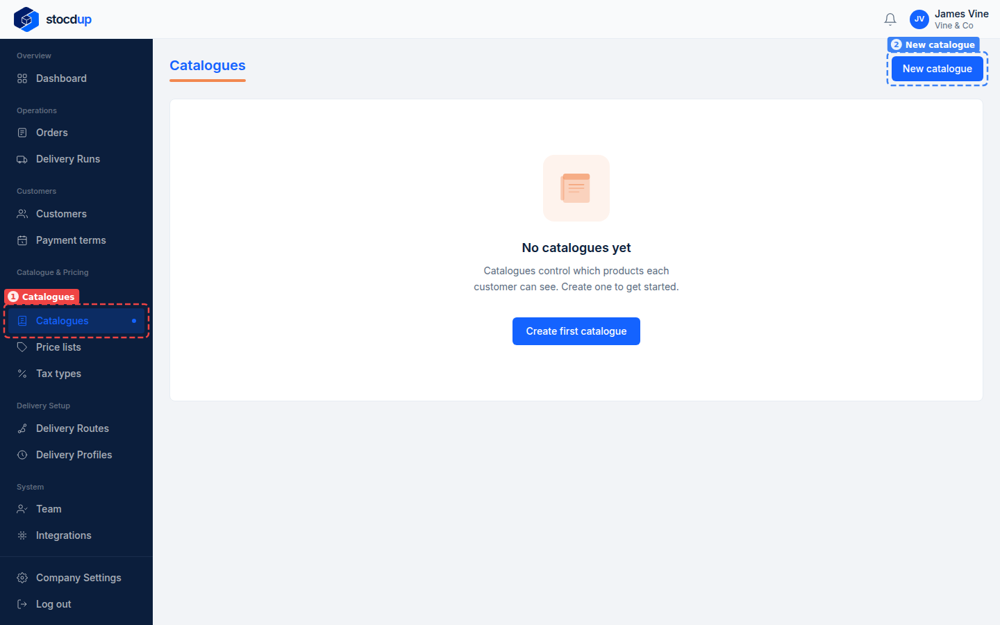

### 2. Add the products

Under **Products**, tick each product in the **Available** list (1), for example **Rioja
Crianza 2020**, **Chianti Classico 2021** and **Marlborough Sauvignon Blanc 2023**. If the
list is long, use its **Search** box to find each one; products you've ticked stay ticked
when you search for the next. Then select **Add** (2).

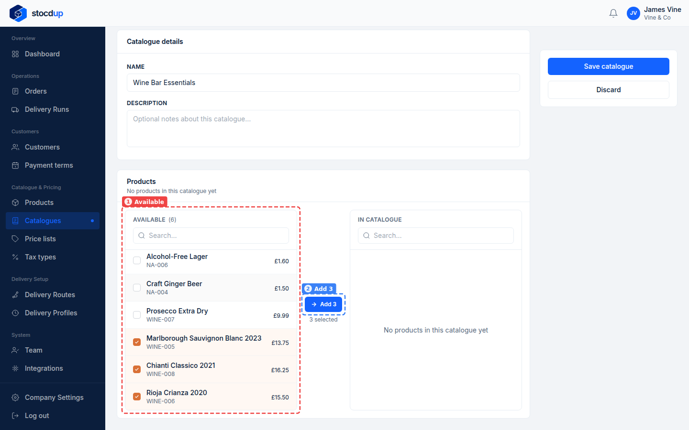

### 3. Save the catalogue

The products are now listed under **In catalogue** (1). Select **Save catalogue** (2).

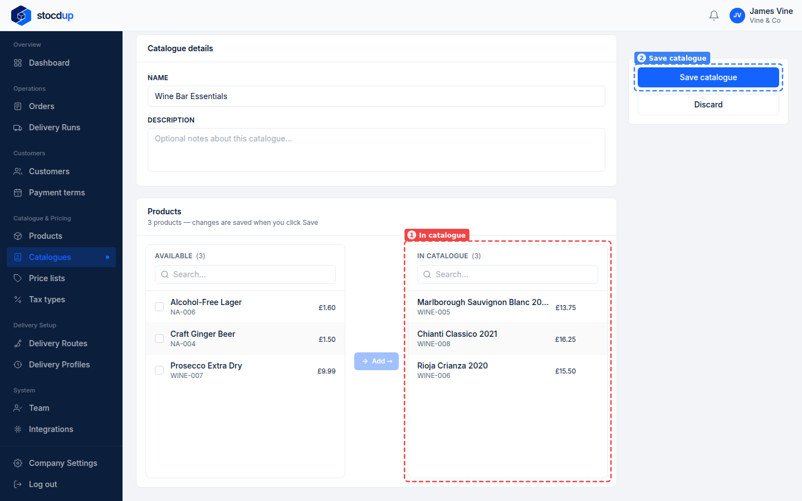

:::note

The products are only kept when you save the catalogue.

:::

Go back to **Catalogues**: the new catalogue (1) is marked **No customers** until you give
it to one.

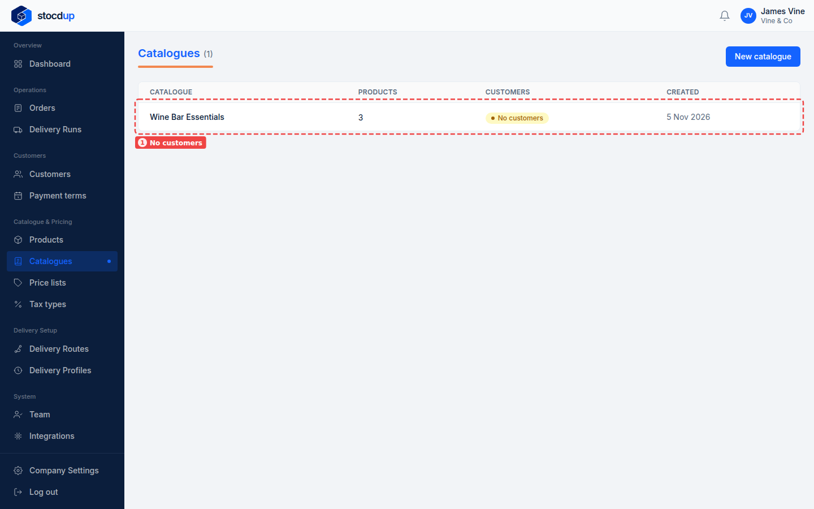

### 4. Open the customer's record

Go to **Customers** (1) and select the customer's name, for example
**Botanica Bar & Kitchen** (2).

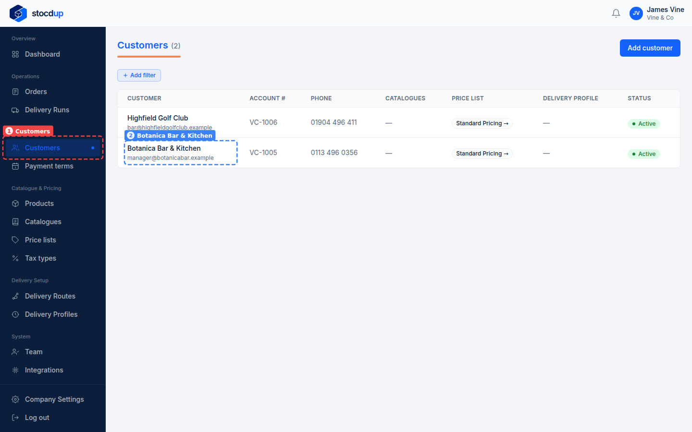

### 5. Give the customer the catalogue

Select the **Catalogue & Pricing** tab, then **Assign catalogue**. Select **Assign** next
to your new catalogue (1).

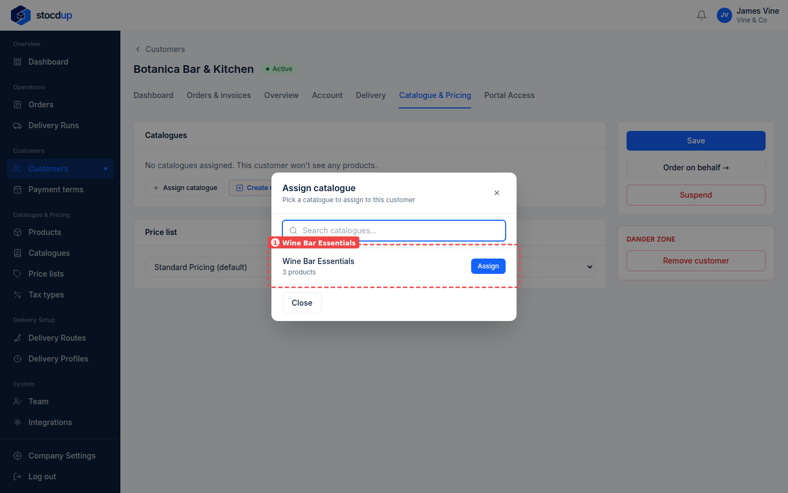

The catalogue is added straight away and shown under **Catalogues** (1), with its number of
products.

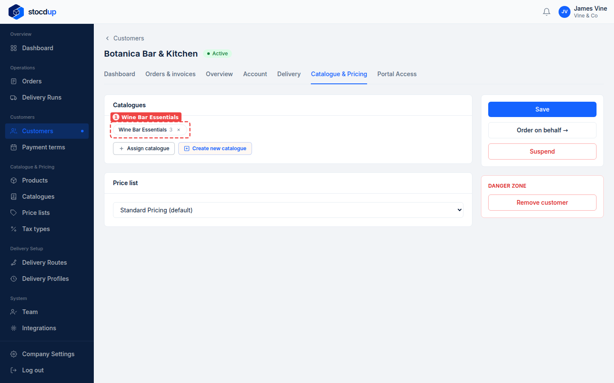

## Way 2: from a customer's record

### 1. Open the customer's catalogue and pricing

Open the customer's record, for example **Highfield Golf Club**, and select the
**Catalogue & Pricing** tab (1). **Catalogues** (2) shows the catalogues they already have.

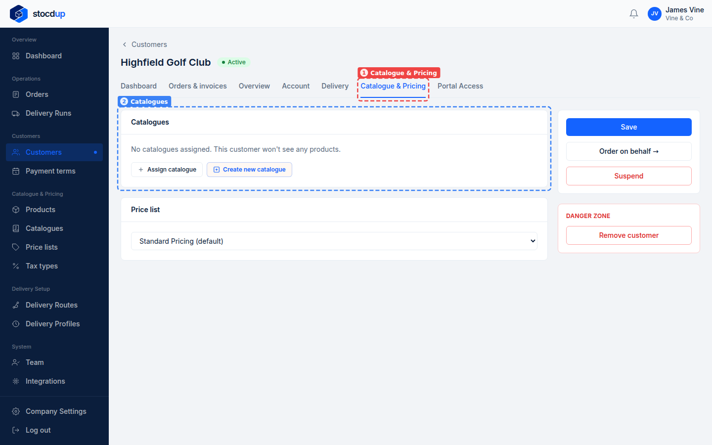

### 2. Start a new catalogue

Select **Create new catalogue**. In the **New catalogue** panel, enter a **Name** (1), for
example **Clubhouse Bar**.

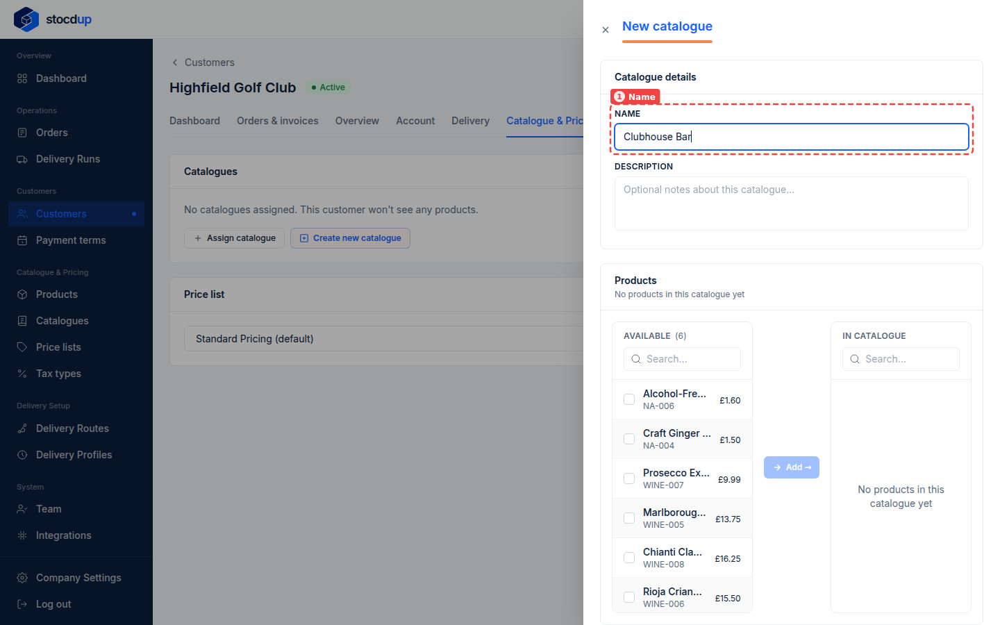

### 3. Add the products

In the **Available** list (1), tick each product, for example **Alcohol-Free Lager**,
**Craft Ginger Beer** and **Prosecco Extra Dry**, and select **Add** (2).

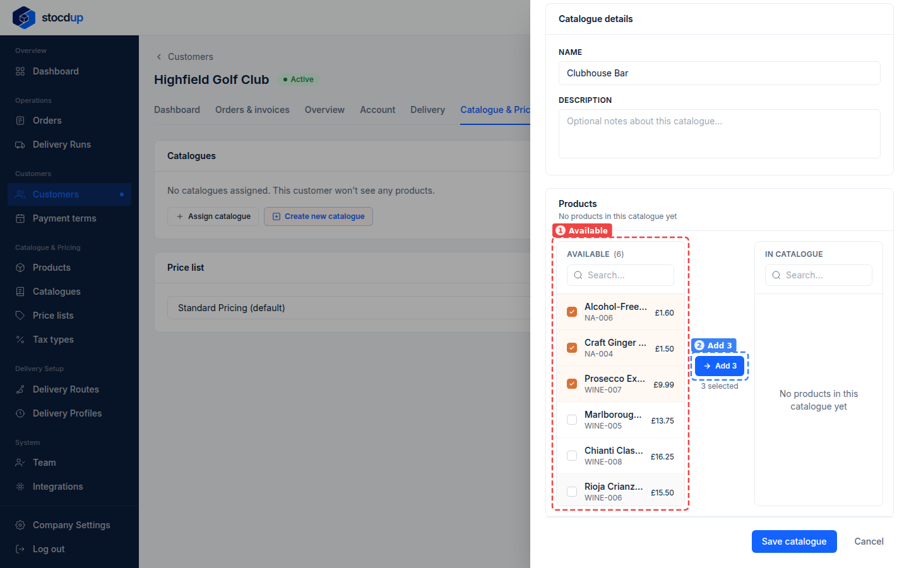

### 4. Save the catalogue

The summary (1) shows how many products the catalogue has, and they're listed under
**In catalogue** (2). Select **Save catalogue** (3).

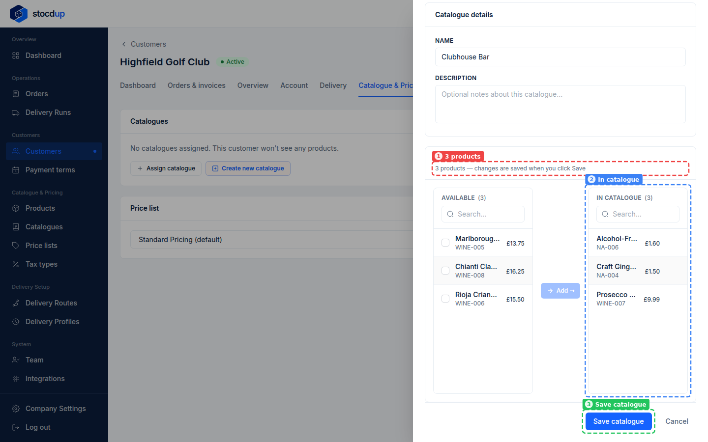

The panel closes, and the catalogue is already added to the customer (1).

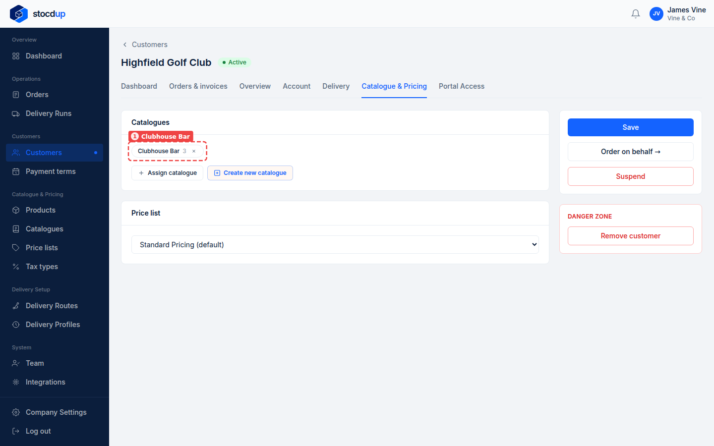

## Result

Each customer now sees the products in their new catalogue when they order. On the
**Catalogues** page, both catalogues (1) show their products and one customer each.

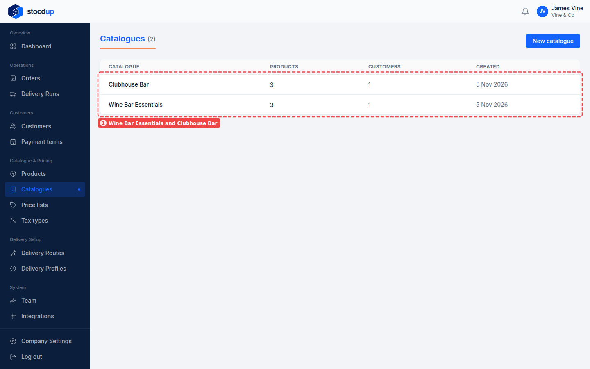

You can change a catalogue's products later from the **Catalogues** page, and give it to
more customers from their records.

## Related

- [Set a customer's catalogue and price list](../customers/set-customer-catalogue-and-price-list.mdx)
- [Add a customer](../customers/add-customer.mdx)
