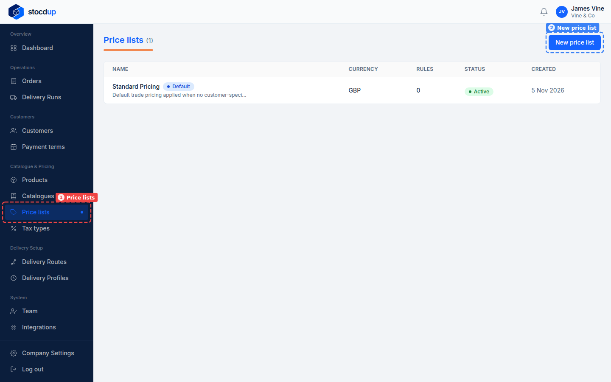
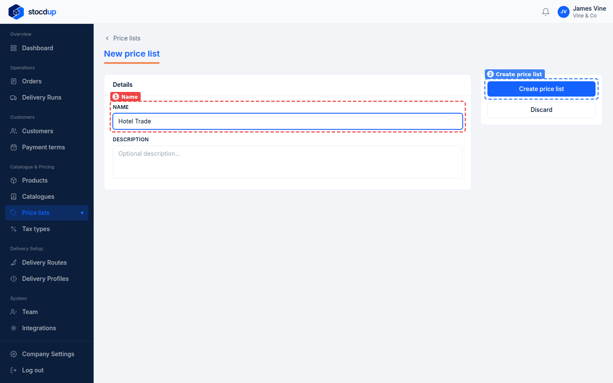
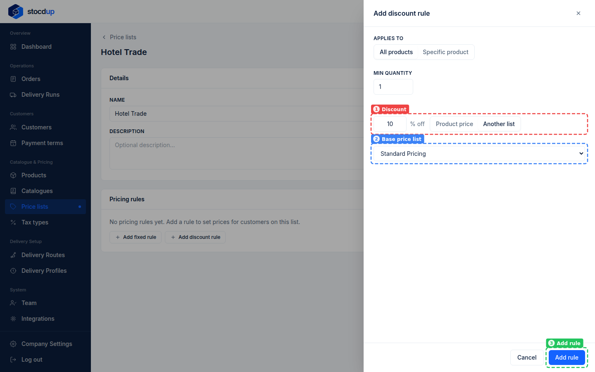
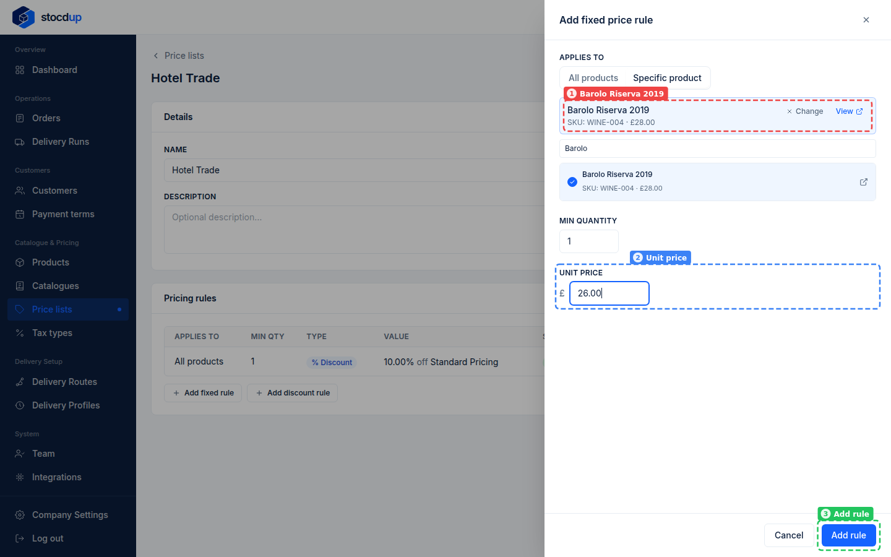
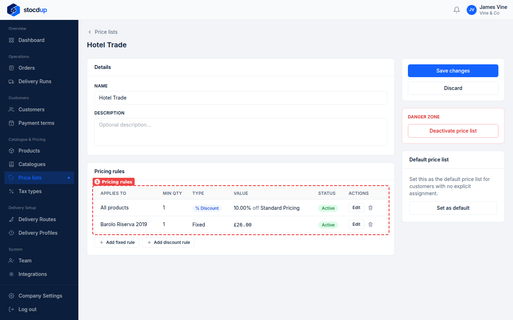

{/* Generated by scenario-docs from documentation/scenarios/create-price-list.md. Edit the scenario and regenerate; changes here are overwritten. */}

In this task you'll create a price list and add its pricing rules: a discount on every
product, and a fixed price for one product.

## About price lists

A price list is a set of prices you give a group of customers, such as trade prices for
hotels. Each customer pays from the price list you've given them, or from your default
price list if you haven't given them one.

A list's prices come from its rules: a fixed price, or a percentage off either the
product's own price or another price list. A rule for one product beats a rule for all
products, and a product with no rule on the list is sold at its own price.

## Before you start

- You'll need an Owner account.

## 1. Start a new price list called Hotel Trade

Go to **Price lists** (1) and select **New price list** (2).

## 2. Create the price list

In **Name** (1), enter **Hotel Trade**, then select **Create price list** (2). The
description is optional.

The price list opens, with a **Pricing rules** section.

:::note

You can only add pricing rules once the price list has been created.

:::

## 3. Add a 10% discount on all products, based on Standard Pricing

Under **Pricing rules**, select **Add discount rule**. **Applies to** is already set to
**All products**. Enter **10** % off and select **Another list** (1), choose
**Standard Pricing** as the **Base price list** (2), and select **Add rule** (3).
**Another list** takes the discount off what that price list charges; **Product price**
would take it off the price on each product instead.

## 4. Add a fixed price of £26.00 for Barolo Riserva 2019

Select **Add fixed rule**, then **Specific product**, so the rule prices just one
product (**All products** would price every product at the same amount). Search for **Barolo** and select
**Barolo Riserva 2019** (1). In **Unit price** (2), enter **26.00**, and select
**Add rule** (3).

:::note

Each rule is saved as soon as you add it.

:::

## Result

The **Pricing rules** (1) list both rules: **10.00% off Standard Pricing** for all
products, and **£26.00** for Barolo Riserva 2019. Hotel Trade also appears on the
**Price lists** page.

Because the rule for one product beats the rule for all products, customers on Hotel
Trade pay £26.00 for Barolo Riserva 2019 and 10% off Standard Pricing for everything else.

:::warning

If you deactivate a price list, customers assigned to it lose their prices.

:::

## Related

- [Set a customer's catalogue and price list](../customers/set-customer-catalogue-and-price-list.mdx)
