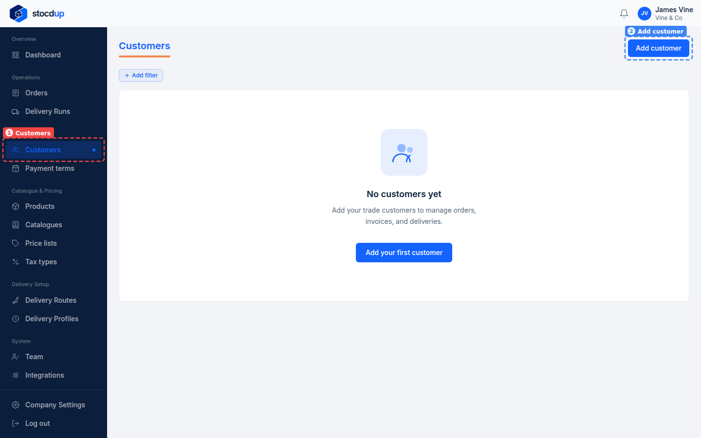
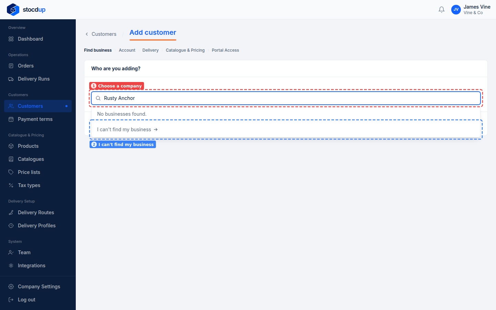
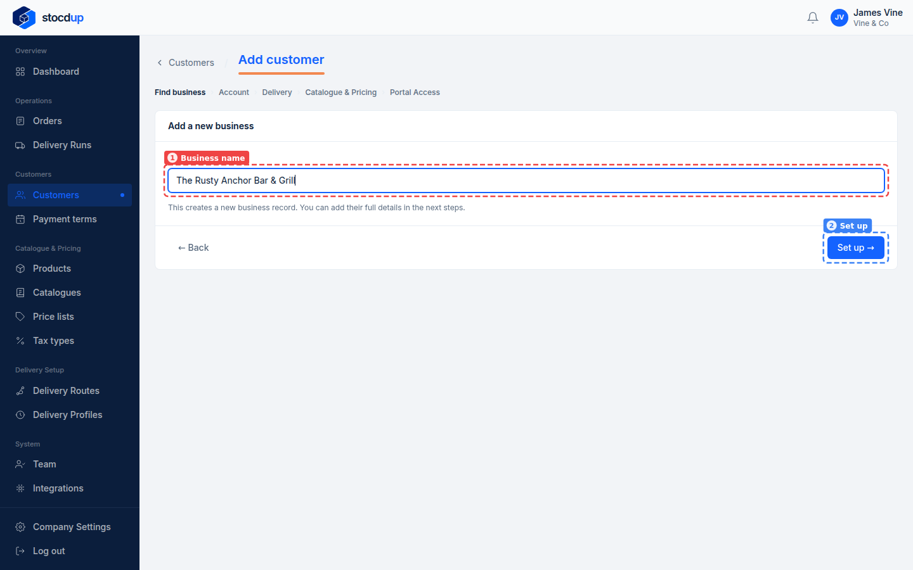
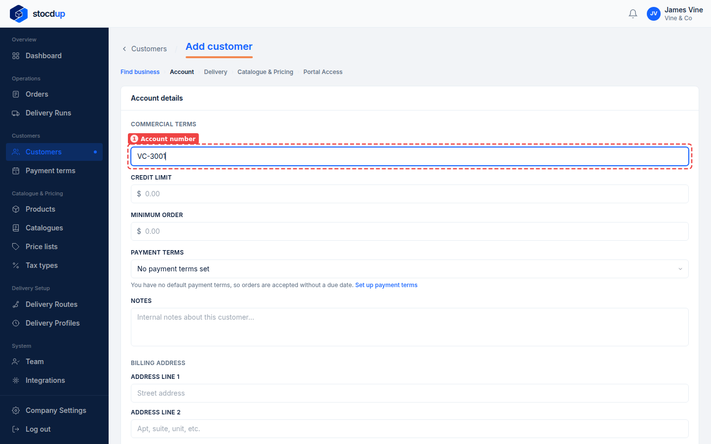
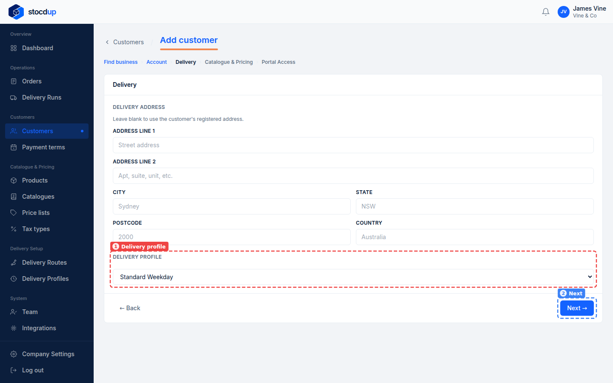
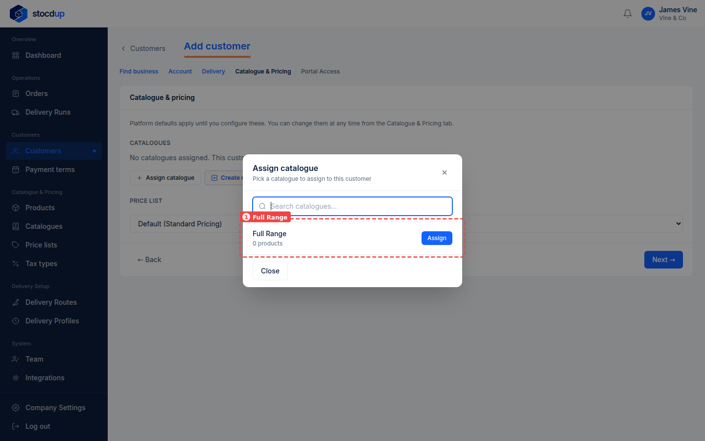
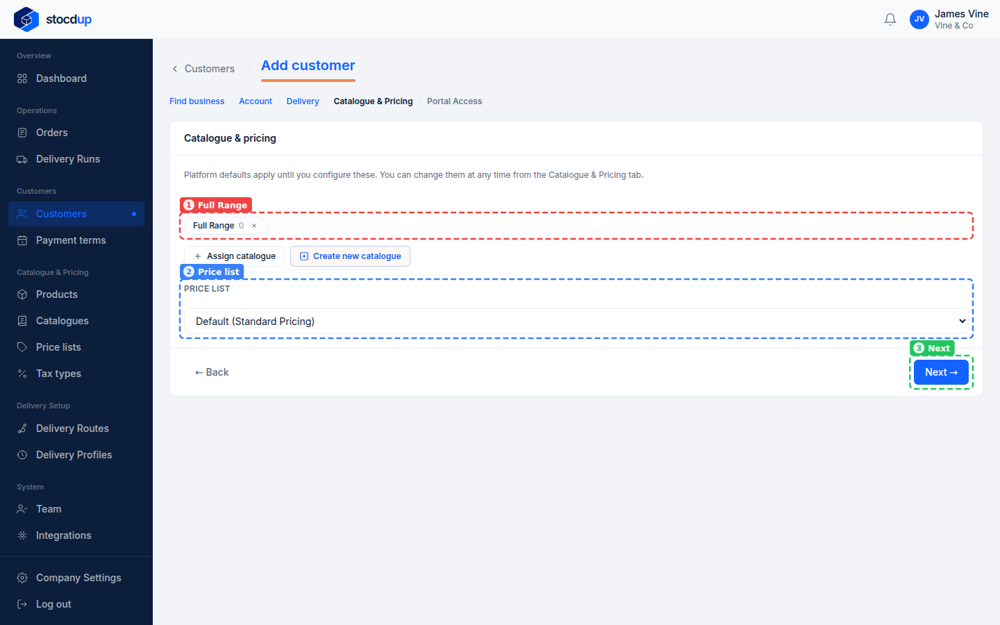
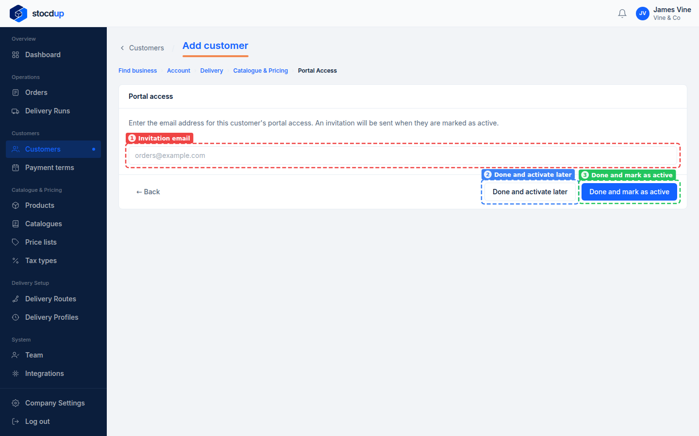
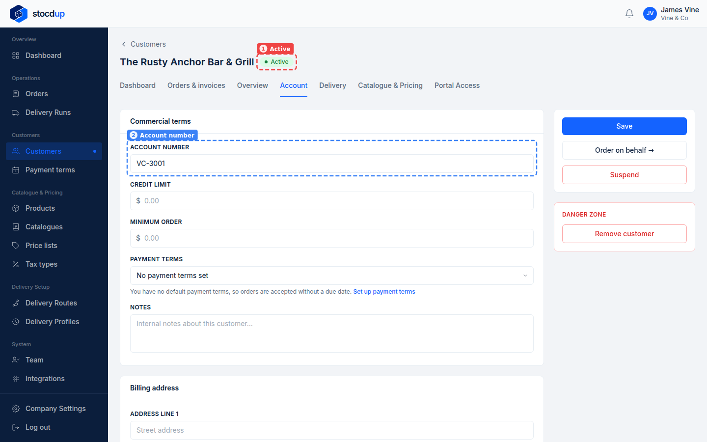

{/* Generated by scenario-docs from documentation/scenarios/add-customer.md. Edit the scenario and regenerate; changes here are overwritten. */}

In this task you'll add a new customer: set up their business, account number, delivery
profile, catalogue and price list, and mark them as active.

## About customers

A customer is a business you sell to, such as a bar, restaurant or shop. The same business
can buy from several distributors on Stocdup, so you first search for it, and only add it
as a new business if it isn't there.

Its set-up with you decides how it can order:

- Its **delivery profile** sets the delivery dates it can choose. With no profile, it has
  none.
- Its **catalogues** set the products it sees. With none, it sees no products.
- Its **price list** sets what it pays. With none, it pays your default price list.

## Before you start

- You'll need an Owner account.
- You'll need a delivery profile and a catalogue to give the customer.

## 1. Start adding a new customer

Go to **Customers** (1) and select **Add customer** (2).

## 2. Search for the business, and add it as a new business if it isn't found

In **Choose a company** (1), type the business's name, for example **Rusty Anchor**. If it
appears in the results, select it and select **Next →**. If it doesn't, select **I can't
find my business** (2).

In **Business name** (1), enter its full name, **The Rusty Anchor Bar & Grill**, and
select **Set up →** (2).

:::note

The customer is created as soon as you select **Set up →**. The next steps fill in its
details.

:::

## 3. Give it an account number

In **Account number** (1), enter the number you use for this customer, for example
**VC-3001**, then select **Next →** at the bottom of the page. Credit limit, minimum order,
payment terms, notes and billing address are optional.

If the number is already used by another customer, a message under **Account number**
says so; choose a different one.

## 4. Put it on a delivery profile

Leave the delivery address blank to use the business's registered address. In
**Delivery profile** (1), choose **Standard Weekday**, then select **Next →** (2).

## 5. Give it a catalogue, and keep the default price list

Under **Catalogues**, select **Assign catalogue**, then select **Assign** next to
**Full Range** (1).

Full Range is now listed under **Catalogues** (1). Leave **Price list** (2) on
**Default (Standard Pricing)**, and select **Next →** (3).

## 6. Finish, and mark the customer as active

Leave **Invitation email** (1) blank: you can invite the customer to the portal later.
Select **Done and mark as active** (3), so the customer can order straight away, and you
can order on their behalf.

:::note

**Done and activate later** (2) leaves the customer as **Pending invite**: they can't
order until you activate them or they accept a portal invitation.

:::

## Result

The customer's record opens, marked **Active** (1). On its **Account** tab, its
**Account number** (2) is the one you entered.

You can change any of these settings later from the customer's record.

## Related

- [Set up a delivery profile](../delivery-setup/delivery-profile-setup.mdx)
- [Invite a customer to the portal](./invite-customer-to-portal.mdx)
- [Set a customer's catalogue and price list](./set-customer-catalogue-and-price-list.mdx)
