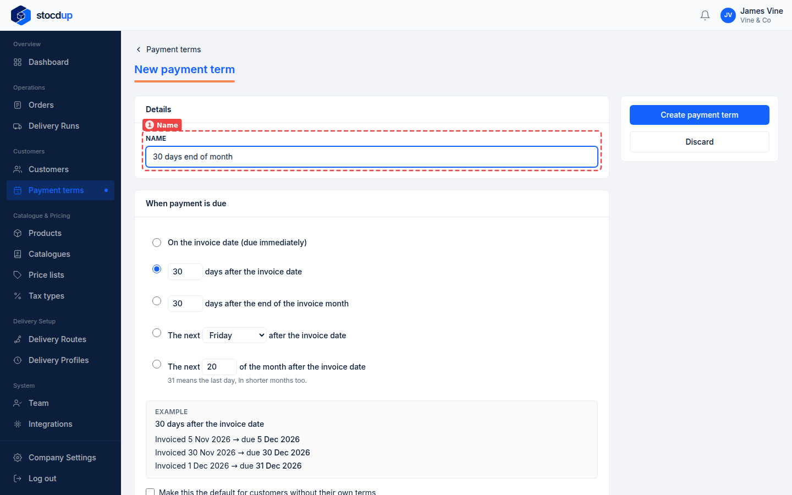
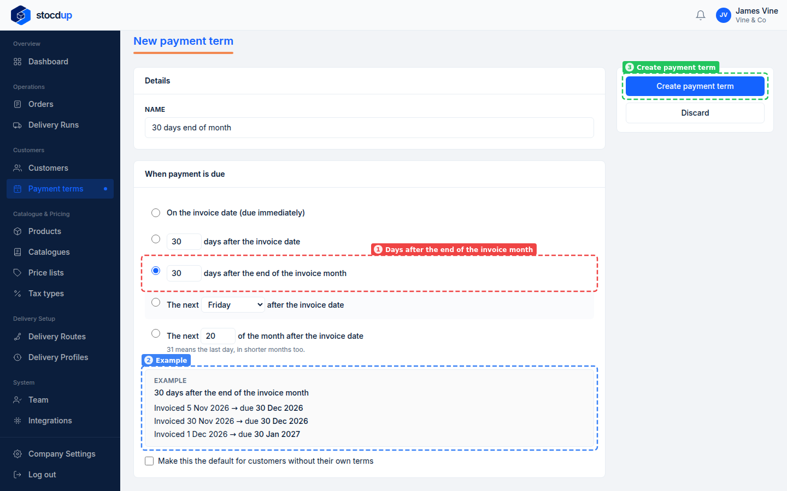
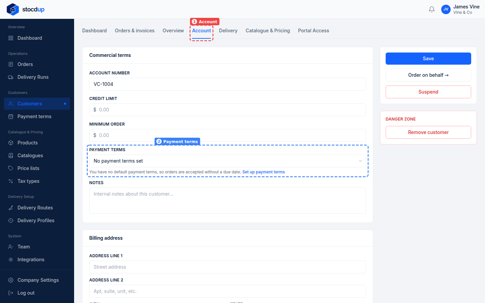
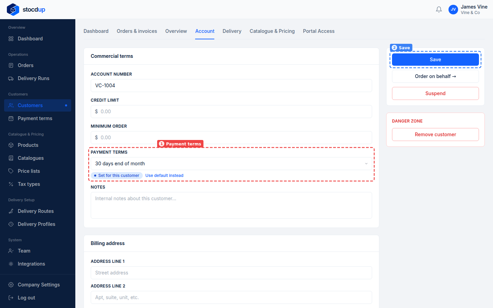
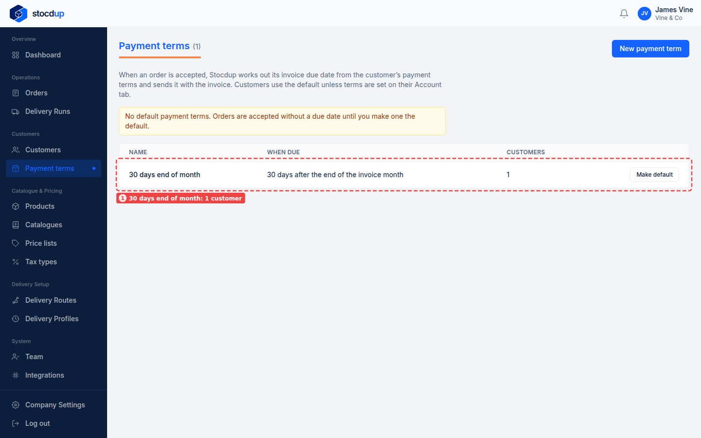

{/* Generated by scenario-docs from documentation/scenarios/create-payment-terms.md. Edit the scenario and regenerate; changes here are overwritten. */}

In this task you'll create payment terms that say when invoices are due, and give them to
a customer.

## About payment terms

Payment terms decide an invoice's due date: due straight away, a number of days after the
invoice date, a number of days after the end of the invoice month, the next given weekday,
or the next given day of the month. You can make one set of terms your default, and give
any customer different terms on their Account tab.

When you accept an order, Stocdup works out the due date from the customer's terms and
fixes it on the order, so changing the terms later doesn't change orders you've already
accepted. If you use Xero, Xero manages due dates until you make one of your own terms
the default.

## Before you start

- You'll need an Owner account.

## 1. Start new payment terms called 30 days end of month

Go to **Payment terms** and select **New payment term**. In **Name** (1), enter
**30 days end of month**.

## 2. Make them due 30 days after the end of the invoice month, and create them

Under **When payment is due**, select **days after the end of the invoice month** (1) and
enter **30**. The **Example** (2) shows the due dates you'll get: an order invoiced on
5 November is due on 30 December.

Select **Create payment term** (3).

To make these terms your default for customers without their own terms, tick
**Make this the default for customers without their own terms** before creating them, or
select **Make default** on the **Payment terms** page later.

## 3. Open The Grand Hotel Leeds' Account tab

Go to **Customers**, select **The Grand Hotel Leeds** and open the **Account** tab (1).
**Payment terms** (2) shows what the customer is on now. Here it's **No payment terms set**,
because there are no default payment terms yet.

## 4. Set its payment terms to 30 days end of month, and save

In **Payment terms** (1), choose **30 days end of month**. It's now marked
**Set for this customer**. Select **Save** (2).

To put a customer back on your default terms, select **Use default instead** and save.

## Result

The Grand Hotel Leeds now has **30 days end of month** as its payment terms, and the
**Payment terms** page shows them with 1 customer (1).

The next time you accept an order from The Grand Hotel Leeds, its due date is worked out
from these terms, and the order shows the due date it was given when it was accepted.

:::note

If you deactivate payment terms, their customers move to your default payment terms.
Orders already accepted keep their due dates.

:::

## Related

- [Add a customer](./add-customer.mdx)
- [Accept an order](../orders-and-deliveries/accept-order.mdx)
