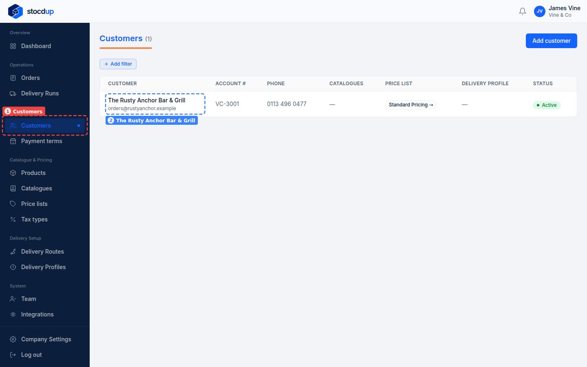
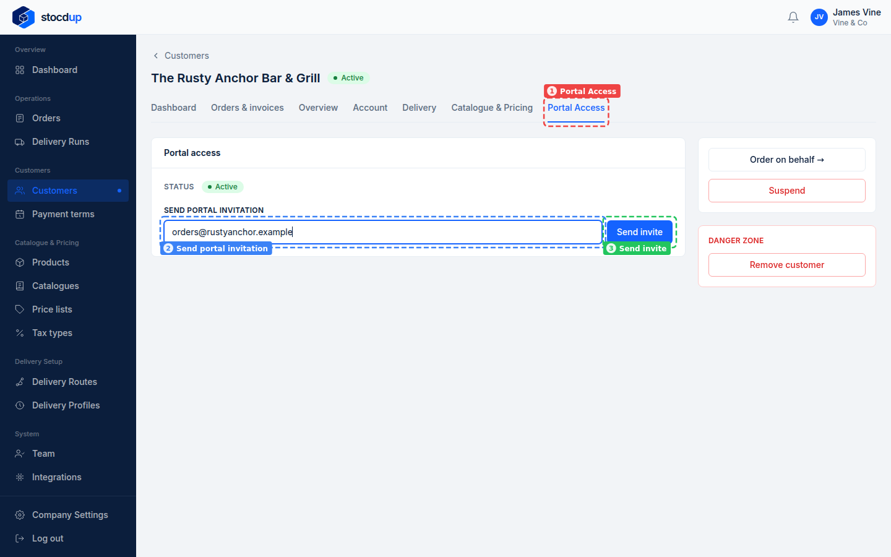
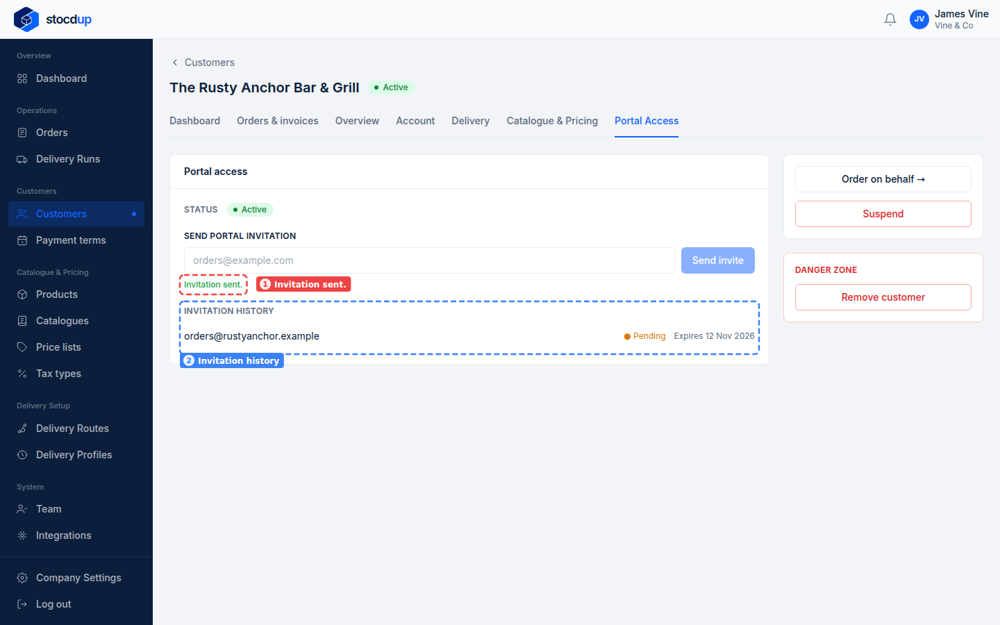

{/* Generated by scenario-docs from documentation/scenarios/invite-customer-to-portal.md. Edit the scenario and regenerate; changes here are overwritten. */}

In this task you'll invite a customer to order from you online by sending a portal
invitation to their email address.

## About the portal

The portal is where your customers browse the products in their catalogues, at their
prices, and place orders themselves.

The invitation is an email with a link that lasts 7 days. The customer accepts it by
creating a login with that email address, or with another address once they've entered a
code emailed to the invited one. Accepting it makes them an active customer if they
weren't already, and **Portal Access** then shows who accepted it and when. Sending a new
invitation to the same address cancels the earlier one.

## Before you start

- You'll need an Owner account.
- You'll need a customer, and the email address they'll use to order.

## 1. Open the customer's record

Go to **Customers** (1) and select the customer's name, for example
**The Rusty Anchor Bar & Grill** (2).

## 2. Send a portal invitation from its portal access

Select the **Portal Access** tab (1). In **Send portal invitation** (2), enter the
customer's email address, for example **orders@rustyanchor.example**, and select
**Send invite** (3).

## Result

**Invitation sent.** appears (1), and the **Invitation history** (2) lists the invitation
as **Pending**, with the date it expires: it's been sent and not used yet. Once the
customer uses it, it shows **Accepted**, with the date and the name and email of the
person who accepted it (which can be a different address, confirmed with a code sent to
the invited one); a link that runs out, or is replaced by a newer
invitation, shows **Expired**.

If an invitation expires before the customer accepts it, send a new one from the same
place for a fresh link.

## Related

- [Add a customer](./add-customer.mdx)
