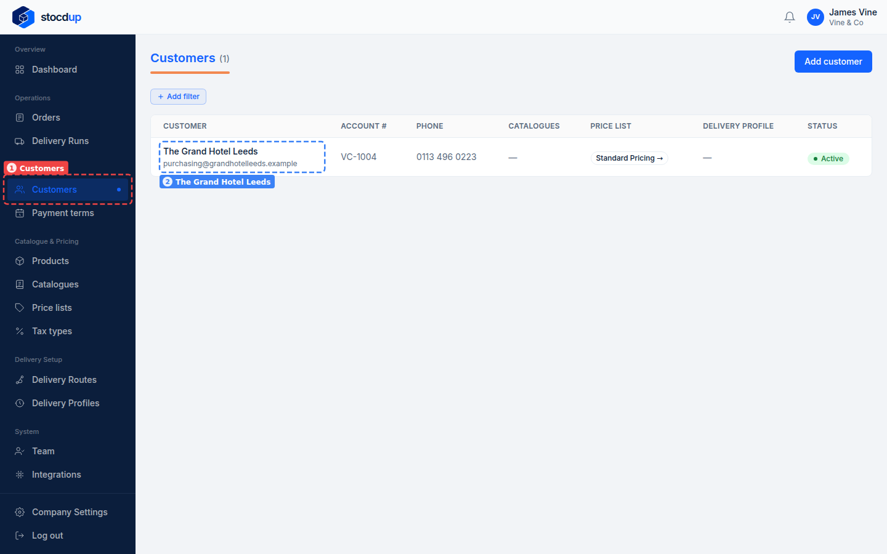
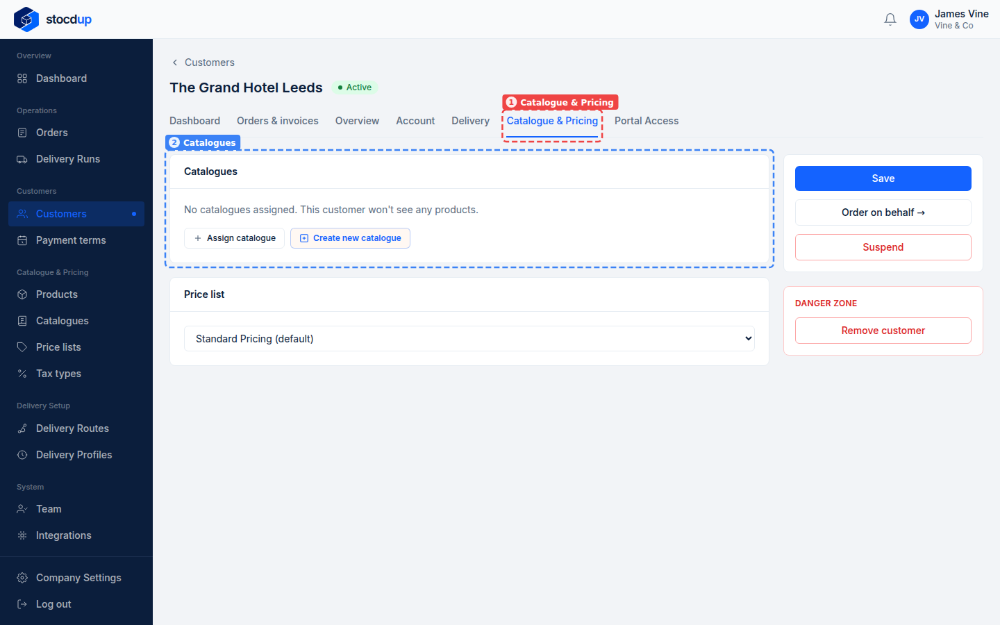
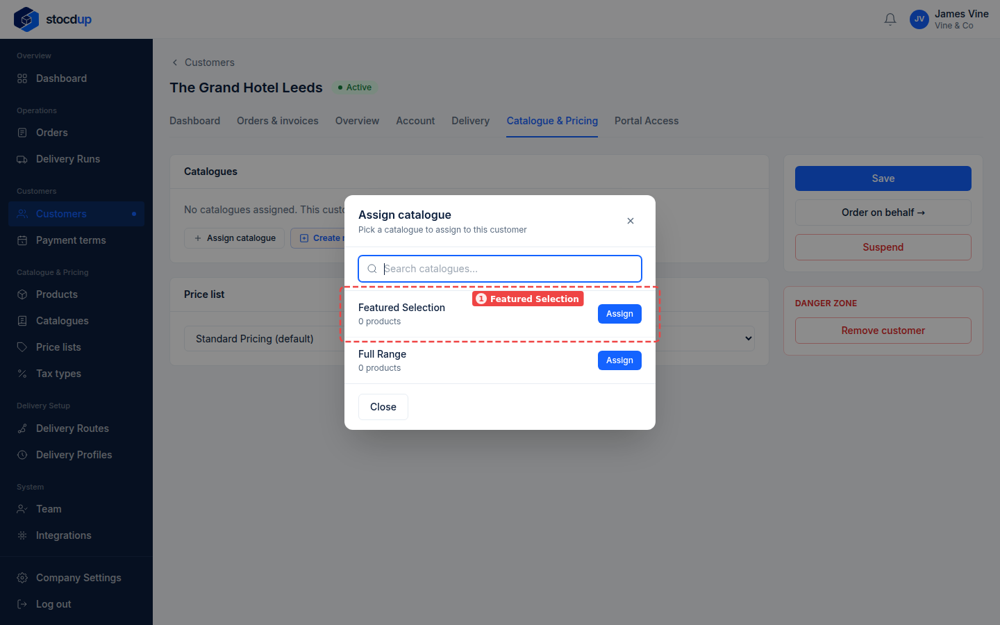
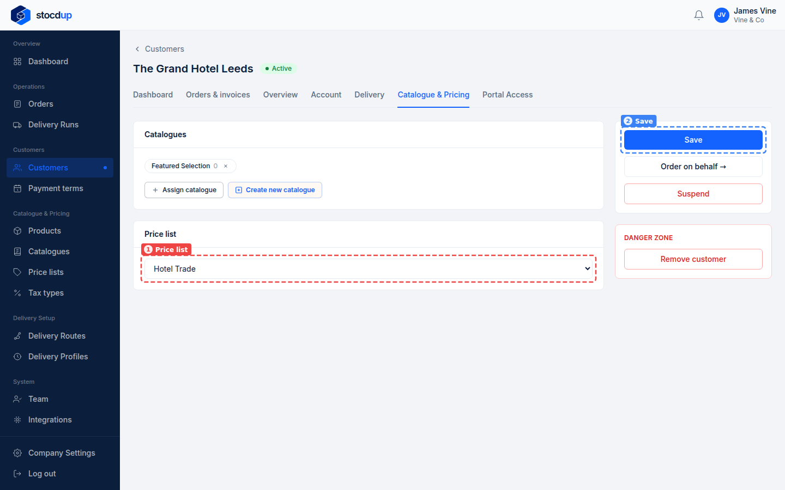
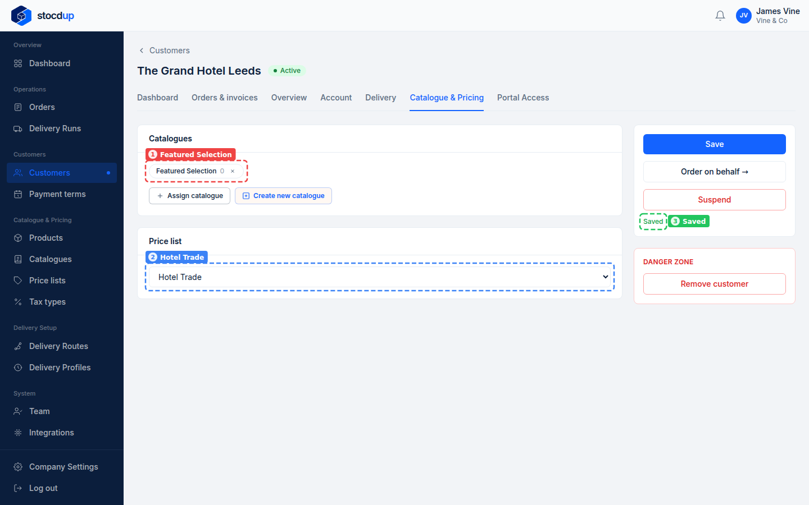

{/* Generated by scenario-docs from documentation/scenarios/set-customer-catalogue-and-price-list.md. Edit the scenario and regenerate; changes here are overwritten. */}

In this task you'll give a customer a catalogue and a price list, which set the products
they see and what they pay.

## About catalogues and price lists

A catalogue is a selection of your products. When a customer orders, they only see the
products in the catalogues you've given them, so a customer with no catalogue sees none.
A customer can have more than one catalogue, and sees the products in all of them.

Their price list decides what they pay for those products; without one, they pay your
default price list. A change applies to new orders: a product already in a customer's
basket or order keeps the price it was added at.

## Before you start

- You'll need an Owner account.
- You'll need a customer, a catalogue and a price list.

## 1. Open the customer's record

Go to **Customers** (1) and select the customer's name, for example
**The Grand Hotel Leeds** (2).

## 2. Go to its catalogue and pricing

Select the **Catalogue & Pricing** tab (1). **Catalogues** (2) shows the catalogues the
customer has; here it has none, so it won't see any products.

## 3. Give it the Featured Selection catalogue

Select **Assign catalogue**, then select **Assign** next to **Featured Selection** (1).

:::note

A catalogue is added as soon as you assign it. The price list change in the next step
needs saving.

:::

## 4. Change its price list to Hotel Trade, and save

In **Price list** (1), choose **Hotel Trade**, then select **Save** (2).

## Result

The tab shows **Featured Selection** under **Catalogues** (1) and **Hotel Trade** as the
price list (2), and **Saved** (3) confirms the change. When the customer next orders, they
see the products in Featured Selection at Hotel Trade prices.

## Related

- [Create a price list](../catalogue-and-pricing/create-price-list.mdx)
- [Add a customer](./add-customer.mdx)
