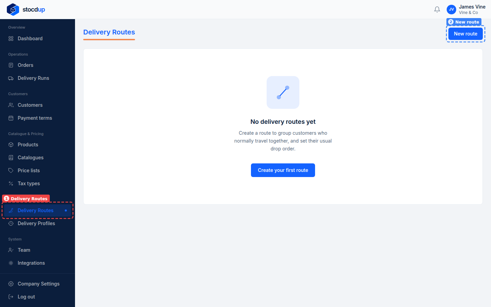
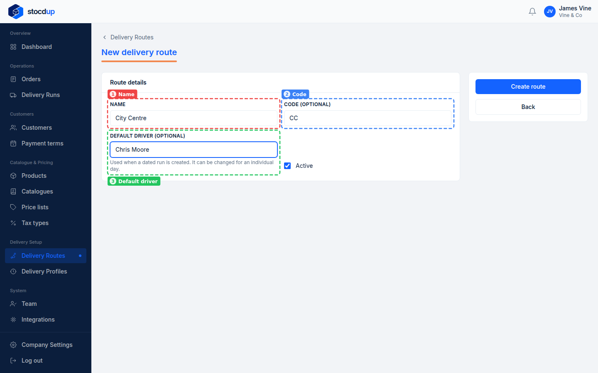
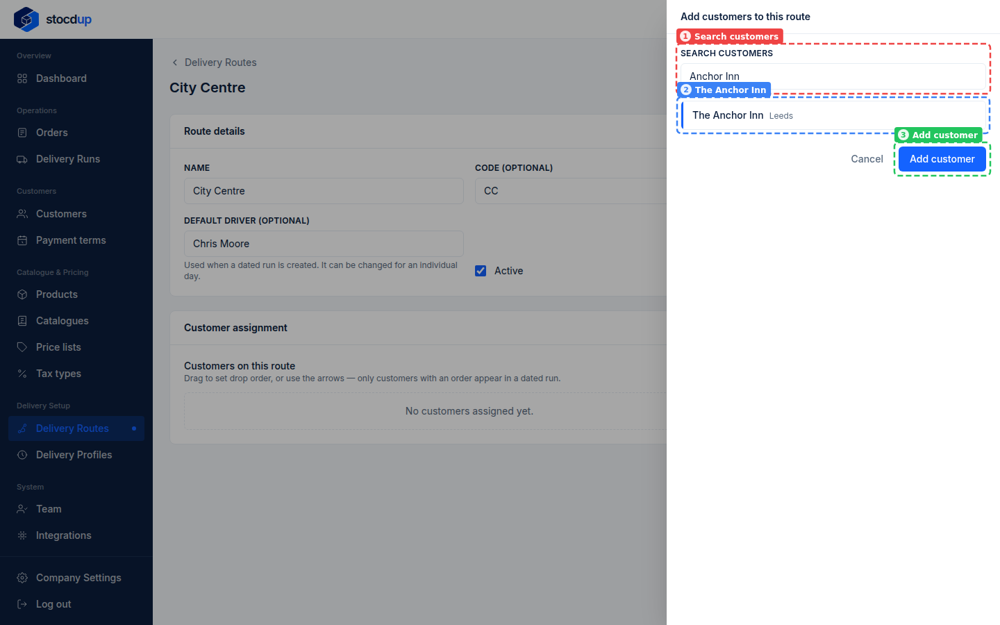
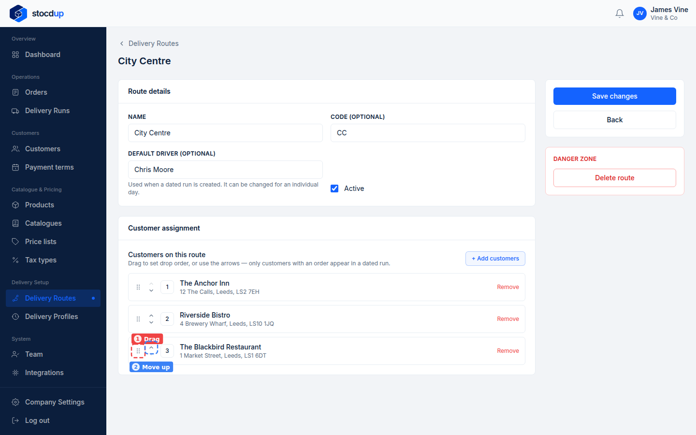
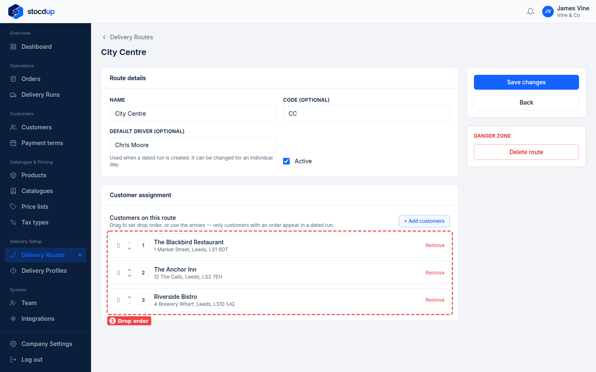
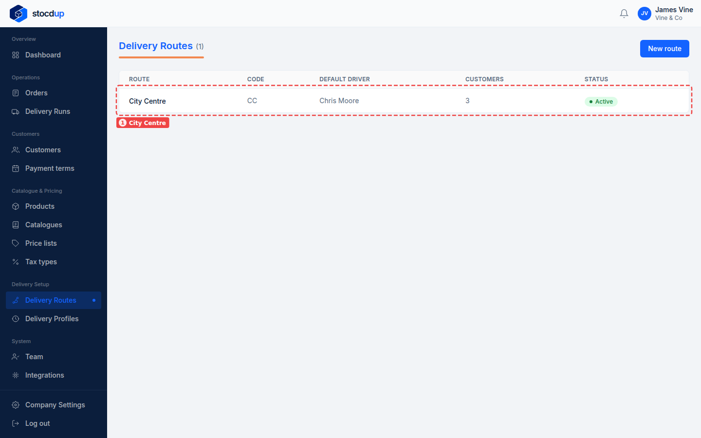

{/* Generated by scenario-docs from documentation/scenarios/create-delivery-route.md. Edit the scenario and regenerate; changes here are overwritten. */}

In this task you'll create a delivery route, give it a default driver, add its customers,
and put them in the order your driver will deliver to them.

## About delivery routes

A delivery route is a group of customers your driver usually delivers to on one trip, in
a set order. Each customer can be on only one route.

When you accept an order, it's added to that day's run for the customer's route (the run
is created if there isn't one yet). The order takes the customer's place in the route's
**drop order**, so the run and the driver's manifest list the deliveries in that order.

**That's why the drop order should be the order you want your driver to visit the
customers:** first drop at the top, last drop at the bottom.

Customers with no order that day simply don't appear in the run. A delivery that's
already in a run keeps its place if you change the order later.

## Before you start

- You'll need an Owner account.
- You'll need the customers you want on the route. They mustn't already be on another
  route.

## 1. Start a new delivery route

Go to **Delivery Routes** (1) and select **New route** (2). In **Name**, enter a name for
the route, for example **City Centre**.

## 2. Give it a code and a default driver

With the name in **Name** (1), enter a short **Code** (2), for example **CC**, and the
**Default driver** (3), for example **Chris Moore**. The default driver is used when a
day's run is created, and you can change it for an individual day.

## 3. Create the route

Select **Create route**. The route opens, with a **Customer assignment** section below
its details.

:::note

You can only add customers once the route has been created.

:::

## 4. Add the customers

Select **+ Add customers**. In **Search customers** (1), type the customer's name, select
it in the list, for example **The Anchor Inn** (2), and select **Add customer** (3).
Do the same for each customer, for example **Riverside Bistro** and **The Blackbird
Restaurant**.

:::note

Each customer joins at the end of the drop order. A customer that's already on another
route can't be added.

:::

## 5. Put the drops in the order the driver will do them

The number next to each customer is its place in the drop order: **1** is your driver's
first delivery. Move each customer to where the driver should visit them, by dragging it
by its handle (1) or with the **Move up** (2) and **Move down** arrows. For example, move
**The Blackbird Restaurant** up to first, so the order is The Blackbird Restaurant, The
Anchor Inn, then Riverside Bistro.

Each day's run and the driver's manifest list the deliveries in this order, so set it to
the route you want driven.

:::note

The drop order saves as soon as you move a customer. You don't need to select **Save
changes**, which only saves the route's details.

:::

## Result

The route's customers are listed in your driver's delivery order (1).

On the **Delivery Routes** page, the new route (1) shows its code, default driver and
number of customers. From now on, when you accept an order from one of its customers,
it's added to that day's run in this order.

:::warning

**Delete route** deactivates the route. Customers on it will need a new default route
before their orders are added to runs automatically again.

:::

## Related

- [Plan a day's deliveries](../orders-and-deliveries/plan-delivery-runs.mdx)
- [Set up a delivery profile](./delivery-profile-setup.mdx)
- [Accept an order](../orders-and-deliveries/accept-order.mdx)
