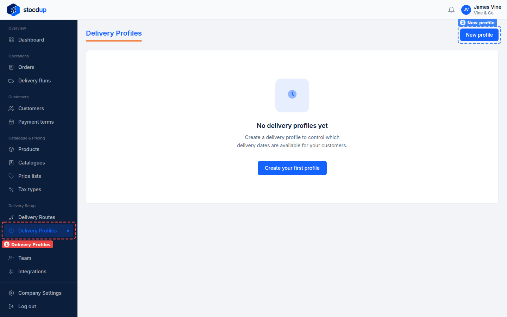
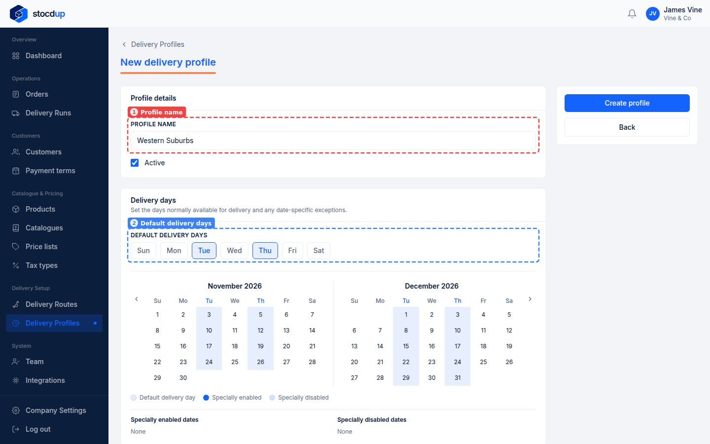
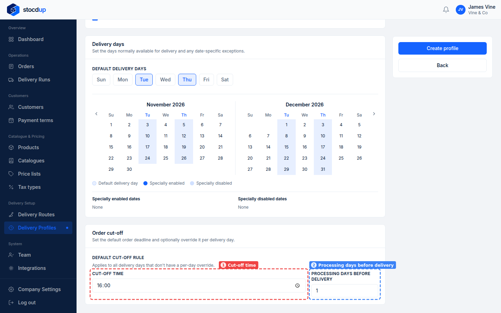
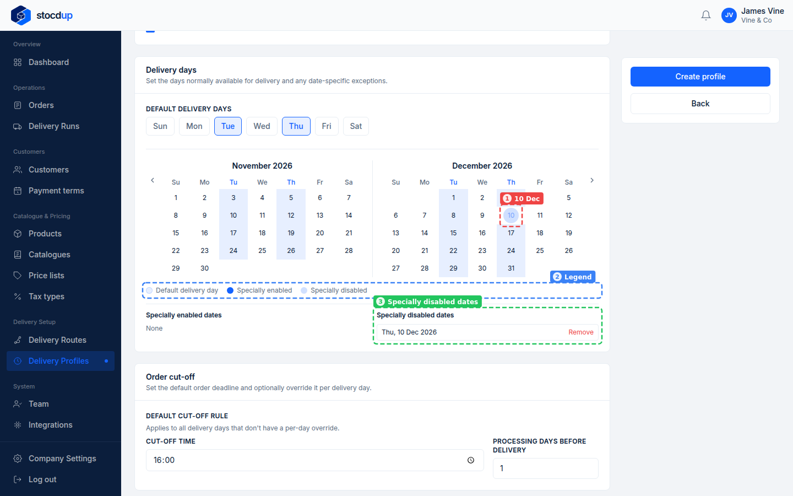
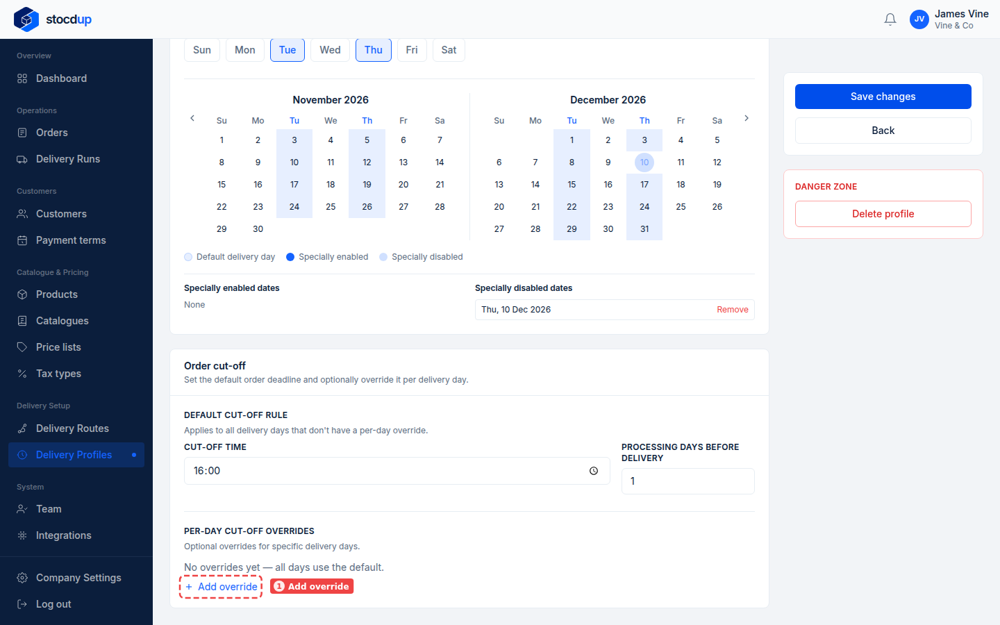
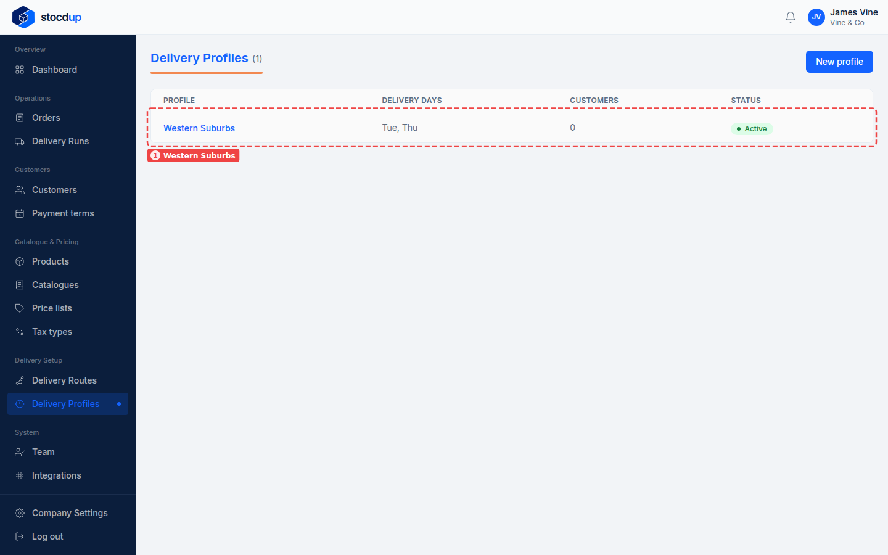

{/* Generated by scenario-docs from documentation/scenarios/delivery-profile-setup.md. Edit the scenario and regenerate; changes here are overwritten. */}

In this task you'll create a delivery profile: choose the days you deliver, set the
order cut-off, and block any dates you can't deliver.

## About delivery profiles

A delivery profile is a delivery schedule you share across a group of customers: the
weekdays you deliver, one-off dates you add or block, and an order cut-off for each
delivery day. Each customer is on one profile.

When customers order, the only delivery dates they can choose are their profile's dates
whose cut-off hasn't passed. A customer with no profile has no dates to choose at all.
Getting it right means customers can't book a delivery you can't make, and you always
get the notice you need to prepare it.

## Before you start

- You'll need an Owner account.

## 1. Start a new delivery profile called Western Suburbs

Go to **Delivery Profiles** (1) and select **New profile** (2).

## 2. Choose Tuesday and Thursday as the default delivery days

In **Profile name** (1), enter **Western Suburbs**. Under **Default delivery days** (2),
select **Tue** and **Thu**.

The calendars below highlight every Tuesday and Thursday this month and next.

## 3. Set the order cut-off to 16:00, 1 processing day before delivery

Under **Order cut-off**, set **Cut-off time** (1) to **16:00** and **Processing days
before delivery** (2) to **1**.

This is the deadline for every delivery day that doesn't have its own override.

## 4. Block a Thursday next month (optional)

To stop deliveries on one date, click it twice in the calendar: for example, a Thursday
next month (1). The legend (2) shows what each date colour means. The date is then listed
under **Specially disabled dates** (3); select **Remove** there to undo it.

:::note

On a delivery day, the first click marks the date as specially enabled, and the second
click marks it as specially disabled.

:::

## 5. Create the profile

Select **Create profile**. The profile opens, showing everything you entered.

Under **Order cut-off**, you can now give one weekday a different deadline, for
example an earlier cut-off for Friday deliveries: select **Add override** (1).

## Result

**Western Suburbs** appears in the delivery profiles list (1) as **Active** (you can give it to
customers; a deactivated profile shows **Inactive** and can't be given to them), delivering on
**Tue, Thu**. Customers you assign to it can only choose the delivery dates it allows.

:::warning

If you make a profile inactive, its customers are left with no delivery dates.

:::
