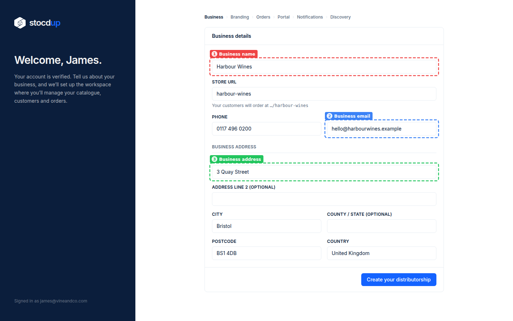
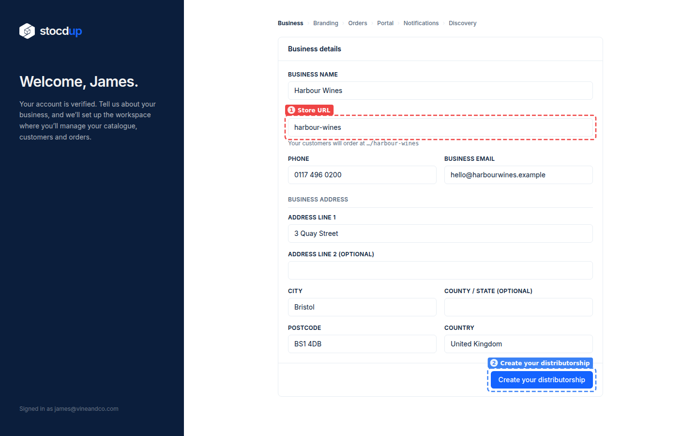
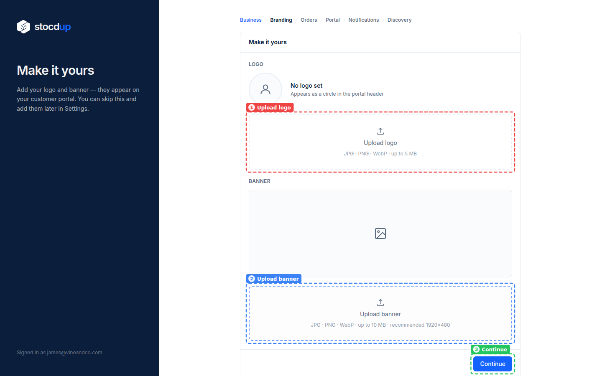
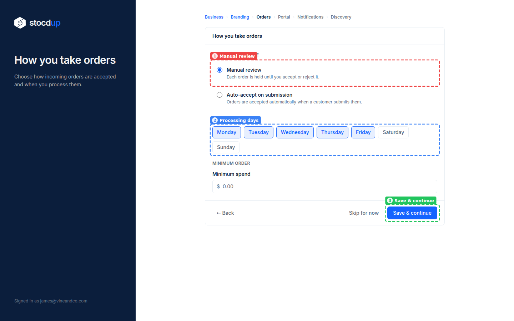
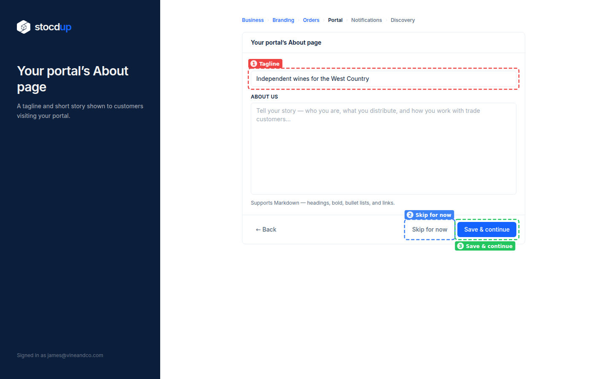
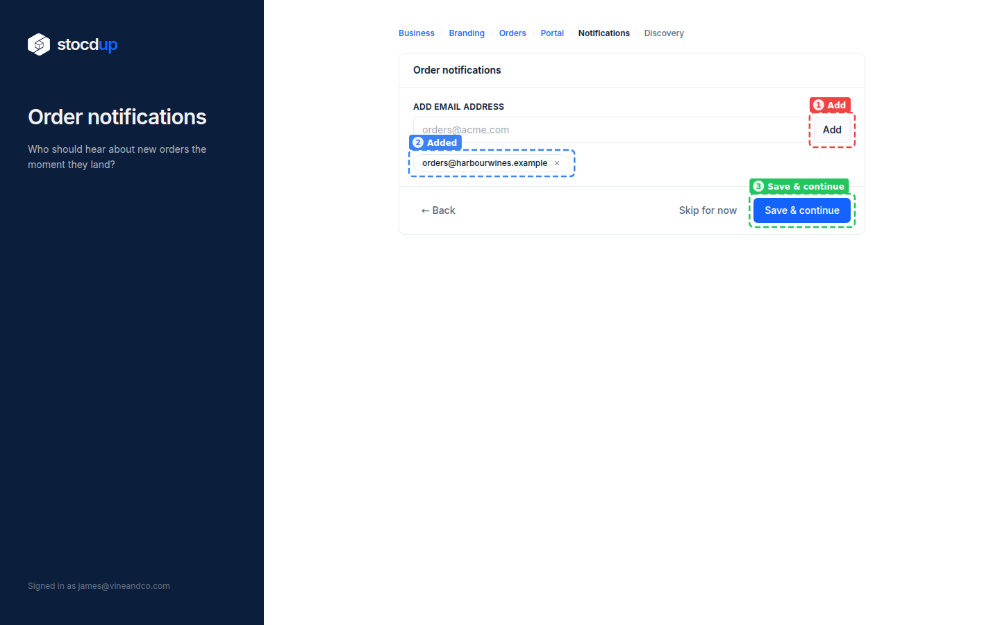
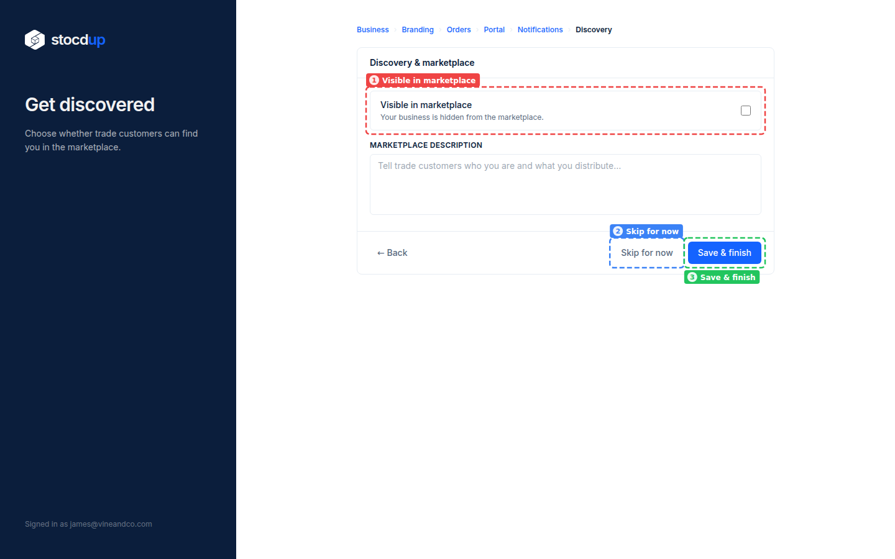
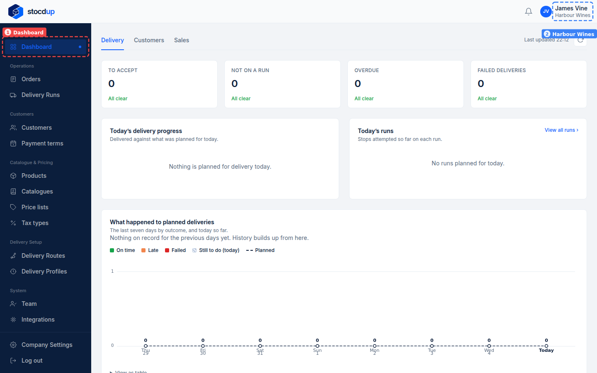

{/* Generated by scenario-docs from documentation/scenarios/distributor-onboarding.md. Edit the scenario and regenerate; changes here are overwritten. */}

In this task you'll set up your business on Stocdup: your business details and store URL,
then your branding, how you take orders, your portal's About page, order notifications
and whether trade customers can find you.

## About your distributorship

Your distributorship is your business on Stocdup: everything else, your products,
customers and orders, belongs to it, and you are its Owner. Your store URL is the address
of your customer portal, where your customers browse and order. The settings you choose
here decide how incoming orders are handled and who hears about them, and every one of
them can be changed later in **Company Settings**, including the store URL.

## Before you start

- You'll need a newly registered account. The first time you sign in, Stocdup takes you
  straight to this set-up.

## 1. Enter your business details

Under **Business details**, enter **Harbour Wines** as the **Business name** (1). Enter
**0117 496 0200** as the **Phone** and **hello@harbourwines.example** as the
**Business email** (2). Under **Business address** (3), enter **3 Quay Street**,
**Bristol** and **BS1 4DB**. The **Country** is already **United Kingdom**.

## 2. Choose your store URL and create the distributorship

The **Store URL** (1) fills itself in from your business name, here **harbour-wines**.
Change it if you'd like a different one. Your customers order at this address. Then
select **Create your distributorship** (2).

:::note

A store URL can only use lowercase letters, numbers and hyphens.

:::

Your business now exists. The remaining steps can each be skipped and set later.

## 3. Add your branding

Use **Upload logo** (1) and **Upload banner** (2) to add your logo and a banner. They
appear on your customer portal. Select **Continue** (3) when you're done, or to skip
this for now.

## 4. Choose how you take orders

**Manual review** (1) is already selected: each order waits until you accept or reject
it. (**Auto-accept on submission** would accept orders as soon as customers submit them.) The **Processing days** (2), the days you handle orders, are already **Monday** to
**Friday**. Leave **Minimum spend** empty for no minimum order, and select
**Save & continue** (3).

## 5. Add a tagline for your portal's About page

In **Tagline** (1), enter **Independent wines for the West Country**. You can also tell
your story under **About us**. Select **Save & continue** (3), or **Skip for now** (2).

## 6. Choose who gets order notifications

In **Add email address**, enter **orders@harbourwines.example** and select **Add** (1).
The address is listed below (2). Add as many as you need, then select
**Save & continue** (3).

## 7. Choose whether trade customers can find you

Tick **Visible in marketplace** (1) if you want trade customers to find you in the
marketplace. Leave it unticked to stay hidden. Select **Save & finish** (3), or
**Skip for now** (2).

## Result

Your **Dashboard** (1) opens, and **Harbour Wines** (2) shows next to your name at the
top of the page.

## Related

- [Change how you take orders](../orders-and-deliveries/change-order-settings.mdx)
