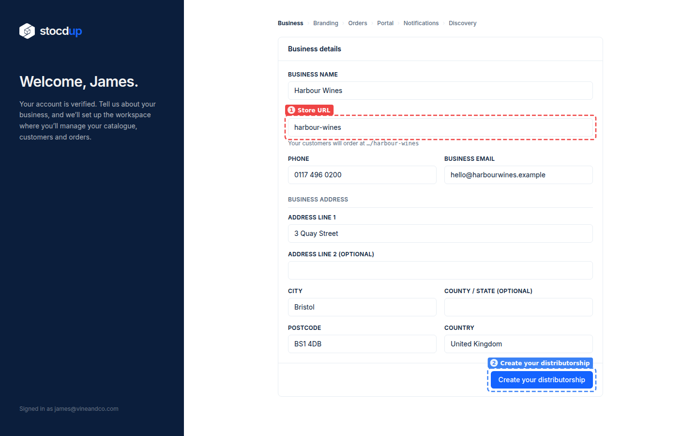
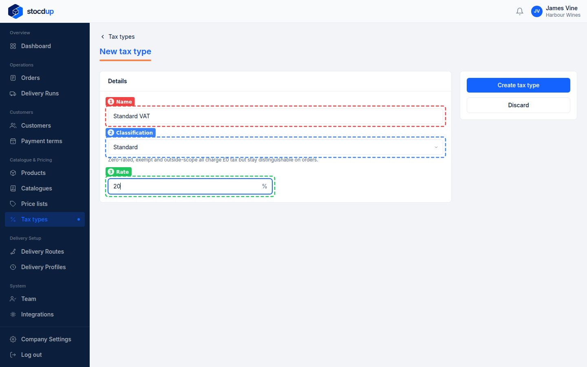
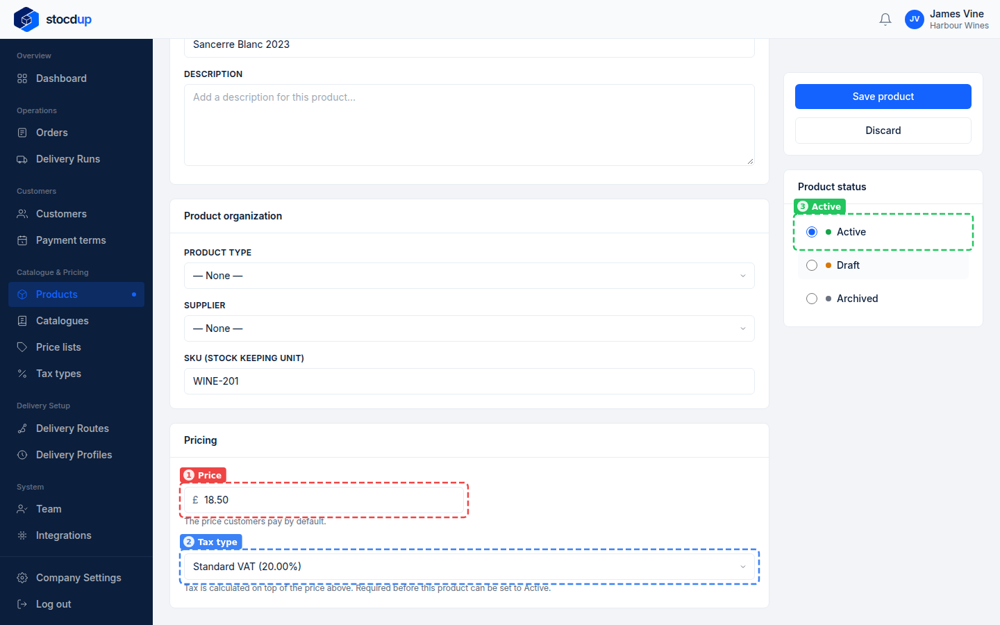
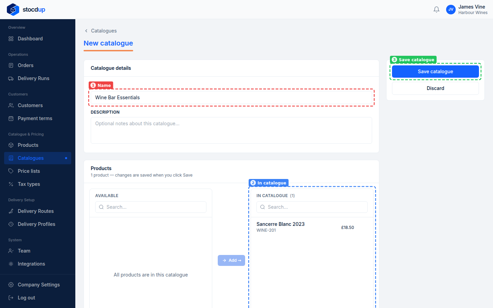
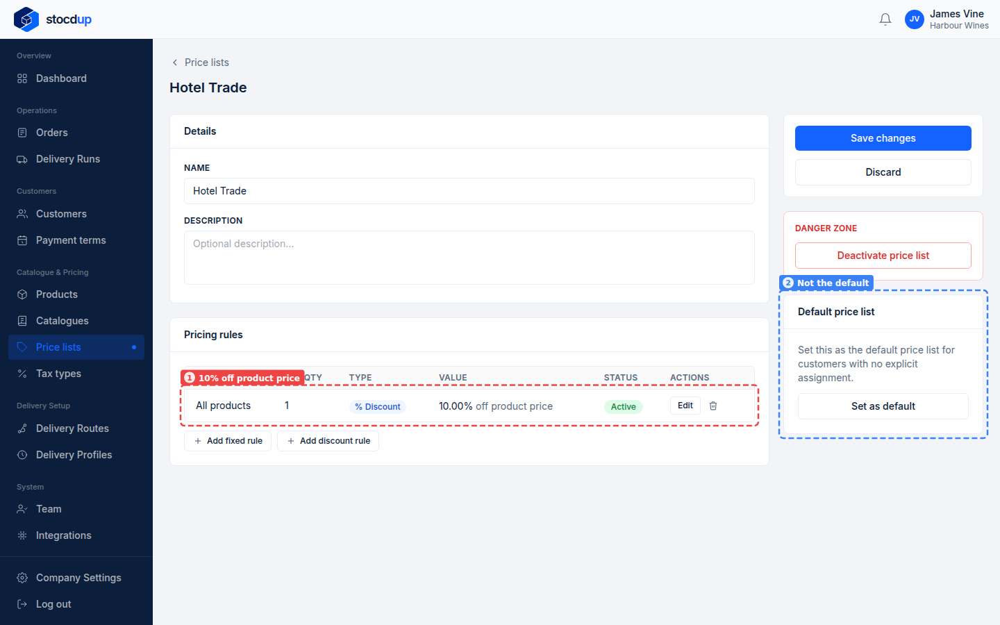
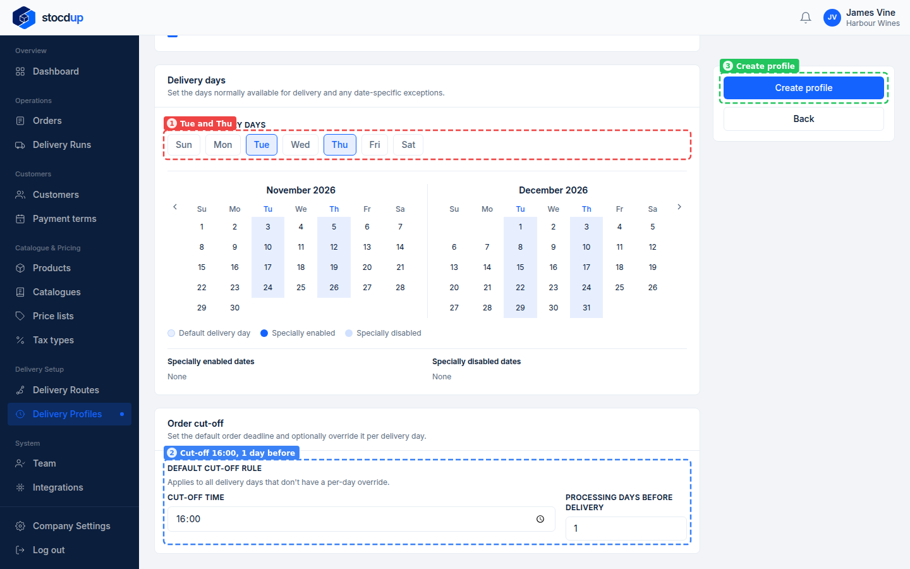
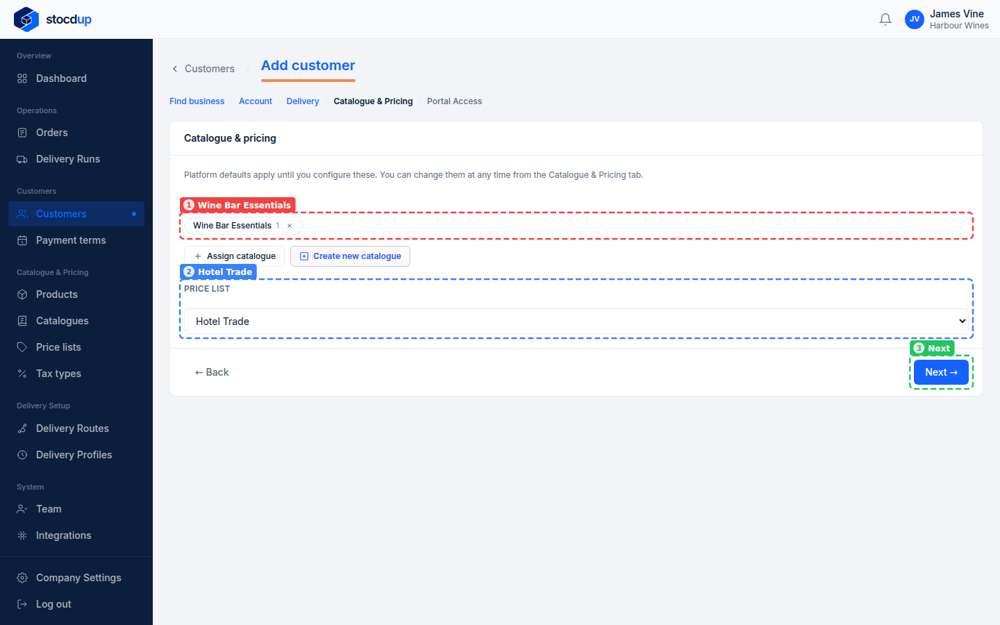
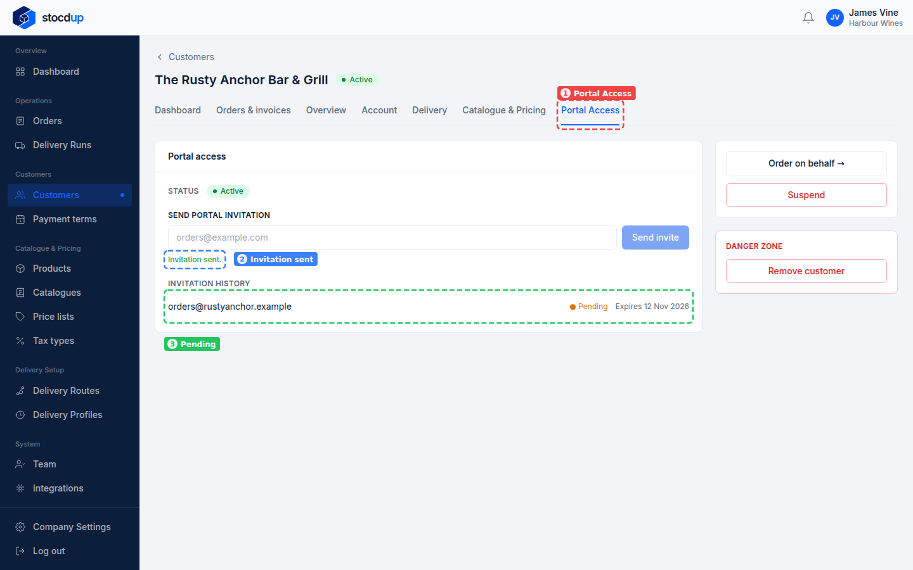
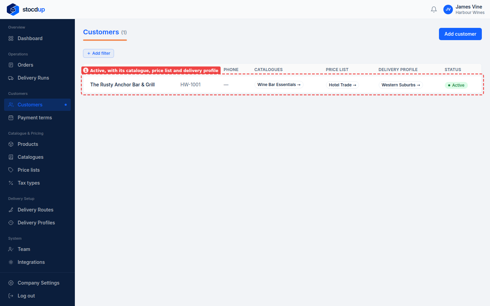

{/* Generated by scenario-docs from documentation/scenarios/guides/get-started-owner.md. Edit the guide and regenerate; changes here are overwritten. */}

You've just signed up, and nothing is set up yet. By the end of this guide you'll have
your business, a product and your prices set up, and your first customer ready to order
from you online.

## What you'll do

**Your business**

1. Set up your business

**Products and prices**

2. Add a tax type
3. Add your first product
4. Choose what customers can see
5. Set your trade prices

**Delivery**

6. Choose your delivery days

**Customers**

7. Add your first customer
8. Invite them to order online

## Before you start

- You'll need a newly registered account.

## 1. Set up your business

Everything else you add belongs to your business, so it comes first. Your business on
Stocdup is your distributorship, and you are its Owner. Your store URL is the address of
the portal where your customers browse and order.

The first time you sign in, Stocdup asks for your business details and a **Store URL**
(1), such as **Harbour Wines** at **harbour-wines**. Select
**Create your distributorship** (2). It then offers your branding, how you take orders,
your portal's About page, order notifications and marketplace visibility. You can skip
any of these and change them later in **Company Settings**.

Step by step: [Set up your distributorship](./distributor-onboarding.mdx)

## 2. Add a tax type

A product can't go on sale without a tax type, so you need one first. A tax type is the
tax a product is sold with, such as standard-rate VAT at 20%.

Go to **Tax types** and select **New tax type**. Enter **Standard VAT** as the
**Name** (1), keep the **Standard** **Classification** (2), enter **20** as the
**Rate** (3), and select **Create tax type**. The classification only says what kind of
tax it is (others are **Reduced rate**, **Zero-rated**, **Exempt** and
**Outside the scope of tax**); the tax charged comes from the rate.

Step by step: [Add a tax type](../catalogue-and-pricing/add-tax-type.mdx)

## 3. Add your first product

A product is something your customers can order, with a SKU, a default price and a tax
type. Customers only see Active products, and a product needs a tax type before it can
be Active.

Go to **Products** and select **Add product**. Enter **Sancerre Blanc 2023** with the
SKU **WINE-201**. Enter **18.50** as the **Price** (1), choose
**Standard VAT (20.00%)** as the **Tax type** (2), select **Active** (3), so customers
can see and order it, and save it. (New products start as **Draft**, hidden from
customers; **Archived** hides them too.)
You can add a photo once it's saved. You haven't set up any product types or suppliers
yet, so leave those as **None**.

Step by step: [Add a product](../catalogue-and-pricing/add-product.mdx)

## 4. Choose what customers can see

A catalogue is a selection of your products. A customer only sees the products in the
catalogues you give them, so without one your first customer would see nothing.

Go to **Catalogues** and select **New catalogue**. Name it **Wine Bar Essentials** (1),
add **Sancerre Blanc 2023** so it's listed **In catalogue** (2), and select
**Save catalogue** (3). You'll give it to your customer when you add them, in step 7.

With one product, your catalogue holds everything you sell. Catalogues come into their
own when different customers should see different products: the step-by-step page shows
two catalogues for two kinds of customer.

Step by step: [Create a catalogue and give it to a customer](../catalogue-and-pricing/create-catalogue.mdx)

## 5. Set your trade prices

A price list is a set of prices you give a group of customers, such as trade prices for
hotels. Its prices come from its rules, such as a percentage off the product's own price.

Go to **Price lists** and select **New price list**. Name it **Hotel Trade** and create
it. Then select **Add discount rule**, enter **10** % off the **Product price** for
**All products**, and select **Add rule** (1). A rule can instead price one
**Specific product**, or take its discount off **Another list**.

:::note

A new price list isn't your default (2). A customer gets its prices once you give it to
them. A customer with no price list pays the product's own price.

:::

Step by step: [Create a price list](../catalogue-and-pricing/create-price-list.mdx)

## 6. Choose your delivery days

A delivery profile is a delivery schedule you share across a group of customers: the
weekdays you deliver and an order cut-off for each delivery day. A customer can only
choose delivery dates from their profile, so a customer with no profile has none.

Go to **Delivery Profiles** and select **New profile**. Name it **Western Suburbs**,
choose **Tue** and **Thu** (1), set the cut-off to **16:00**, **1** processing day
before delivery (2), and select **Create profile** (3).

Step by step: [Set up a delivery profile](../delivery-setup/delivery-profile-setup.mdx)

## 7. Add your first customer

A customer is a business you sell to. Its set-up with you decides how it can order: its
delivery profile sets the dates it can choose, its catalogues set the products it sees,
and its price list sets what it pays.

Go to **Customers** and select **Add customer**. Search for
**The Rusty Anchor Bar & Grill**, and add it as a new business when it isn't found. Give
it the account number **HW-1001** and the **Western Suburbs** delivery profile. Assign
the **Wine Bar Essentials** catalogue (1) and choose **Hotel Trade** as its
**Price list** (2), since you have no default price list to keep. Select **Next** (3), then
finish without an invitation email and mark it as active, so it can order straight away
(otherwise it stays **Pending invite** until it accepts a portal invitation).

Step by step: [Add a customer](../customers/add-customer.mdx)

## 8. Invite them to order online

The portal is where your customers browse the products in their catalogues, at their
prices, and place orders themselves. The invitation is an email with a link that lasts
7 days.

Open the customer's record and its **Portal Access** tab (1). Enter
**orders@rustyanchor.example** and select **Send invite**. You'll see
**Invitation sent.** (2), and the invitation is listed as **Pending** (3) until they
accept it.

Step by step: [Invite a customer to the portal](../customers/invite-customer-to-portal.mdx)

## You're up and running

The Rusty Anchor Bar & Grill is **Active**, with the **Wine Bar Essentials** catalogue,
the **Hotel Trade** price list and the **Western Suburbs** delivery profile (1), and has
been invited to your portal. Once they accept, they can see Sancerre Blanc 2023 at their
price and order it for a Tuesday or Thursday delivery.

## Next steps

### Your business

- [Change how you take orders](../orders-and-deliveries/change-order-settings.mdx): review each order or accept them automatically, and set a minimum order.
- [Invite a team member](../team/invite-team-member.mdx): give the people you work with their own sign-in.

### Products and prices

- [Set a customer's catalogue and price list](../customers/set-customer-catalogue-and-price-list.mdx): change what a customer sees and pays.

### Delivery

- [Create a delivery route](../delivery-setup/create-delivery-route.mdx): group customers into a driver's trip, in drop order.
- [Plan a day's deliveries](../orders-and-deliveries/plan-delivery-runs.mdx): sort out each day's runs and drivers.

### Customers

- [Set up payment terms](../customers/create-payment-terms.mdx): decide when customers' invoices are due.
- [Review and accept a new order](../orders-and-deliveries/accept-order.mdx): what to do when your first order arrives.
