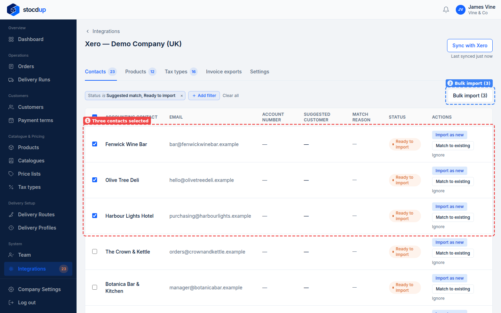
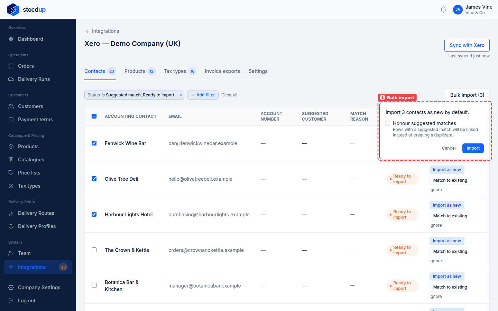
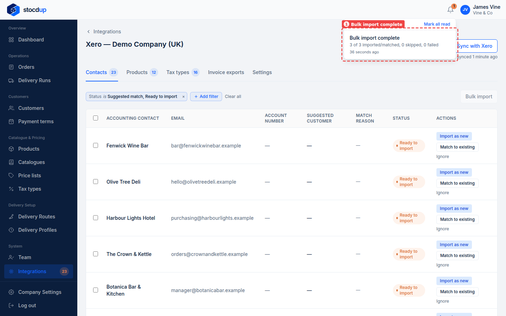
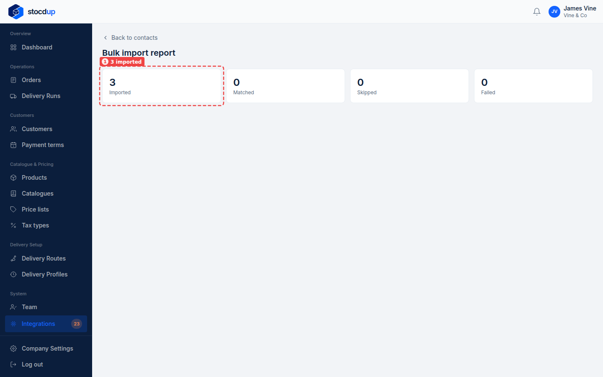
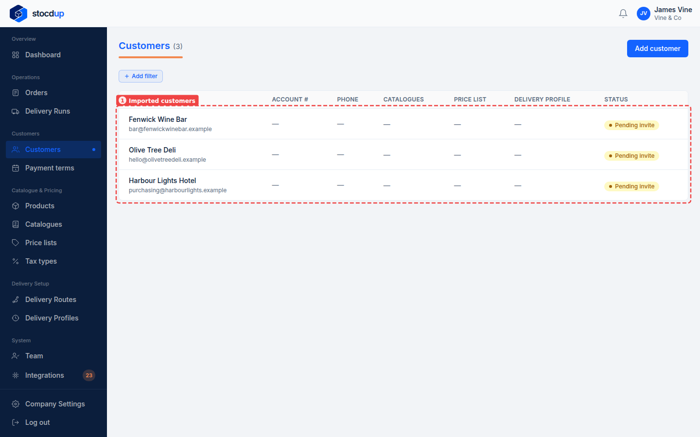

{/* Generated by scenario-docs from documentation/scenarios/bulk-import-customers-from-xero.md. Edit the scenario and regenerate; changes here are overwritten. */}

In this task you'll bring a batch of Xero contacts into Stocdup as customers in one go,
and check the import report for what happened.

## About importing several customers at once

You can select several contacts on the Contacts tab and import them together as
customers, each linked to its contact. The import runs in the background and you're
notified when it's done. A contact with a suggested match is linked to that customer only
if you tick **Honour suggested matches**; otherwise it becomes a new customer alongside
the one it matched. Contacts that can't be imported, such as archived ones or ones Xero
doesn't treat as customers, are skipped.

## Before you start

- You'll need an Owner account.
- Xero needs to be connected and synced.

## 1. Open the synced Xero data and go to Contacts

Go to **Integrations** and select **View synced data** on the Xero card. The page opens
on the **Contacts** tab.

## 2. Select Harbour Lights Hotel, Olive Tree Deli and Fenwick Wine Bar

Tick the box at the start of each of the three rows (1). The button at the top right
becomes **Bulk import (3)** (2).

## 3. Import them

Select **Bulk import (3)**. The panel that opens (1) says the contacts will be imported
as new customers. None of these three has a suggested match, so leave **Honour suggested
matches** unticked and select **Import**. Stocdup says the import is queued and that
you'll be notified when it's done.

## 4. Open the import report when it's done

When the import finishes, a notification appears under the bell: **Bulk import
complete** (1), with how many contacts were imported or matched, skipped and failed.
Select it to open the report.

The **Bulk import report** shows how many contacts were imported, matched, skipped and
failed. Here all three were **Imported** (1), each created as a new customer. **Matched** means
linked to its suggested match, **Skipped** means already linked or not eligible (archived in Xero, or a supplier-only contact),
and **Failed** means it couldn't be imported; the report lists those below, with the reason.

## Result

Go to **Customers**. **Fenwick Wine Bar**, **Olive Tree Deli** and **Harbour Lights
Hotel** are listed (1), each with its email from Xero and the status **Pending invite**: they can't order until you make them
active or they accept a portal invitation.
They have no account number yet; add one on each customer if you use them.

Before they can order, give each customer a delivery profile, a catalogue and a price
list: see [Set a customer's catalogue and price list](../../../customers/set-customer-catalogue-and-price-list.mdx).

## Related

- [Add a customer from a Xero contact](./import-customer-from-xero.mdx)
- [Match your customers to Xero](./match-customers-to-xero.mdx)
- [Import several products from Xero at once](../products/bulk-import-products-from-xero.mdx)
