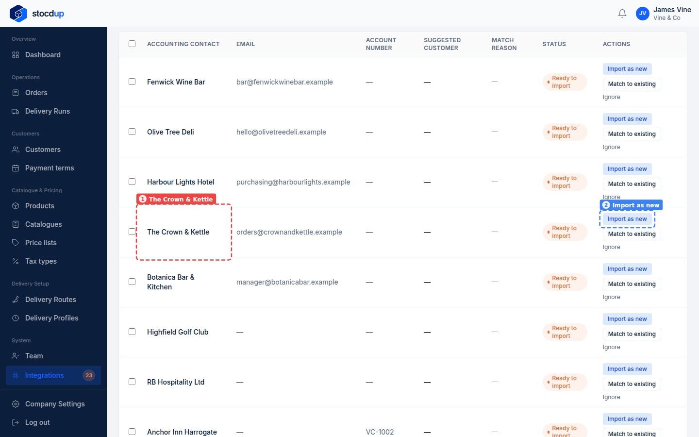
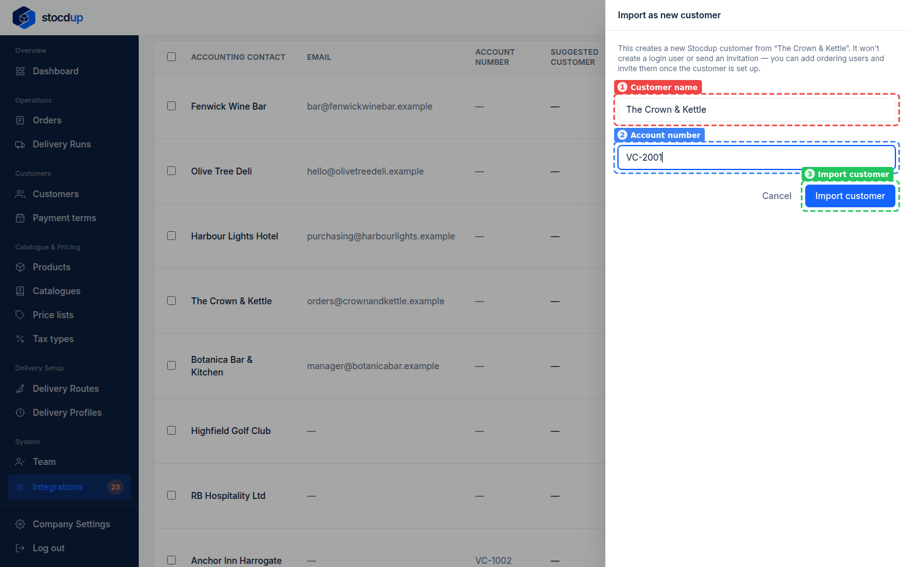
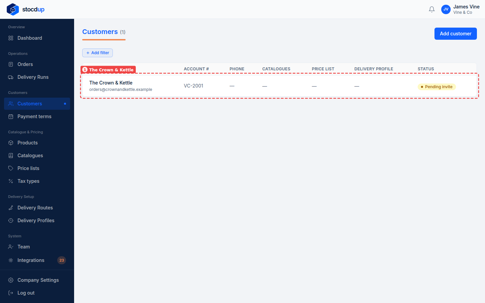
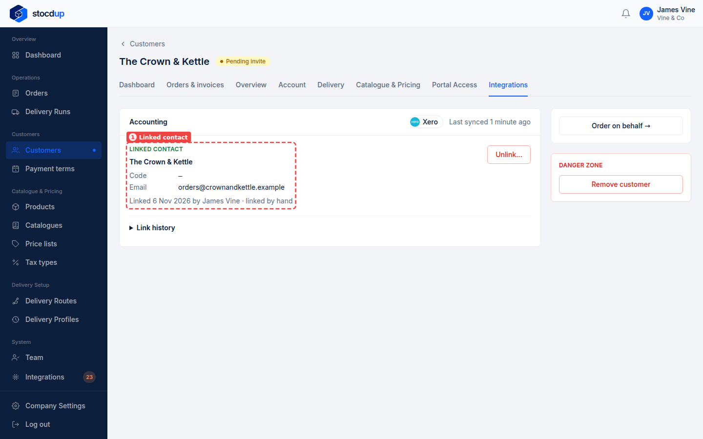

{/* Generated by scenario-docs from documentation/scenarios/import-customer-from-xero.md. Edit the scenario and regenerate; changes here are overwritten. */}

In this task you'll create a new Stocdup customer from a contact you already have in
Xero, linked to it from the start.

## About importing customers from Xero

A Xero contact that isn't in Stocdup yet can be imported as a new customer. Its name,
email and address come from Xero, and you can set the name and account number as you
import it. Because it's linked, orders you accept from this customer are invoiced to the
right Xero contact. Only contacts Xero treats as customers can be imported.

## Before you start

- You'll need an Owner account.
- Xero needs to be connected and synced.

## 1. Open the synced Xero data and go to Contacts

Go to **Integrations** and select **View synced data** on the Xero card. The page opens
on the **Contacts** tab.

## 2. Find The Crown & Kettle

Find **The Crown & Kettle** (1). It shows as **Ready to import**: none of your customers
matches it. Select **Import as new** (2) at the end of its row.

## 3. Import it as a new customer with account number VC-2001

The panel that opens has the **Customer name** (1) filled in from Xero; change it if you
need to. Enter **VC-2001** as the **Account number** (2), then select **Import
customer** (3).

:::note

Importing a customer doesn't create a login for them or send an invitation. You can
invite their ordering users once the customer is set up.

:::

## 4. Open the new customer

Go to **Customers**. **The Crown & Kettle** (1) is listed with its email from Xero,
**orders@crownandkettle.example**, account number **VC-2001** and the status **Pending
invite**. Select it, then select **View customer**.

## Result

On the customer's **Integrations** tab, the **Linked contact** (1) is The Crown & Kettle
in Xero, with its email and when it was linked.

Before The Crown & Kettle can order, give them a delivery profile, a catalogue and a
price list: see [Set a customer's catalogue and price list](../../../customers/set-customer-catalogue-and-price-list.mdx).
To import several contacts at once, see
[Import several customers from Xero at once](./bulk-import-customers-from-xero.mdx).

## Related

- [Match your customers to Xero](./match-customers-to-xero.mdx)
- [Import several customers from Xero at once](./bulk-import-customers-from-xero.mdx)
- [Set a customer's catalogue and price list](../../../customers/set-customer-catalogue-and-price-list.mdx)
