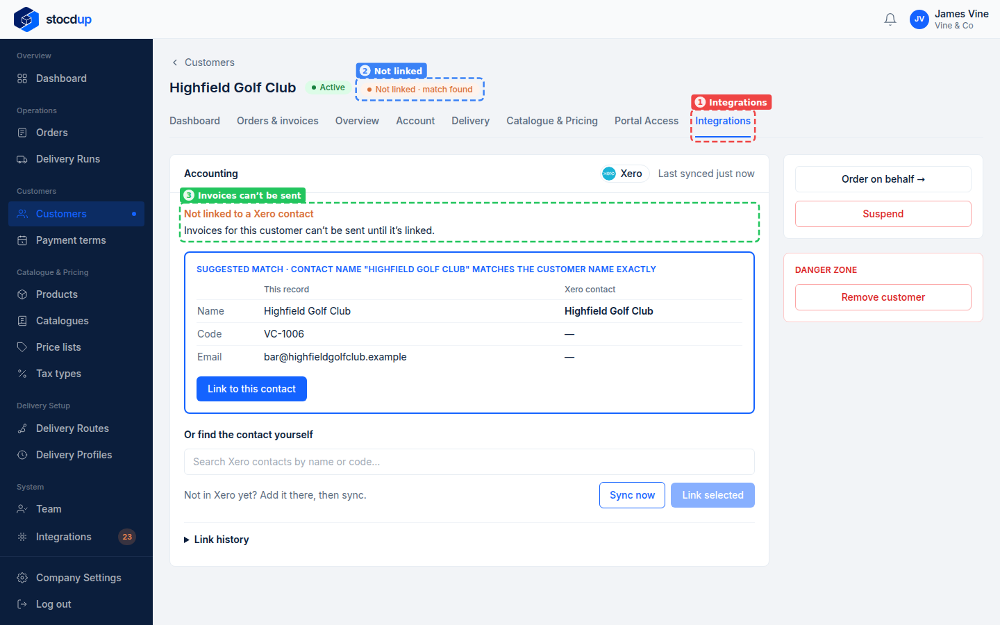
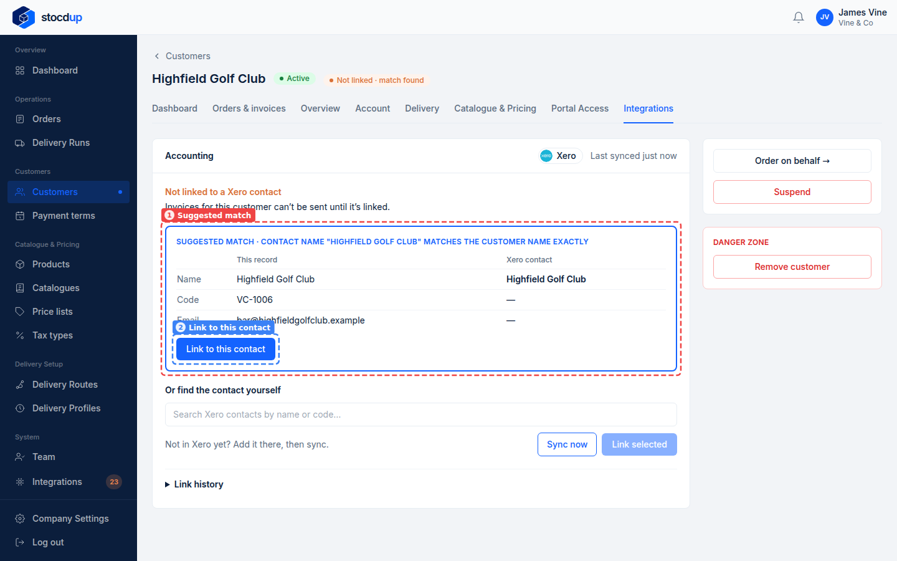
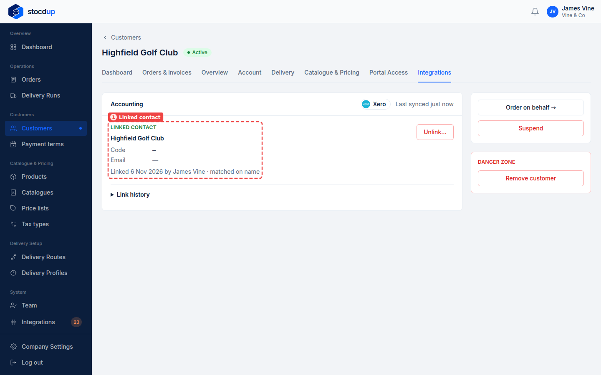

{/* Generated by scenario-docs from documentation/scenarios/link-customer-from-its-record.md. Edit the scenario and regenerate; changes here are overwritten. */}

In this task you'll link a customer to their Xero contact from the customer's own page,
and see the link there.

## About a customer's Integrations tab

Each customer has an **Integrations** tab showing its link to Xero: the linked contact,
when it was linked and by whom, and when Stocdup last synced. Until a customer is linked,
the tab warns that their invoices can't be sent to Xero, shows the contact Stocdup
suggests if there is one, and lets you search Xero's contacts yourself.

## Before you start

- You'll need an Owner account.
- Xero needs to be connected and synced.

## 1. Open the customer Highfield Golf Club and go to its Integrations tab

Go to **Customers**, select **Highfield Golf Club**, then select **View customer**.
Select the **Integrations** tab (1). Next to the customer's name, **Not linked · match
found** (2) shows it isn't linked yet, but Stocdup has found a Xero contact that may be
it. The tab warns that **Invoices for this customer can't be sent until it's linked**
(3).

## 2. Check the suggested Xero contact

The **Suggested match** (1) says why Stocdup suggested it (here, the contact name matches
the customer name exactly) and puts the customer and the Xero contact side by side.
Check it's the same business.

## 3. Link the customer to it

Select **Link to this contact** (2).

If nothing is suggested, or the suggestion is wrong, search Xero's contacts by name
under **Or find the contact yourself**, choose one, then select **Link selected**.

## Result

The tab now shows the **Linked contact** (1), **Highfield Golf Club**, **Linked … by
James Vine · matched on name**, and no longer warns about invoices.

To remove the link, select **Unlink…**. Until the customer is linked again, their
invoices can't be sent to Xero.

## Related

- [Match your customers to Xero](./match-customers-to-xero.mdx)
- [Send an order's invoice to Xero](../invoices/invoice-sent-to-xero.mdx)
- [Link a product to Xero from the product](../products/link-product-from-its-record.mdx)
