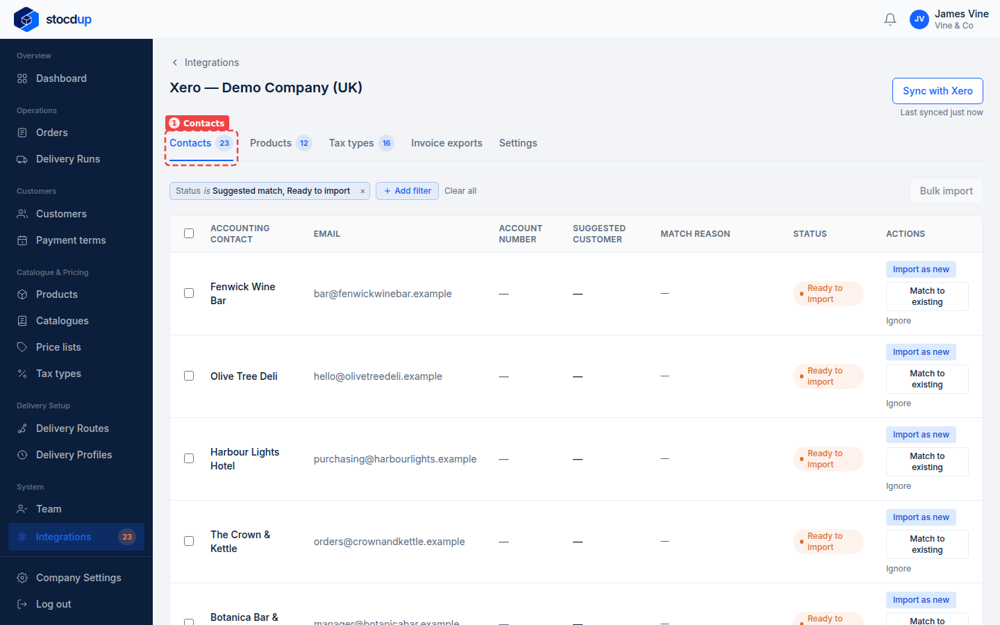
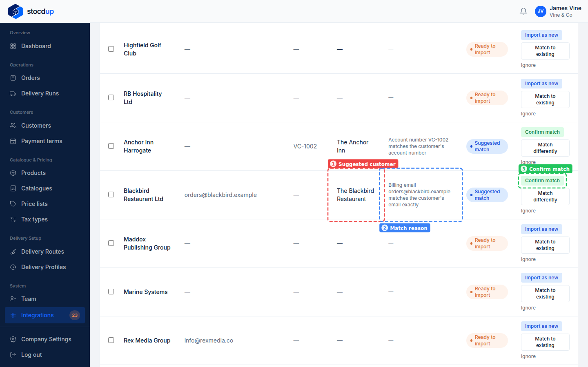
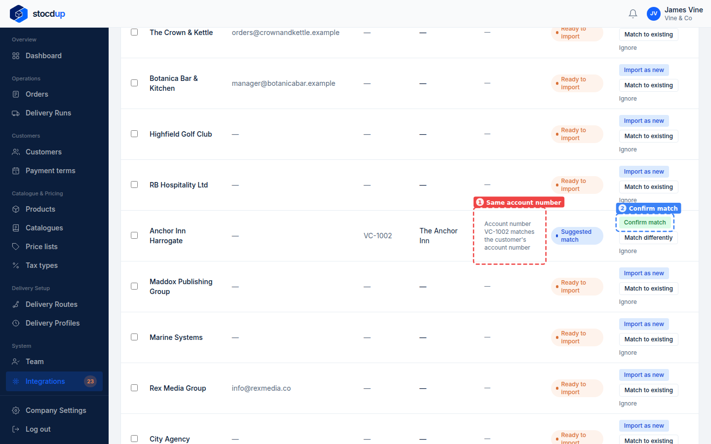
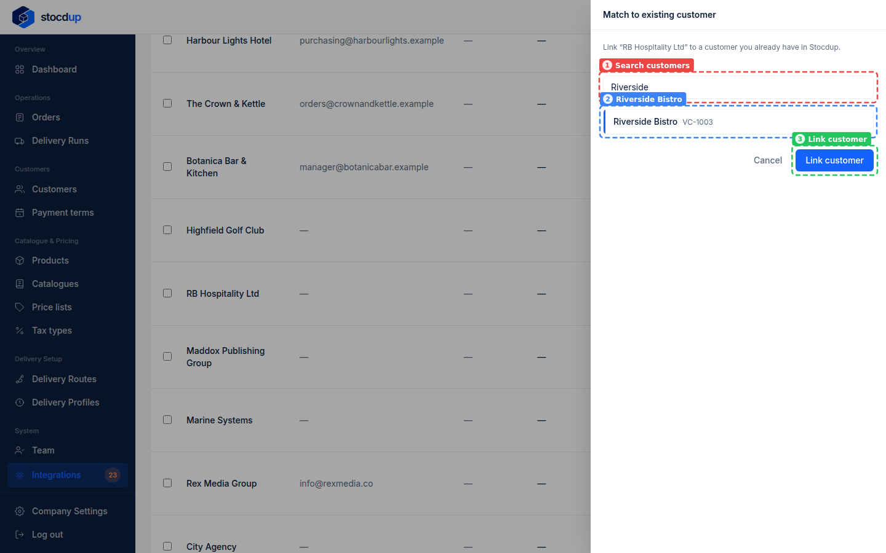
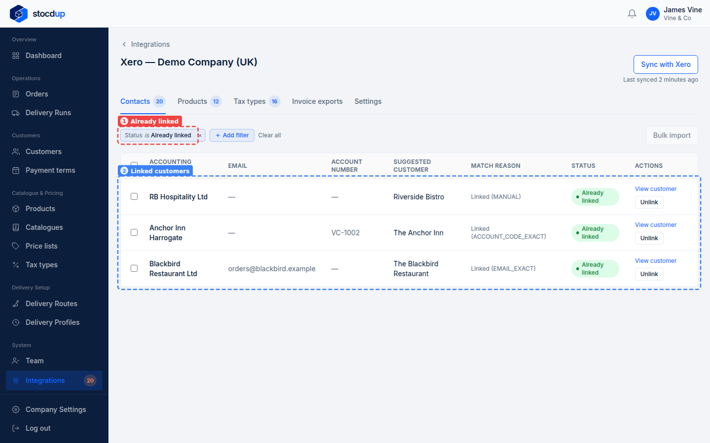

{/* Generated by scenario-docs from documentation/scenarios/match-customers-to-xero.md. Edit the scenario and regenerate; changes here are overwritten. */}

In this task you'll link your customers to their contacts in Xero, by confirming the
matches Stocdup suggests and matching the rest yourself.

## About customers and Xero

An accepted order is sent to Xero as an invoice for the customer's linked contact. A
customer with no link can't be invoiced: the invoice fails until you link it. Each sync,
Stocdup suggests a contact when its account number, email or name matches a customer's
(or a similar name has the same postcode), and shows why. It never links anything on its
own, so a contact under a different trading name is matched by hand.

## Before you start

- You'll need an Owner account.
- Xero needs to be connected and synced.

## 1. Open the synced Xero data and go to Contacts

Go to **Integrations** and select **View synced data** on the Xero card. The page opens
on the **Contacts** tab (1), filtered to the contacts that are a **Suggested match** (Stocdup found a
customer that looks like the same business) or **Ready to import** (no matching customer,
so you can create one from it).

## 2. Find Blackbird Restaurant Ltd, check why it was suggested, and confirm the match

Find **Blackbird Restaurant Ltd**. The **Suggested customer** column shows **The
Blackbird Restaurant** (1), and the **Match reason** (2) says why: the contact's billing
email matches the customer's email exactly. It's the same business, so select
**Confirm match** (3). The contact is now linked, so it leaves the list.

## 3. Confirm Anchor Inn Harrogate for The Anchor Inn

**Anchor Inn Harrogate** is suggested for **The Anchor Inn** because their account
numbers match, **VC-1002** (1). Select **Confirm match** (2).

## 4. Find RB Hospitality Ltd and match it to the existing customer Riverside Bistro

**RB Hospitality Ltd** is the company behind Riverside Bistro, but nothing about it
matches the customer, so it shows as **Ready to import** with no suggestion. Select
**Match to existing** at the end of its row. In the panel that opens, search for
**Riverside** (1), choose **Riverside Bistro** (2), then select **Link customer** (3).

## Result

Change the filter to show **Already linked** contacts (1): **Blackbird Restaurant Ltd**,
**Anchor Inn Harrogate** and **RB Hospitality Ltd** are linked to **The Blackbird
Restaurant**, **The Anchor Inn** and **Riverside Bistro** (2).

Invoices for these customers' orders can now be sent to Xero. A link can be undone with
**Unlink**. Contacts Xero has only as suppliers show as **Not a customer**: they can't be
imported or matched from this list.

## Related

- [Add a customer from a Xero contact](./import-customer-from-xero.mdx)
- [Link a customer to Xero from the customer](./link-customer-from-its-record.mdx)
- [Send an order's invoice to Xero](../invoices/invoice-sent-to-xero.mdx)
