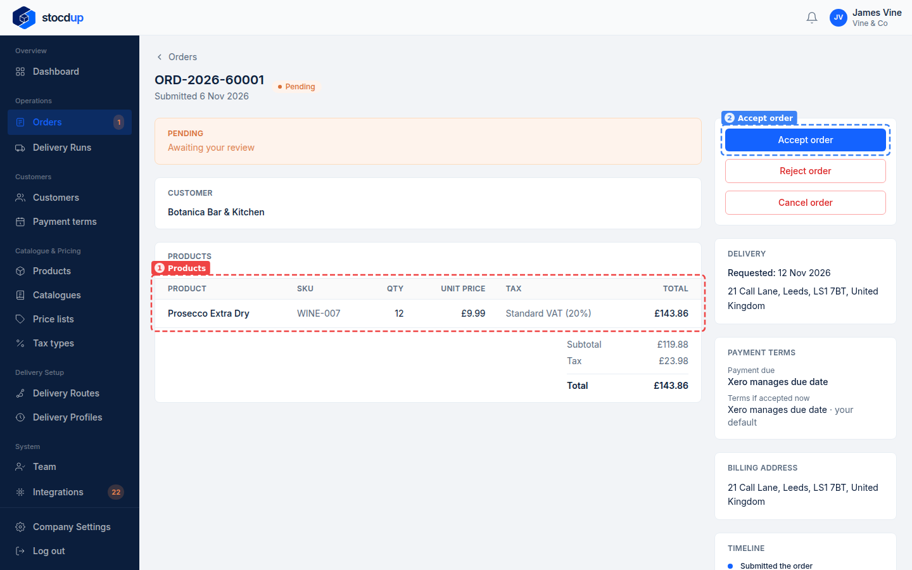
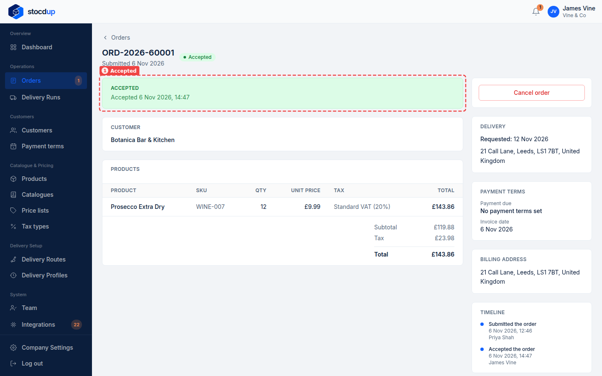
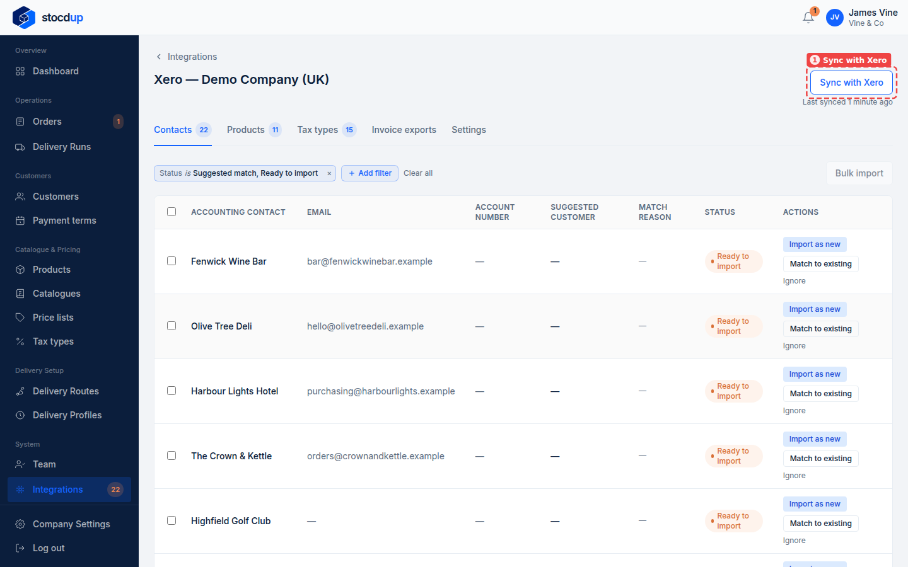
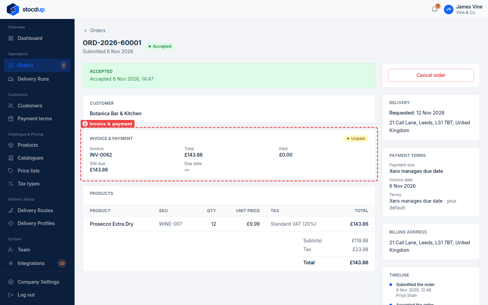

{/* Generated by scenario-docs from documentation/scenarios/invoice-sent-to-xero.md. Edit the scenario and regenerate; changes here are overwritten. */}

In this task you'll accept an order and see its invoice in Xero, with the amount still
due, on the order.

## About invoices in Xero

When you accept an order from a customer linked to Xero, Stocdup creates the invoice in
Xero for you, at Stocdup's prices, with the order number as its reference. Lines for
linked products carry the Xero item's code, and each line's tax comes from its tax type's
linked Xero rate. Stocdup then follows the invoice in Xero: once a sync has seen it, the
order shows the invoice number, what's been paid and what's still due. If the customer
isn't linked to a Xero contact, the invoice can't be created; the order says so, and you
can retry once it's linked.

## Before you start

- You'll need an Owner account.
- Xero needs to be connected, and the customer linked to their Xero contact.

## 1. Open order ORD-2026-60001

Go to **Orders** and select **ORD-2026-60001**, Botanica Bar & Kitchen's order. It's
**Pending**, awaiting your review: it waits for you to accept or reject it. Check the **Products** (1): 12 × Prosecco Extra Dry.

## 2. Accept the order

Select **Accept order** (2), then **Yes, accept**. The order shows **Accepted** (1).

A few seconds later a notification appears under the bell: **Invoice created**, with the
Xero invoice number and the order number.

## 3. Sync with Xero to bring the invoice's status back

Go to **Integrations**, select **View synced data** on the Xero card, then select **Sync
with Xero** (1). Wait for **Sync complete**.

:::note

You don't have to do this: Stocdup checks unpaid invoices on its own every 15 minutes.
Syncing just shows the invoice sooner.

:::

## 4. Open the order again

Go to **Orders** and select **ORD-2026-60001** again.

## Result

The order now has an **Invoice & payment** section (1): the Xero invoice number, the
**Total**, what's been **Paid** and what's **Still due**. Nothing is paid yet, so the
status is **Unpaid** and **£143.86** is still due. Once it's paid in Xero, the status
becomes **Part paid** or **Paid**; it shows **Overdue** once the due date passes while
money is still owed.

When the invoice is paid in Xero, the order shows what's been paid after the next sync.
Whether invoices arrive in Xero as drafts or ready to send is set on the Xero page's
**Settings** tab: see [Choose how invoices are created in Xero](../setting-up/xero-invoice-settings.mdx).

## Related

- [Match your customers to Xero](../customers/match-customers-to-xero.mdx)
- [Choose how invoices are created in Xero](../setting-up/xero-invoice-settings.mdx)
- [Review and accept a new order](../../../orders-and-deliveries/accept-order.mdx)
