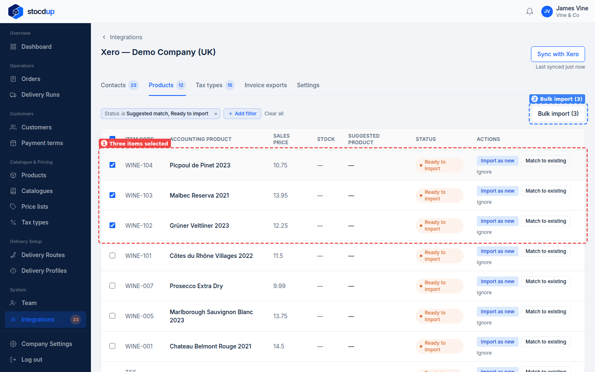
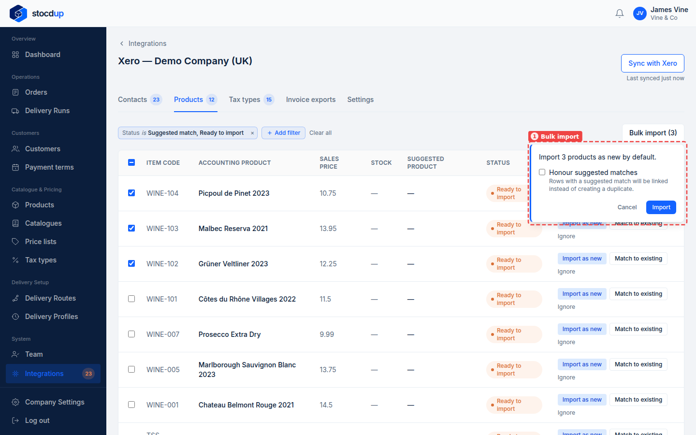
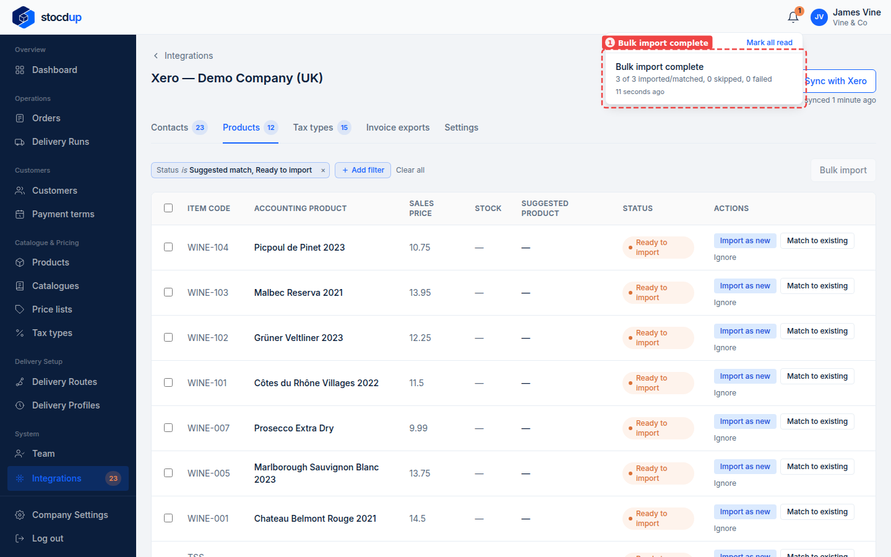
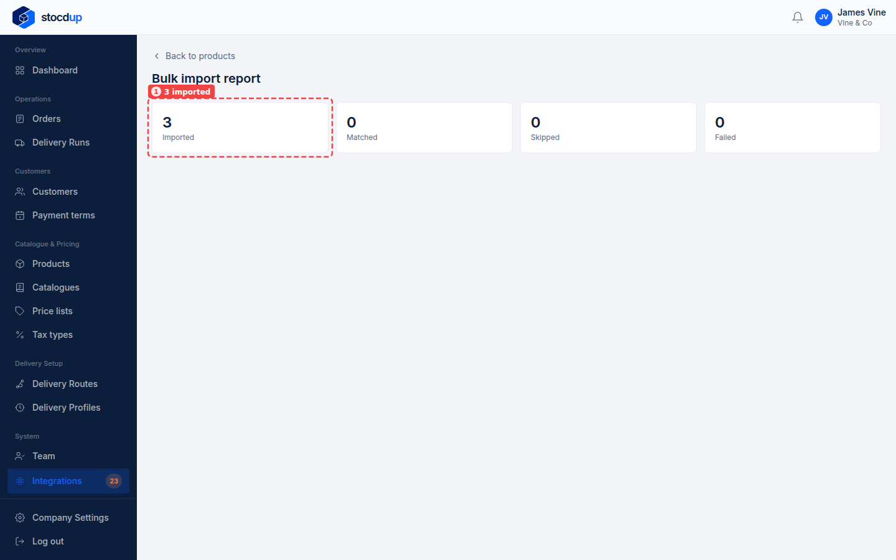
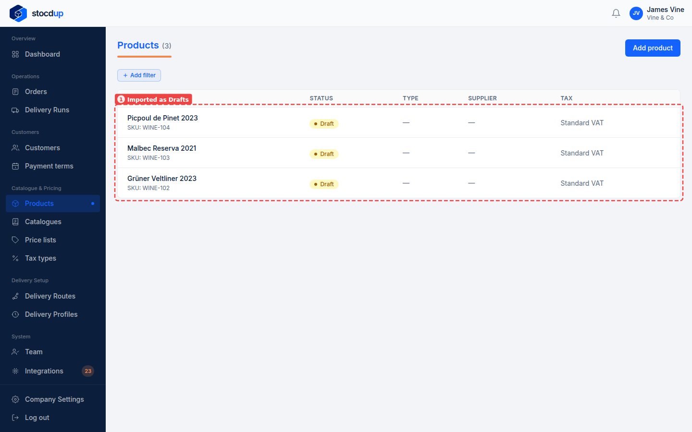

{/* Generated by scenario-docs from documentation/scenarios/bulk-import-products-from-xero.md. Edit the scenario and regenerate; changes here are overwritten. */}

In this task you'll bring a batch of Xero items into Stocdup in one go, and check the
import report for what happened.

## About importing several products at once

Instead of importing items one at a time, you can select several items on the Products
tab and import them together. The import runs in the background and you're notified when
it's done. Each item is handled on its own: an item ready to import becomes a new Draft
product with Xero's name, code and price. An item with a suggested match is linked to
that product only if you tick **Honour suggested matches**; otherwise it's imported as a
new product alongside the one it matched. Items that can't be imported are skipped, and
one item failing doesn't stop the rest.

## Before you start

- You'll need an Owner account.
- Xero needs to be connected and synced.
- Link your tax types first, so imported products get the right one.

## 1. Open the synced Xero data and go to Products

Go to **Integrations**, select **View synced data** on the Xero card, then select the
**Products** tab.

## 2. Select Grüner Veltliner 2023, Malbec Reserva 2021 and Picpoul de Pinet 2023

Tick the box at the start of each of the three rows (1). The button at the top right
becomes **Bulk import (3)** (2).

## 3. Import them

Select **Bulk import (3)**. The panel that opens (1) says the items will be imported as
new products. None of these three has a suggested match, so leave **Honour suggested
matches** unticked and select **Import**. Stocdup says the import is queued and that
you'll be notified when it's done.

:::tip

When your selection includes items with a suggested match, tick **Honour suggested
matches**, so those items are linked to their products rather than imported again as
duplicates.

:::

## 4. Open the import report when it's done

When the import finishes, a notification appears under the bell: **Bulk import
complete** (1), with how many items were imported or matched, skipped and failed.
Select it to open the report.

The **Bulk import report** shows how many items were imported, matched, skipped and
failed. Here all three were **Imported** (1), each created as a new product. **Matched** means
linked to its suggested match, **Skipped** means already linked or not eligible (purchase-only in Xero, or gone from Xero),
and **Failed** means it couldn't be imported; the report lists those below, with the reason.

## Result

Go to **Products**. **Grüner Veltliner 2023**, **Malbec Reserva 2021** and **Picpoul de
Pinet 2023** are listed as **Drafts** (1), each with its Xero code as its SKU and the
tax type **Standard VAT**.

Imported products start as Drafts: finish setting each one up and make it **Active**
before customers can see it.

## Related

- [Import a product from Xero](./import-product-from-xero.mdx)
- [Match your products to Xero](./match-products-to-xero.mdx)
- [Import several customers from Xero at once](../customers/bulk-import-customers-from-xero.mdx)
