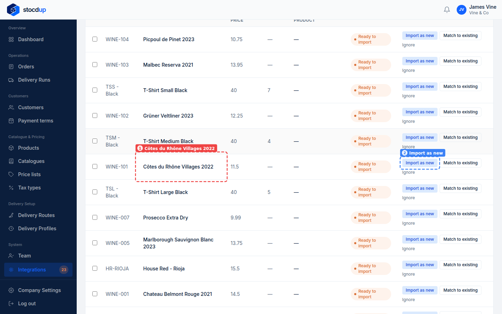
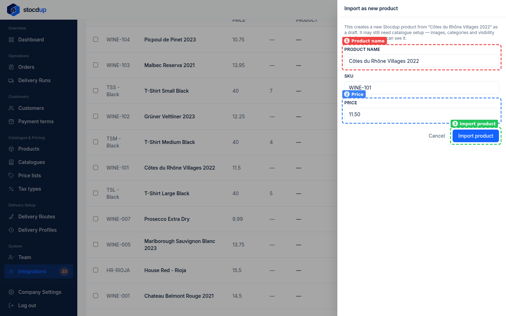
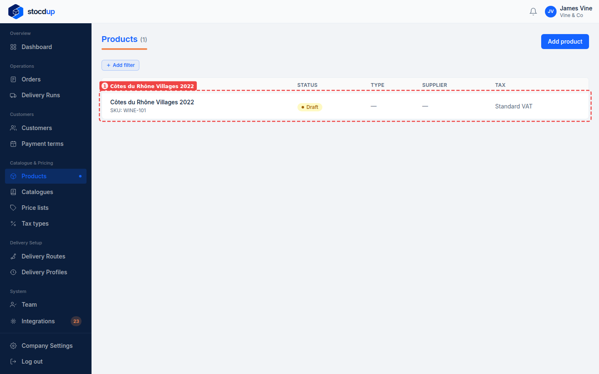
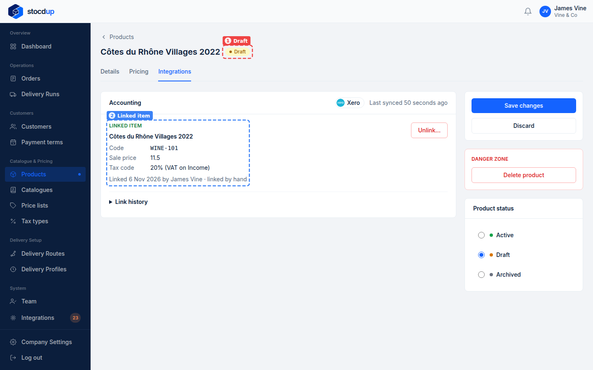

{/* Generated by scenario-docs from documentation/scenarios/import-product-from-xero.md. Edit the scenario and regenerate; changes here are overwritten. */}

In this task you'll create a new Stocdup product from an item in Xero, checking its name,
SKU and price as you import it.

## About importing products from Xero

An item that's in Xero but not yet in Stocdup can be imported as a new product, already
linked to its Xero item. The name, code and sales price come from Xero, and you can
change them before importing. The product starts as a Draft: customers can't see it
until you finish setting it up and make it active.

If the item's Xero tax rate is linked to a Stocdup tax type, the product gets that tax
type; if not, it has none until you set one. From then on, the product's details and its
price are Stocdup's.

## Before you start

- You'll need an Owner account.
- Xero needs to be connected and synced.
- Link your tax types first, so imported products get the right one.

## 1. Open the synced Xero data and go to Products

Go to **Integrations**, select **View synced data** on the Xero card, then select the
**Products** tab.

## 2. Find the Xero item Côtes du Rhône Villages 2022

Find **Côtes du Rhône Villages 2022** (1). It shows as **Ready to import**: none of your
products matches it. Select **Import as new** (2) at the end of its row.

## 3. Import it as a new product, keeping the name, SKU WINE-101 and price £11.50

The panel that opens is filled in from Xero: the **Product name** (1), the **SKU**
(**WINE-101**) and the **Price** (2), **11.50**. Change any of them if you need to,
then select **Import product** (3).

:::note

If a product already has that SKU, Stocdup says so; match the item to that product
instead.

:::

## 4. Open the new product

Go to **Products**. **Côtes du Rhône Villages 2022** (1) is listed as a **Draft**, with
SKU **WINE-101** and the tax type **Standard VAT**, from its Xero tax rate. Select it to
open it.

## Result

The product is a **Draft** (1). On its **Integrations** tab, the **Linked item** (2)
is the Xero item it came from, with its code, sale price and tax rate. Its own price,
on the **Pricing** tab, is **11.5**.

Before customers can see it, finish setting it up and make it **Active**. Only items Xero
marks as sold can be imported. To import many items at once, see
[Import several products from Xero at once](./bulk-import-products-from-xero.mdx).

## Related

- [Match your products to Xero](./match-products-to-xero.mdx)
- [Import several products from Xero at once](./bulk-import-products-from-xero.mdx)
- [Match your tax types to Xero](../tax-types/match-tax-types-to-xero.mdx)
