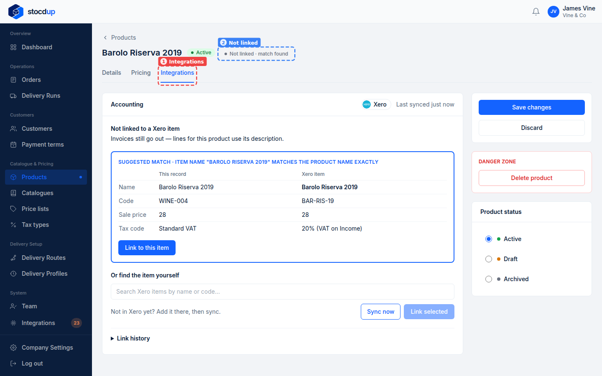
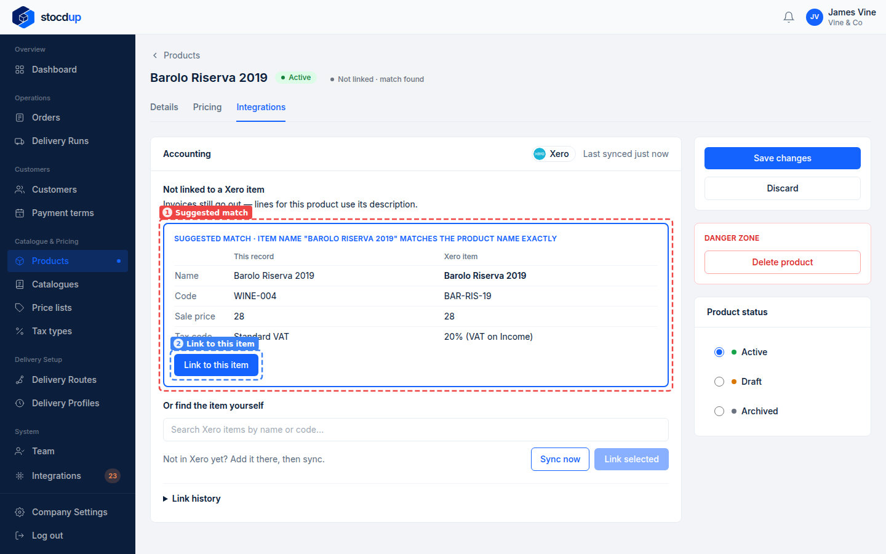
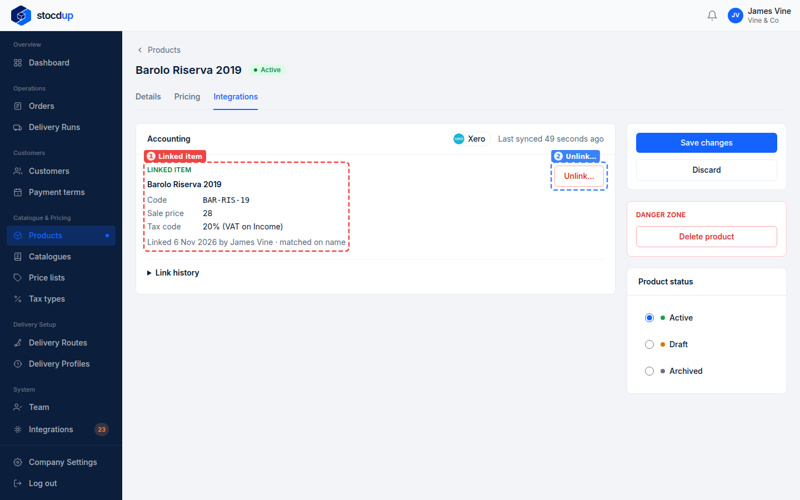

{/* Generated by scenario-docs from documentation/scenarios/link-product-from-its-record.md. Edit the scenario and regenerate; changes here are overwritten. */}

In this task you'll link a product to its Xero item from the product's own page, and see
the link there.

## About a product's Integrations tab

Each product has an **Integrations** tab showing its link to Xero: the linked item's
code, sale price and tax rate, when it was linked and by whom, and when Stocdup last
synced. A product that isn't linked shows the item Stocdup suggests, if any, and lets you
search Xero's items yourself. An unlinked product is still invoiced, described by its
name and SKU; linking it puts the Xero item's code on invoice lines.

## Before you start

- You'll need an Owner account.
- Xero needs to be connected and synced.

## 1. Open the product Barolo Riserva 2019 and go to its Integrations tab

Go to **Products**, select **Barolo Riserva 2019**, then select **View product**. Select
the **Integrations** tab (1). Next to the product's name, **Not linked · match found**
(2) shows it isn't linked yet, but Stocdup has found a Xero item that may be it.

## 2. Check the suggested Xero item

The **Suggested match** (1) says why Stocdup suggested it (here, the item name matches
the product name exactly) and puts the product and the Xero item side by side: name,
code, sale price and tax code. Check it's the same wine. The codes differ (WINE-004 and
BAR-RIS-19), which is fine: invoice lines will use Xero's code.

## 3. Link the product to it

Select **Link to this item** (2).

If nothing is suggested, or the suggestion is wrong, search Xero's items by name or code
under **Or find the item yourself**, choose one, then select **Link selected**.

## Result

The tab now shows the **Linked item** (1): **Barolo Riserva 2019**, code **BAR-RIS-19**,
with its sale price and tax code in Xero, and **Linked … by James Vine · matched on
name**.

To remove the link, select **Unlink…** (2). **Link history** records the product's links:
when, by whom and how each was made.

## Related

- [Match your products to Xero](./match-products-to-xero.mdx)
- [Review a change made in Xero](./review-a-xero-change.mdx)
- [Link a customer to Xero from the customer](../customers/link-customer-from-its-record.mdx)
