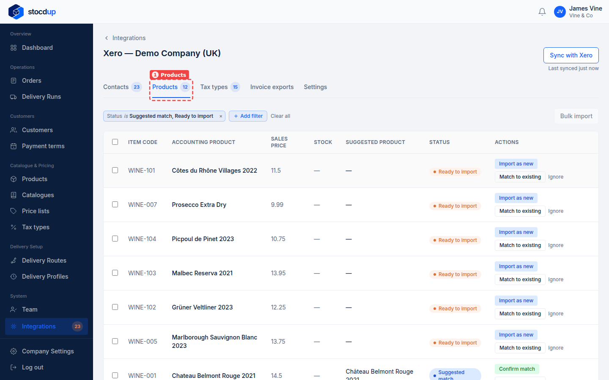
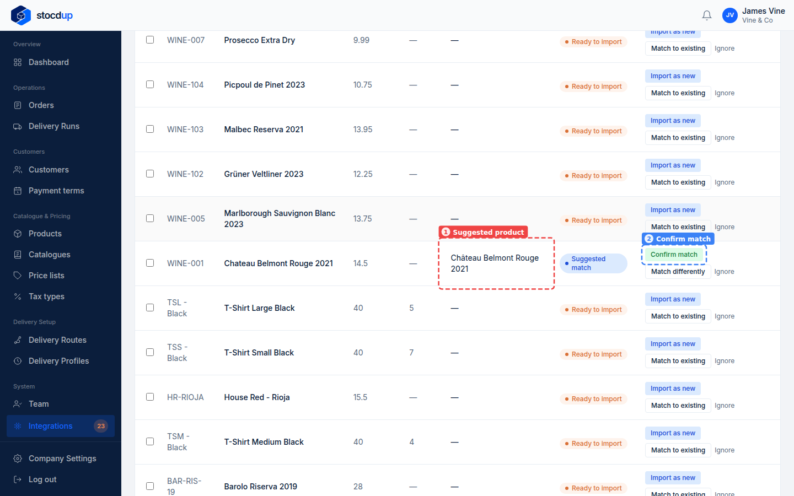
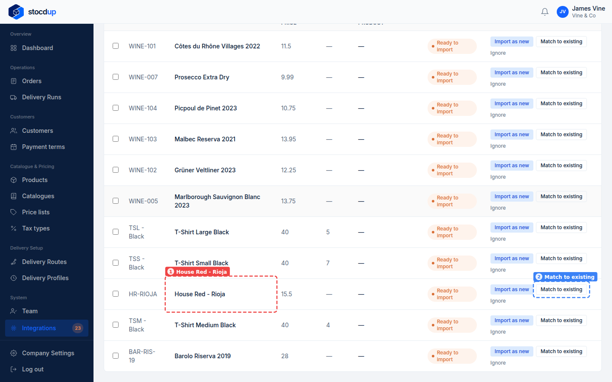
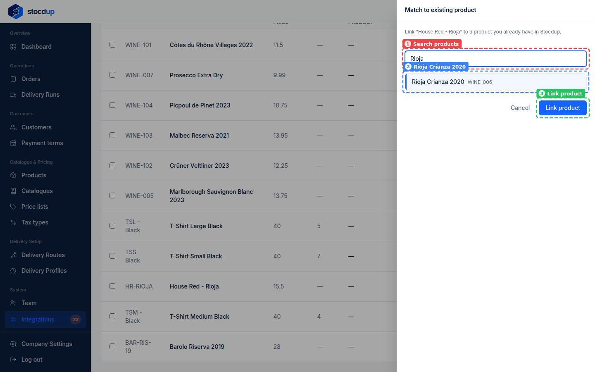
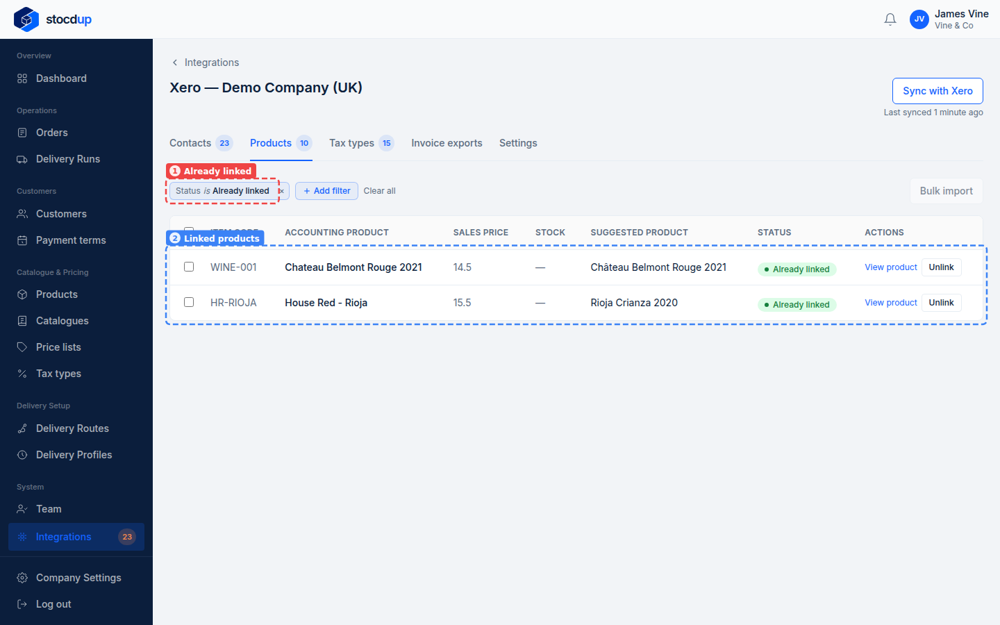

{/* Generated by scenario-docs from documentation/scenarios/match-products-to-xero.md. Edit the scenario and regenerate; changes here are overwritten. */}

In this task you'll link the products you sell in Stocdup to the same items in Xero, by
confirming the matches Stocdup suggests and matching the rest yourself.

## About products and Xero

When a product is linked to a Xero item, invoice lines for it carry that item's code and
its sales account. An unlinked product is still invoiced, described by its name and SKU.
Either way, the price on the invoice is always Stocdup's, never Xero's.

Each sync, Stocdup suggests a match when a Xero item's code matches a product's SKU
(exactly, or ignoring case and separators), or when the names match closely. It never
links anything on its own, because similar codes can be different products, sizes or
vintages, so items with no suggestion are matched by hand.

## Before you start

- You'll need an Owner account.
- Xero needs to be connected and synced.
- Link your tax types first, so matching doesn't need to change a product's tax type.

## 1. Open the synced Xero data and go to Products

Go to **Integrations** and select **View synced data** on the Xero card. Select the
**Products** tab (1). It starts filtered to the items that are a **Suggested match** (Stocdup
found a product whose SKU matches the item code) or **Ready to import** (no matching
product, so you can create one from it).

## 2. Find the Xero item Chateau Belmont Rouge 2021 and check its suggested product

Find **Chateau Belmont Rouge 2021**. Its status is **Suggested match**, and the
**Suggested product** column shows the Stocdup product it matched, **Château Belmont
Rouge 2021** (1): the item code, WINE-001, is the product's SKU. Check it's the same
wine. **Confirm match** (2) is at the end of the row.

## 3. Confirm the match

Select **Confirm match**. The item is now linked, so it leaves the list
while it's filtered to suggested and ready-to-import items.

If the suggestion is wrong, select **Match differently** instead.

## 4. Find the Xero item House Red - Rioja

Find **House Red - Rioja** (1). Nothing is suggested for it: its code and name don't
match any of your products. Select **Match to existing** (2) at the end of its row.

## 5. Match it to the existing product Rioja Crianza 2020

In the panel that opens, search your products (1) for **Rioja**, choose **Rioja
Crianza 2020** (2), then select **Link product** (3).

:::note

If the Xero item's tax rate is linked to a different tax type from the product's,
Stocdup asks before changing the product's tax type.

:::

## Result

Change the filter to show **Already linked** items (1): **Chateau Belmont Rouge 2021**
is linked to **Château Belmont Rouge 2021**, and **House Red - Rioja** to **Rioja
Crianza 2020** (2).

A link can be undone with **Unlink**, and each product's **Integrations** tab shows its
link too. If a product shows **Conflict**, two Xero items are suggested for it; only one
can be linked.

## Related

- [Match your tax types to Xero](../tax-types/match-tax-types-to-xero.mdx)
- [Import a product from Xero](./import-product-from-xero.mdx)
- [Link a product to Xero from the product](./link-product-from-its-record.mdx)
