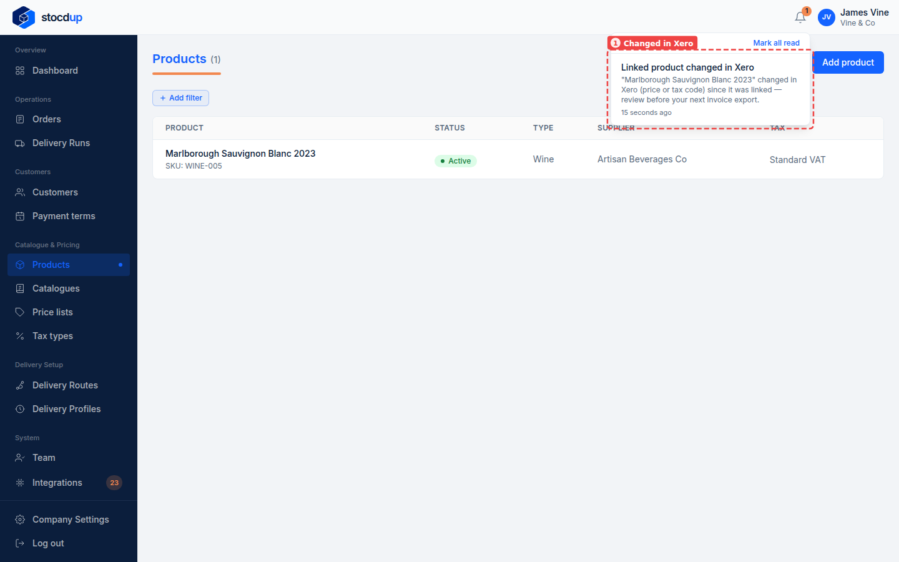
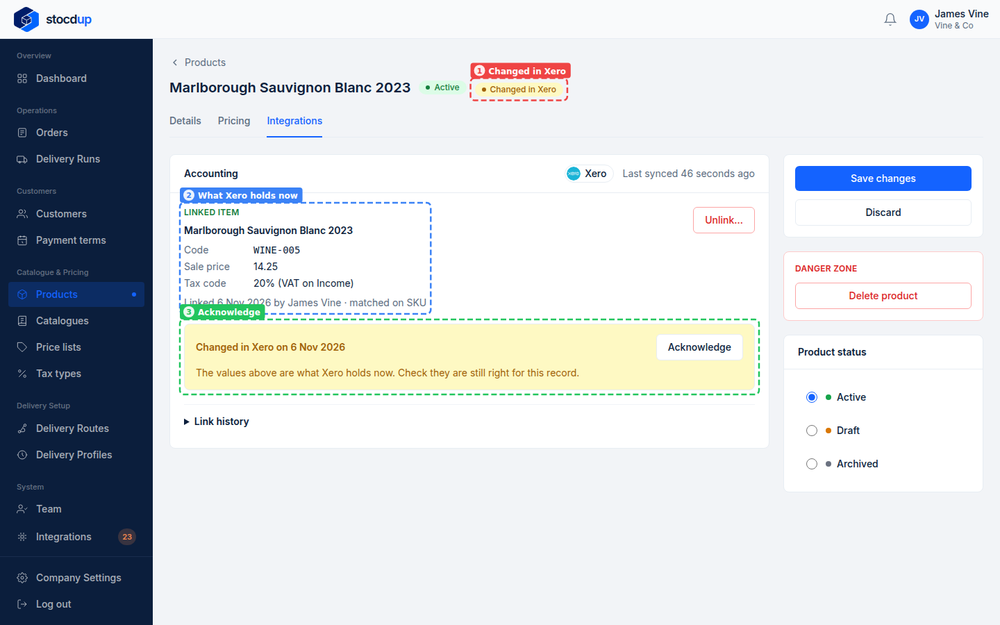
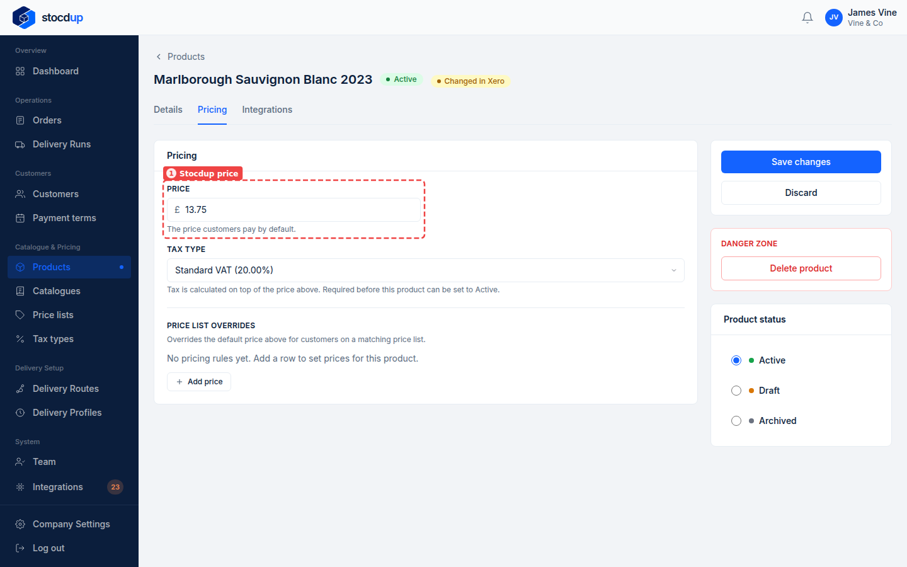
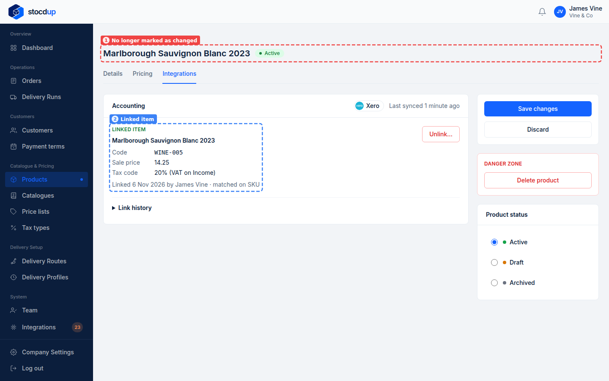

{/* Generated by scenario-docs from documentation/scenarios/review-a-xero-change.md. Edit the scenario and regenerate; changes here are overwritten. */}

In this task you'll check a product whose linked Xero item has changed, and mark the
change as reviewed.

## About changes made in Xero

Stocdup sets your prices; Xero never changes them. When a linked item's sales price or
tax rate changes in Xero, the next sync marks the product **Changed in Xero** and you get
a notification, so you can decide whether Stocdup should change too. The product's
**Integrations** tab shows what Xero holds now. Acknowledging clears the mark without
changing anything; if Stocdup's price should follow, change it on the product.

## Before you start

- You'll need an Owner account.
- Xero needs to be connected, and the product linked to a Xero item.

## 1. Open Marlborough Sauvignon Blanc 2023 and go to its Integrations tab

When a sync finds the change, a notification appears under the bell: **Linked product
changed in Xero** (1), naming the product.

Go to **Products**, select **Marlborough Sauvignon Blanc 2023**, then select **View
product**. Next to its name it shows **Changed in Xero** (1). Select the **Integrations**
tab. The **Linked item** (2) shows what Xero holds now: a sale price of **14.25**. Below
it, a notice (3) says when it changed in Xero.

## 2. Compare Xero's sale price with the product's own price

Select the **Pricing** tab. The product's own **Price** (1) is still **£13.75**: the
change in Xero hasn't changed it. Decide whether Stocdup's price should change too. If
it should, change it here and select **Save changes**.

## 3. Acknowledge the change

Go back to the **Integrations** tab and select **Acknowledge** on the **Changed in Xero**
notice.

## Result

The product no longer shows **Changed in Xero** (1), and the notice has gone. The
**Linked item** (2) still shows Xero's sale price, 14.25, and the product's own price is
still **£13.75**.

Changed products are also flagged on the Xero page's **Products** tab, as **Changed**,
with an **Acknowledge** button. They don't show while the list is filtered to suggested
and ready-to-import items, so clear the filter to see them.

## Related

- [Link a product to Xero from the product](./link-product-from-its-record.mdx)
- [Match your products to Xero](./match-products-to-xero.mdx)
- [Sync with Xero for the first time](../setting-up/sync-with-xero.mdx)
