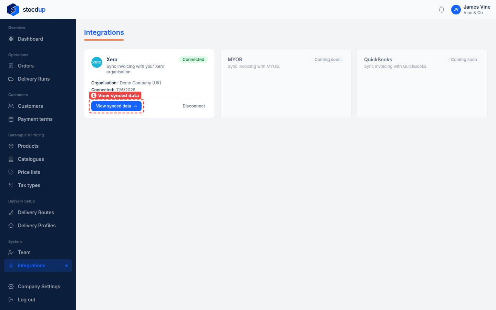
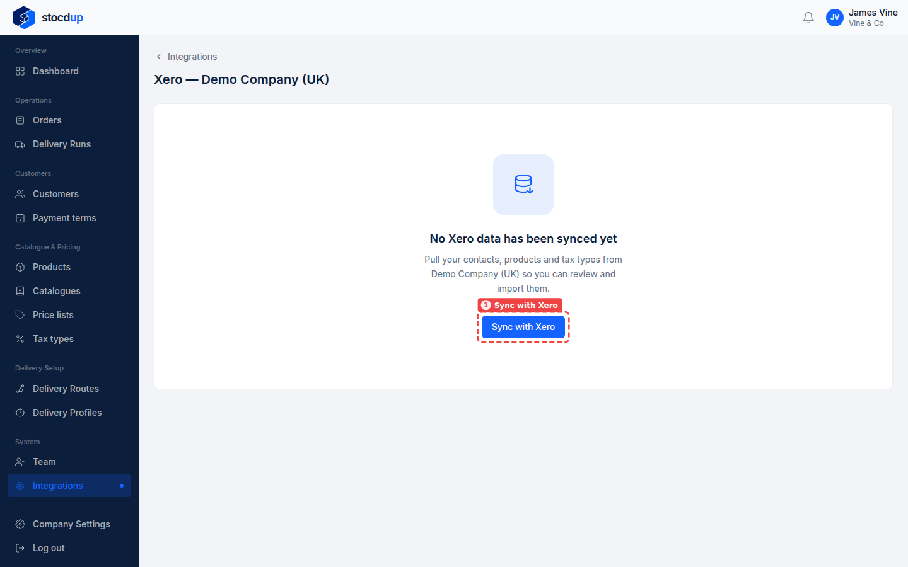
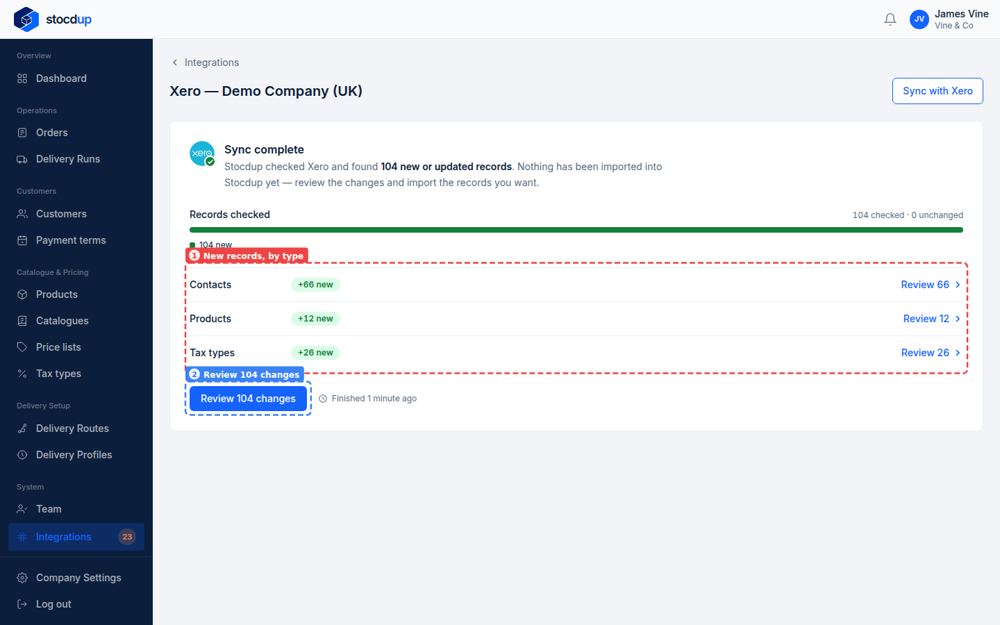
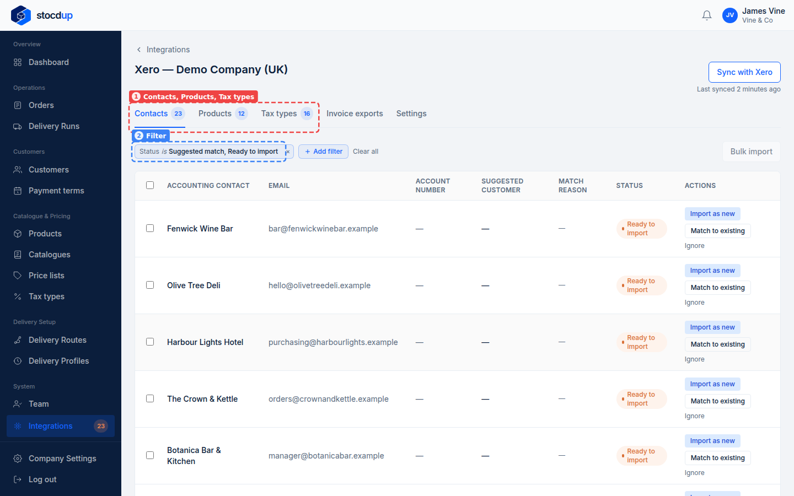
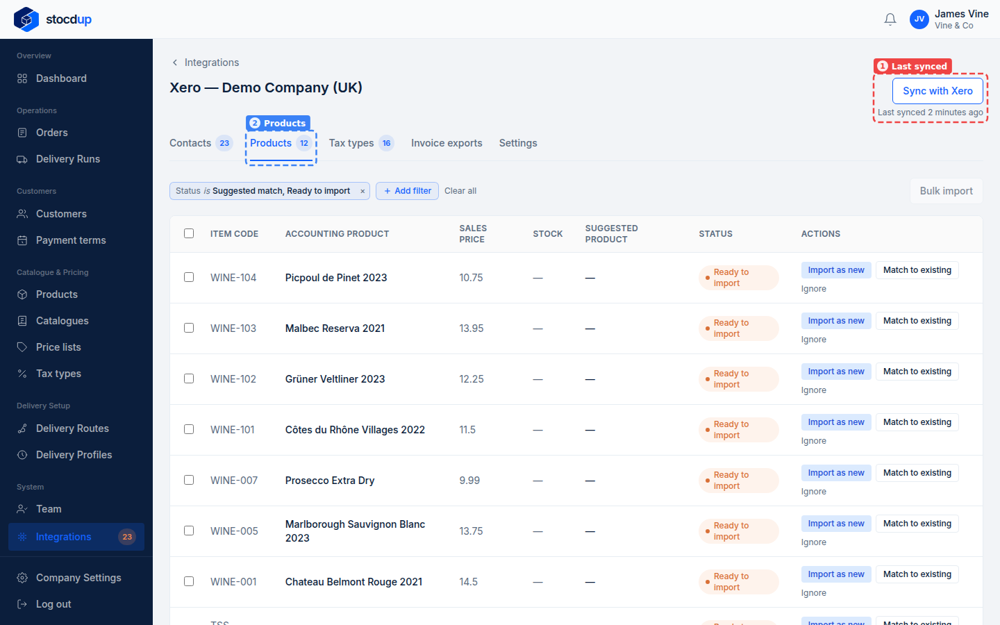

{/* Generated by scenario-docs from documentation/scenarios/sync-with-xero.md. Edit the scenario and regenerate; changes here are overwritten. */}

In this task you'll bring your Xero contacts, products and tax rates into Stocdup, and
see what the sync found, ready to link or import.

## About syncing with Xero

Stocdup keeps a copy of your Xero contacts, items and tax rates, so you can link them to
your customers, products and tax types, or create new ones from them. A sync refreshes
that copy and suggests matches. It never changes your customers, products or prices, and
nothing is linked until you confirm it.

After the first sync, Stocdup syncs again on its own: contacts and products every 30
minutes, tax rates every 6 hours. **Sync with Xero** syncs everything straight away.

## Before you start

- You'll need an Owner account.
- Your Xero organisation needs to be connected to Stocdup.

## 1. Open Integrations and go to your Xero connection

Go to **Integrations**. The **Xero** card shows the organisation you're connected to.
Select **View synced data** (1).

## 2. Sync with Xero

Until the first sync, the page says **No Xero data has been synced yet**. Select
**Sync with Xero** (1).

## 3. Follow the sync until it finishes

The page shows the sync's progress for contacts, products and tax types. You can leave
the page and come back while it runs.

When it's done, the page says **Sync complete** and shows how many new records were
found of each type (1). Nothing has been imported into Stocdup yet. Select
**Review 104 changes** (2) to look through them (the number is however many the sync
found).

## 4. Look through Contacts, Products and Tax types

The **Contacts**, **Products** and **Tax types** tabs (1) list what came across from
Xero; the number on each tab is how many need your attention. Each list starts filtered
to the records that are a **Suggested match** (Stocdup found one of your records that
looks like the same thing, for you to confirm) or **Ready to import** (nothing matches, so
you can create a record from it) (2). Remove the
filter or add your own to see the rest.

## Result

The page shows when Stocdup last synced (1), and each tab, such as **Products** (2),
lists the records from Xero with what you can do with them: confirm a suggested match,
import a record as new, match it to one you already have, or ignore it.

Next, link your tax types, then your products, then your customers. Later, when a
record you've linked changes in Xero, it's marked **Changed** so you can review it.

## Related

- [Match your tax types to Xero](../tax-types/match-tax-types-to-xero.mdx)
- [Match your products to Xero](../products/match-products-to-xero.mdx)
- [Match your customers to Xero](../customers/match-customers-to-xero.mdx)
- [Review a change made in Xero](../products/review-a-xero-change.mdx)
