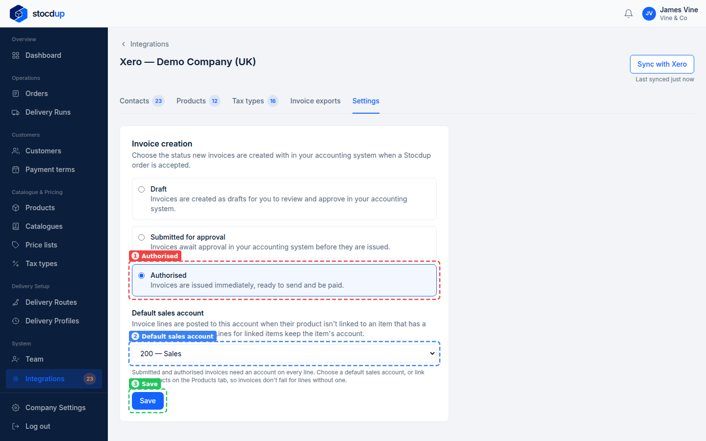
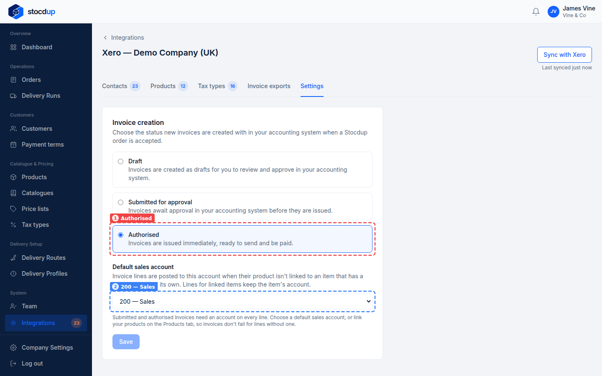

{/* Generated by scenario-docs from documentation/scenarios/xero-invoice-settings.md. Edit the scenario and regenerate; changes here are overwritten. */}

In this task you'll decide whether the invoices Stocdup sends to Xero arrive as drafts,
waiting for approval or ready to send, and which sales account they're posted to.

## About invoice settings

Each order you accept becomes an invoice in Xero. Its status there decides how much
checking happens before your customer sees it: a **Draft** for you to review and approve
in Xero, **Submitted for approval**, or **Authorised**, issued straight away and ready to
be paid. Each line is posted to its linked Xero item's sales account; the default sales
account covers lines with no account of their own (an unlinked product, say). With no
default, Xero decides.

## Before you start

- You'll need an Owner account.
- Xero needs to be connected and synced.

## 1. Open the synced Xero data and go to Settings

Go to **Integrations**, select **View synced data** on the Xero card, then select the
**Settings** tab.

## 2. Choose Authorised for new invoices

Under **Invoice creation**, choose **Authorised**.

## 3. Choose 200 Sales as the default sales account

Under **Default sales account**, choose **200 — Sales**.

:::note

Submitted and authorised invoices need an account on every line. Choose a default sales
account, or link your products to Xero items, so invoices don't fail for lines without
one.

:::

## 4. Save

Check the tab shows **Authorised** (1) and **200 — Sales** (2), then select **Save**
(3). Stocdup confirms with **Saved**.

## Result

The **Settings** tab shows **Authorised** (1) and the default sales account **200 —
Sales** (2).

The setting applies to orders you accept from now on.

## Related

- [Send an order's invoice to Xero](../invoices/invoice-sent-to-xero.mdx)
- [Match your products to Xero](../products/match-products-to-xero.mdx)
