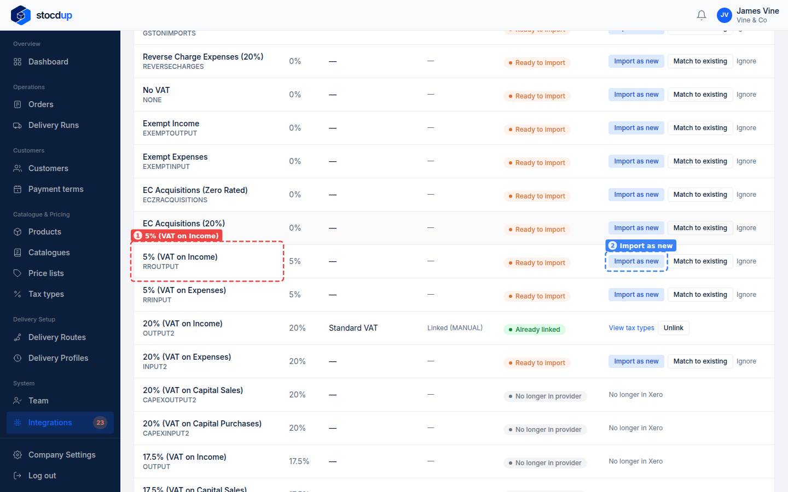
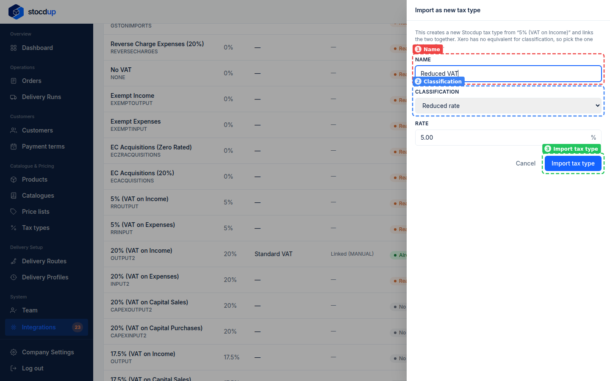
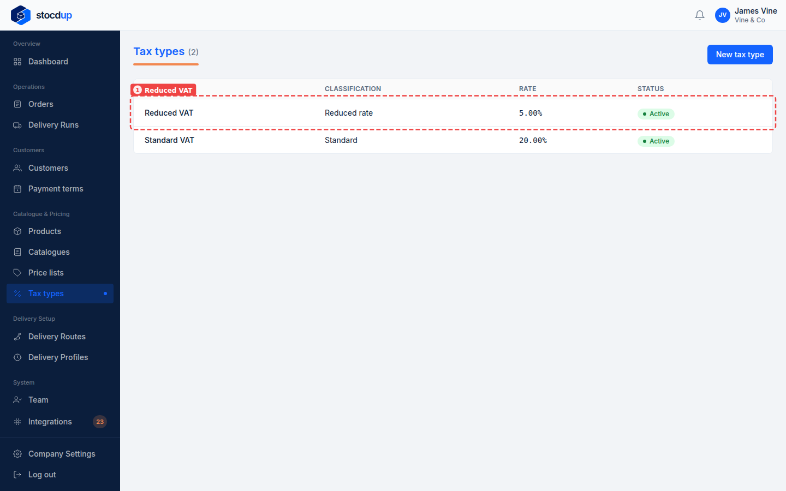

{/* Generated by scenario-docs from documentation/scenarios/import-xero-tax-rate.md. Edit the scenario and regenerate; changes here are overwritten. */}

In this task you'll add a tax type to Stocdup from a tax rate you already have in Xero,
linked to it from the start.

## About creating tax types from Xero

If Xero has a tax rate you sell at that Stocdup doesn't have yet, you can create the
Stocdup tax type straight from it, instead of adding it by hand and linking it
afterwards. You choose its name and classification; the rate comes from Xero. Because
it's linked, invoice lines for products with this tax type carry the Xero rate.

## Before you start

- You'll need an Owner account.
- Xero needs to be connected and synced.

## 1. Open the synced Xero data and go to Tax types

Go to **Integrations**, select **View synced data** on the Xero card, then select the
**Tax types** tab.

## 2. Find the Xero tax rate 5% (VAT on Income)

Scroll down to **5% (VAT on Income)** (1). It shows as **Ready to import**: none of your tax types
matches it, so you can create one from it. Select
**Import as new** (2) at the end of its row.

## 3. Import it as a new tax type called Reduced VAT

A panel opens with Xero's name and rate filled in. In **Name** (1), enter
**Reduced VAT**. Xero has nothing to match Stocdup's classification, so choose
**Reduced rate** as the **Classification** (2). Leave the **Rate** at **5.00**, then
select **Import tax type** (3).

## Result

On the **Tax types** tab, **5% (VAT on Income)** now shows **Reduced VAT** and
**Already linked**. Go to **Tax types** in the menu: **Reduced VAT** (1) is listed with
the **Reduced rate** classification and a **5.00%** rate, and is **Active**.

You can now give Reduced VAT to your products.

## Related

- [Match your tax types to Xero](./match-tax-types-to-xero.mdx)
- [Add a tax type](../../../catalogue-and-pricing/add-tax-type.mdx)
