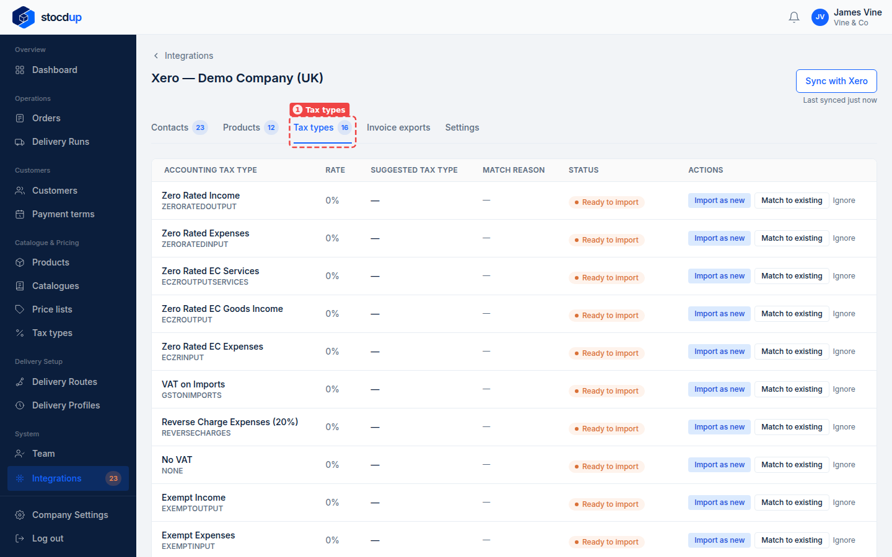
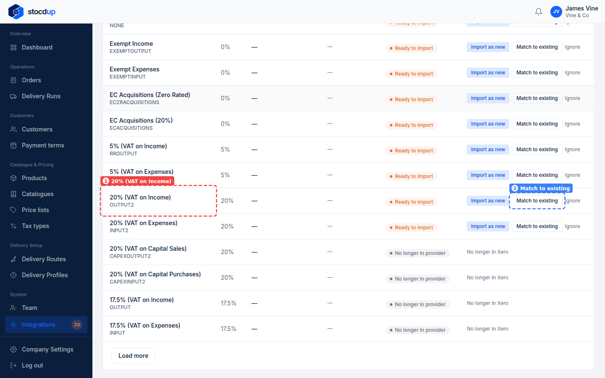
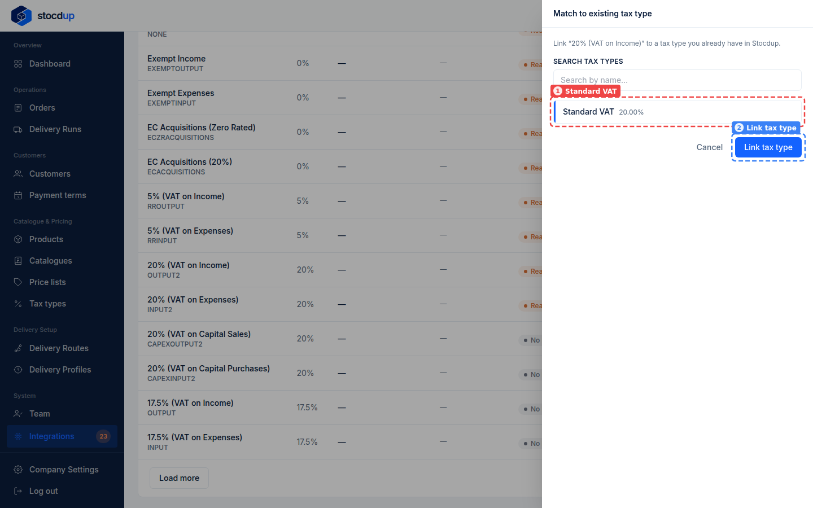
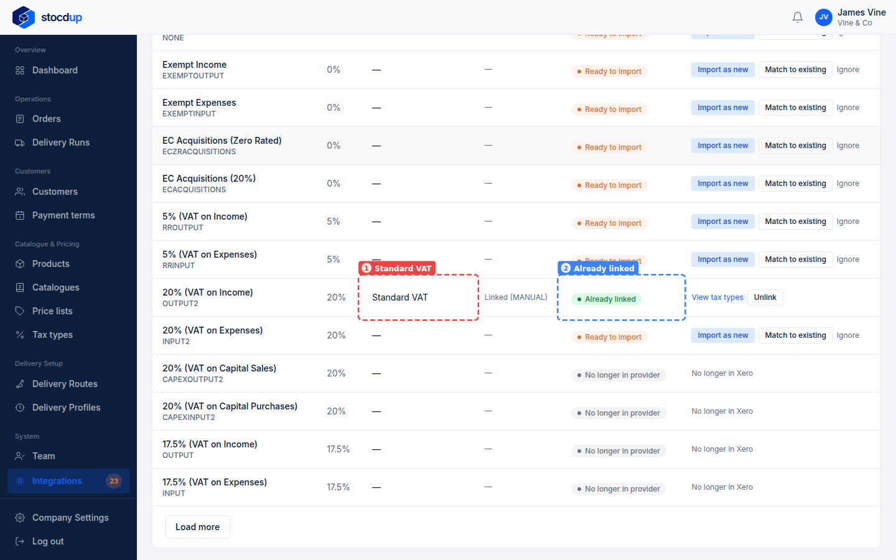

{/* Generated by scenario-docs from documentation/scenarios/match-tax-types-to-xero.md. Edit the scenario and regenerate; changes here are overwritten. */}

In this task you'll link each tax type you use in Stocdup to the matching tax rate in
Xero.

## About tax types and Xero

Every product in Stocdup has a tax type, and each order line keeps it. When an order is
sent to Xero as an invoice, each line uses the Xero tax rate linked to its tax type; a
line whose tax type isn't linked goes without one, and Xero applies its own default.

Stocdup suggests a link only when the names match closely, and tax rate names often
differ ("Standard VAT" in Stocdup, "20% (VAT on Income)" in Xero), so you'll often link
them yourself. Linking tax types first also means products you import from Xero get the
right tax type.

## Before you start

- You'll need an Owner account.
- Xero needs to be connected and synced.

## 1. Open the synced Xero data and go to Tax types

Go to **Integrations** and select **View synced data** on the Xero card. Select the
**Tax types** tab (1). It lists every tax rate in your Xero organisation, with its rate
and whether it's linked.

## 2. Find the Xero tax rate 20% (VAT on Income)

Scroll down to **20% (VAT on Income)** (1). It shows as **Ready to import**, with no
suggested tax type: Stocdup suggests a match only when a tax type's name is similar, so
you link this one yourself. Its **Match to existing** button (2) is at the end of the row.

## 3. Match it to the existing tax type Standard VAT

On that row, select **Match to existing**. In the panel that opens, choose **Standard VAT** (1) from your tax types, then select **Link tax type**
(2).

:::note

A tax type can be linked to only one Xero tax rate.

:::

## Result

The **20% (VAT on Income)** row now shows **Standard VAT** (1) and **Already linked**
(2). Invoice lines for products with the Standard VAT tax type will carry Xero's 20%
(VAT on Income) rate.

Stocdup never links anything on its own: when it suggests a tax type, the suggestion
still needs confirming. A Xero rate you don't use for sales, such as 20% (VAT on
Expenses), can be ignored with **Ignore** so it stops needing attention. A Xero rate
with no Stocdup tax type yet can be imported as a new tax type with **Import as new**.

## Related

- [Create a tax type from a Xero tax rate](./import-xero-tax-rate.mdx)
- [Match your products to Xero](../products/match-products-to-xero.mdx)
- [Sync with Xero for the first time](../setting-up/sync-with-xero.mdx)
