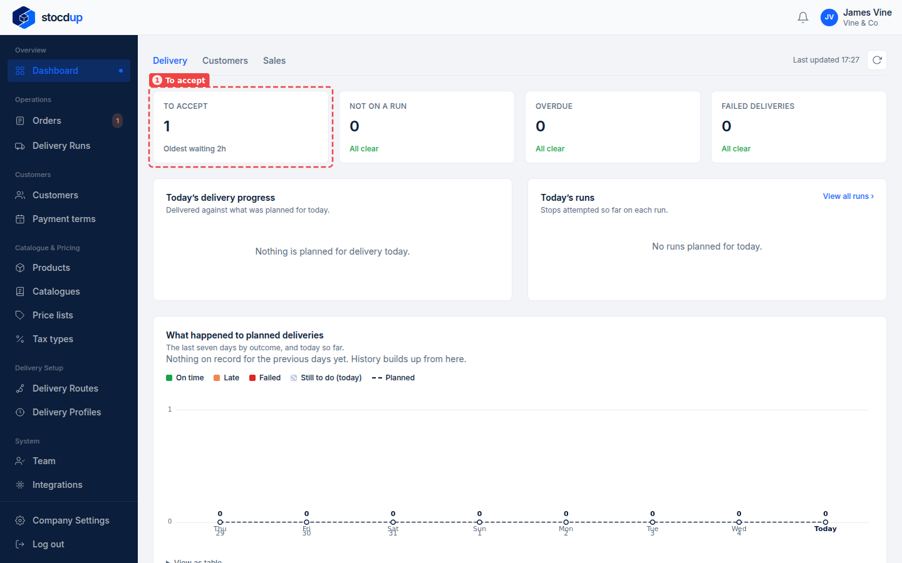
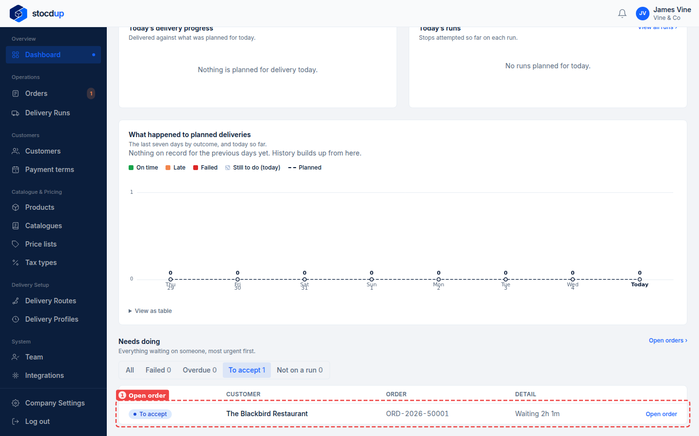
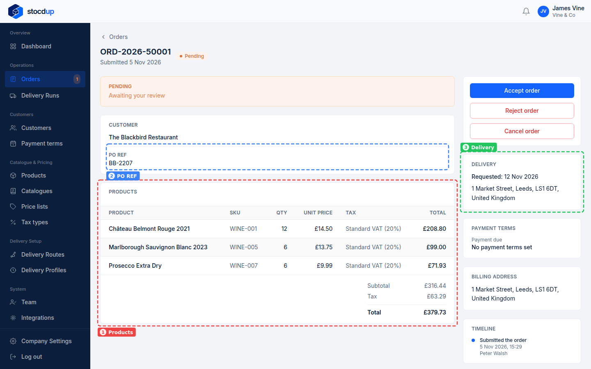
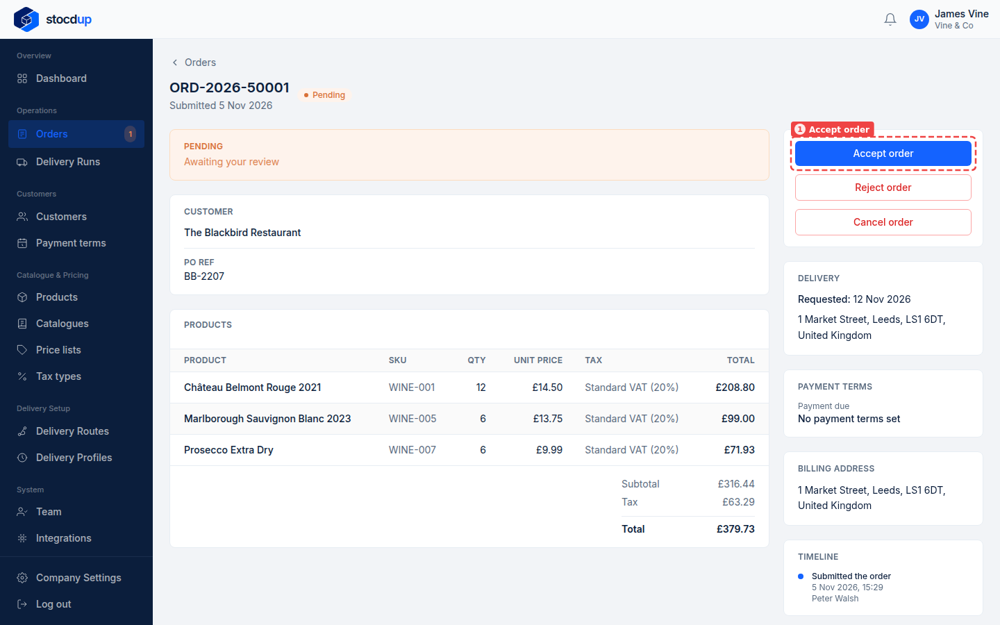
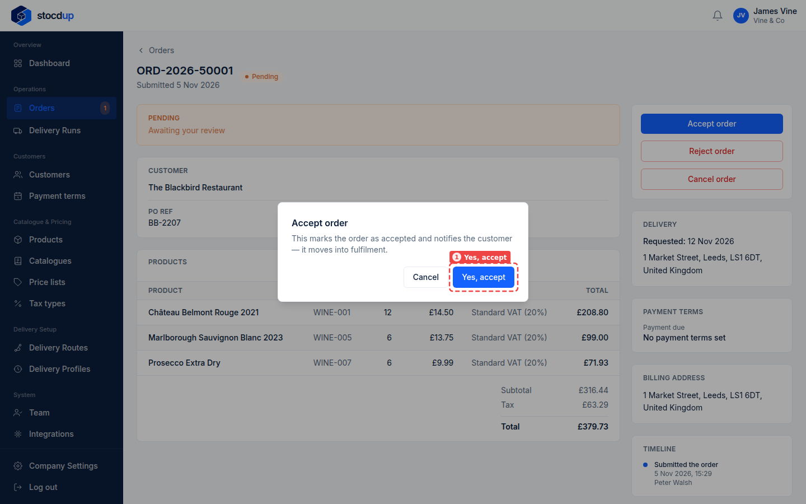
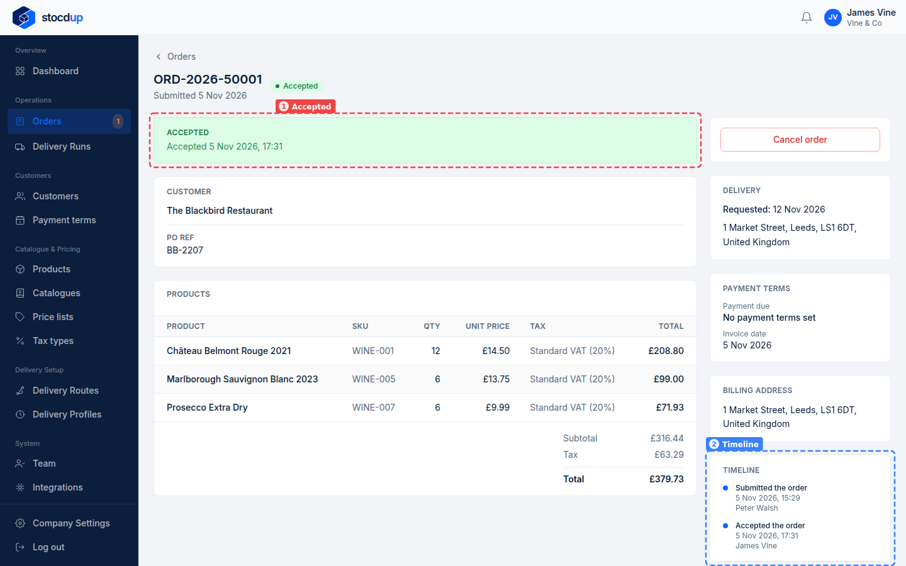

{/* Generated by scenario-docs from documentation/scenarios/accept-order.md. Edit the scenario and regenerate; changes here are overwritten. */}

In this task you'll find an order that's waiting for your review, check its products,
delivery date and PO reference, and accept it.

## About accepting orders

An order a customer places waits for your review, unless you've chosen to accept orders
automatically, either for every customer or for one. Reviewing is your chance to check
you can supply it before you commit to it.

Accepting is the commitment. The order is added to a delivery run on the customer's
route, its payment terms are fixed, and if you've connected an accounting system, an
invoice is created there. If you can't supply it, reject it instead.

## Before you start

- You'll need an Owner account.
- You'll need an order from a customer that is waiting for your review.

## 1. Find the orders that are waiting for your review

On the **Dashboard**, select the **To accept** tile (1). It shows how many orders are
waiting and how long the oldest has waited.

The **Needs doing** list at the bottom of the Dashboard now shows only the orders
waiting for your review, oldest first.

## 2. Open The Blackbird Restaurant's order

In **Needs doing**, find the customer's row and select **Open order** (1).

The order opens, marked **Pending** and **Awaiting your review**: the customer has
submitted it, and it waits for you to accept or reject it.

## 3. Check the products, quantities, delivery date and PO reference

Before you accept, check:

- **Products** (1): each product with its quantity, unit price and total.
- **PO REF** (2): the customer's purchase order reference.
- **Delivery** (3): the requested delivery date and the delivery address.

## 4. Accept the order

Select **Accept order** (1).

A dialog asks you to confirm. Select **Yes, accept** (1).

:::note

If you can't fulfil the order, you can select **Reject order** or **Cancel order** on
the same page instead. Both ask you to confirm, and neither can be undone.

:::

## Result

The order is now marked **Accepted** (1), with the date and time you accepted it, and goes
on to be delivered. Its
**Timeline** (2) records that you accepted it, below the customer's submission.

