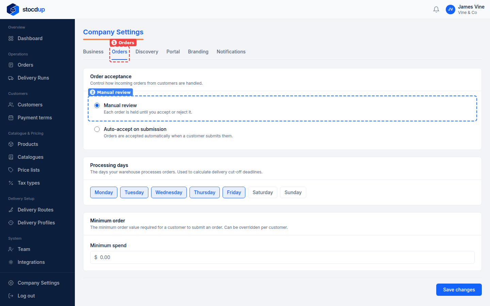
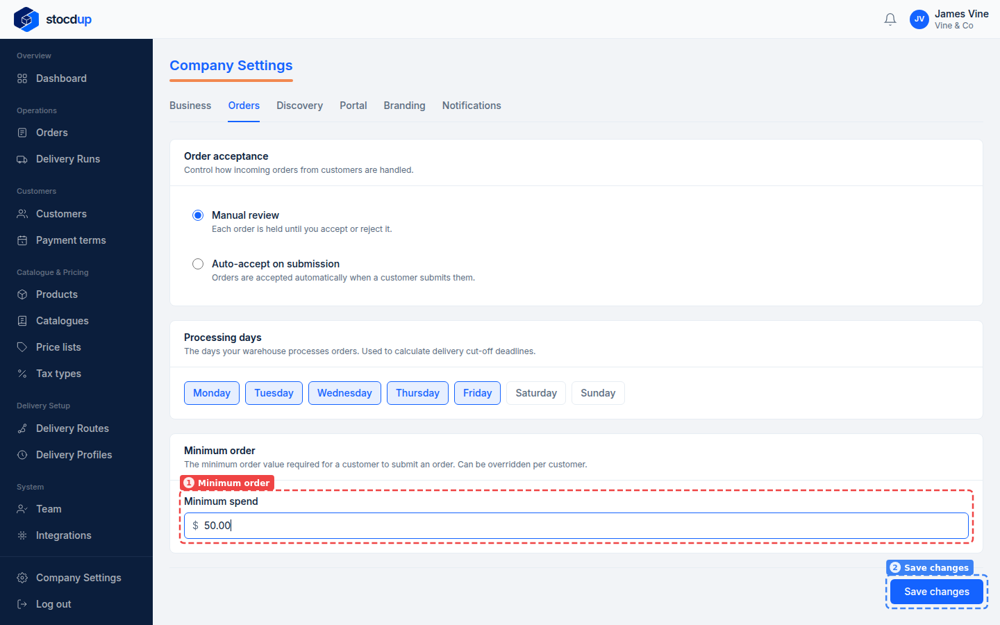
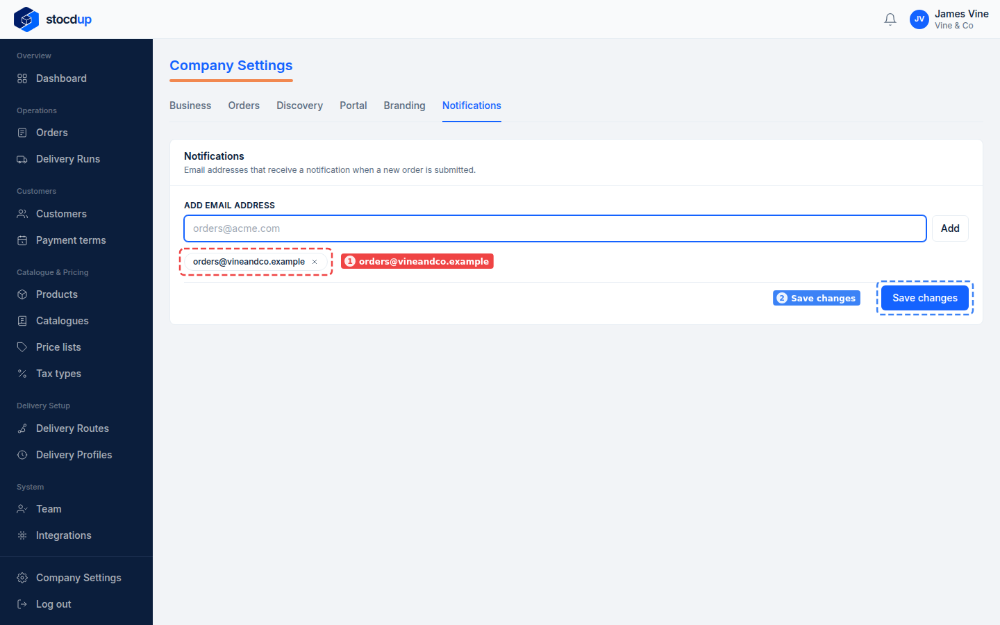
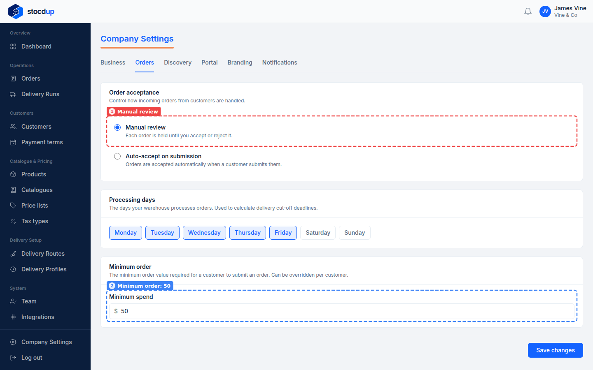
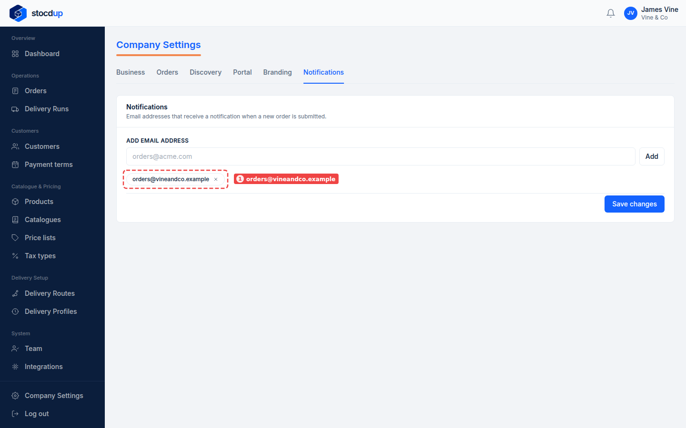

{/* Generated by scenario-docs from documentation/scenarios/change-order-settings.md. Edit the scenario and regenerate; changes here are overwritten. */}

In this task you'll set a minimum order value, choose whether orders are accepted
automatically, and get an email whenever a customer submits an order.

## About order settings

Your company settings decide how orders reach you. With Manual review, each order waits
until you accept or reject it; with Auto-accept on submission, orders are accepted as soon
as a customer submits them. A minimum order stops customers submitting orders below that
value, and you can set a different minimum for a customer on their Account tab. Your
processing days are the days your warehouse handles orders, and they're used to work out
delivery cut-offs. Order notification emails go to the addresses you list each time a new
order is submitted.

## Before you start

- You'll need an Owner account.

## 1. Open Company Settings and go to Orders

Go to **Company Settings** and open the **Orders** tab (1). Under **Order acceptance**,
**Manual review** (2) is selected.

:::note

**Auto-accept on submission** accepts every order as soon as it's submitted, so you won't
review orders first.

:::

## 2. Keep Manual review, and set the minimum order to £50.00

Leave **Manual review** selected. Under **Minimum order** (1), enter **50.00** in
**Minimum spend**.

A customer's own minimum order, set on their **Account** tab, overrides this one.

## 3. Save the changes

Select **Save changes** (2). **Saved** appears next to the button.

## 4. Go to Notifications and add orders@vineandco.example

Open the **Notifications** tab. In **Add email address**, enter
**orders@vineandco.example** and select **Add**. The address appears below (1).

## 5. Save the changes

Select **Save changes** (2).

## Result

On the **Orders** tab, orders are taken by **Manual review** (1) with a minimum order of
50 (2).

On the **Notifications** tab, **orders@vineandco.example** (1) is listed, and gets an
email whenever a customer submits a new order.

## Related

- [Accept an order](./accept-order.mdx)
- [Set up a delivery profile](../delivery-setup/delivery-profile-setup.mdx)
