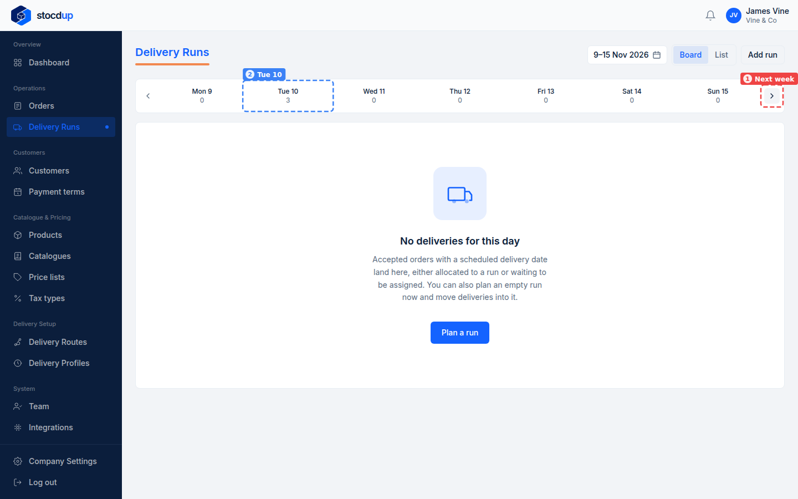
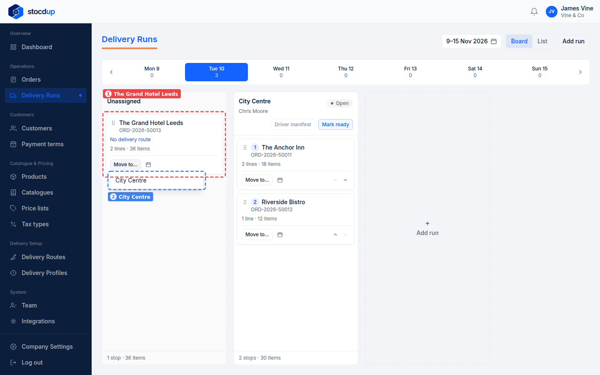
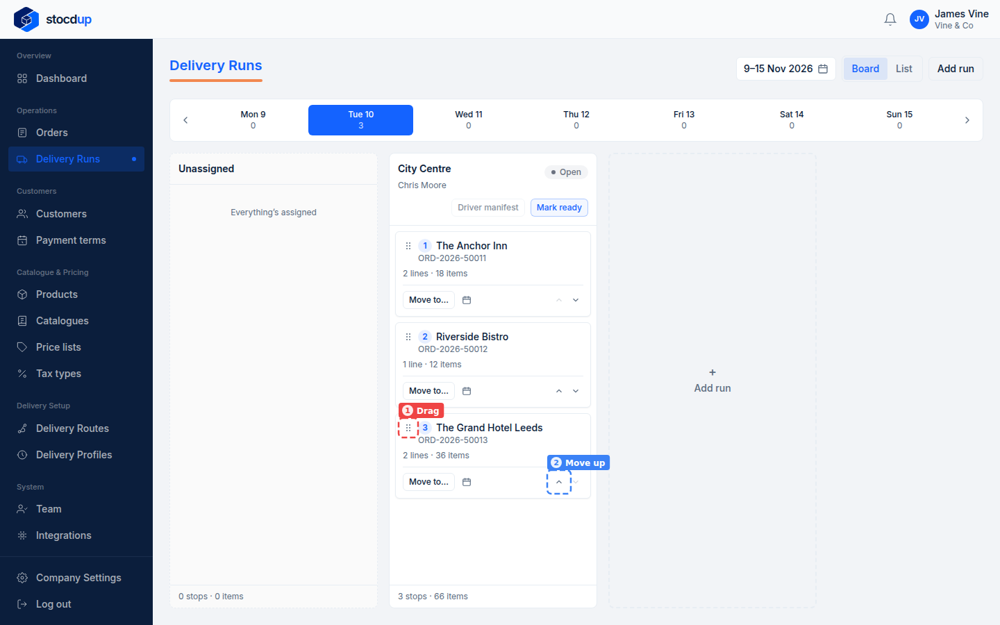
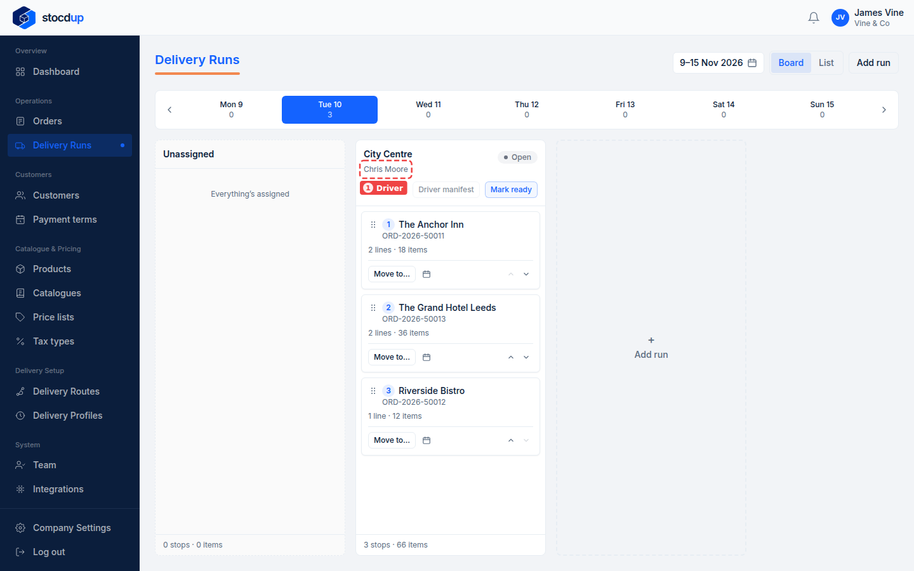
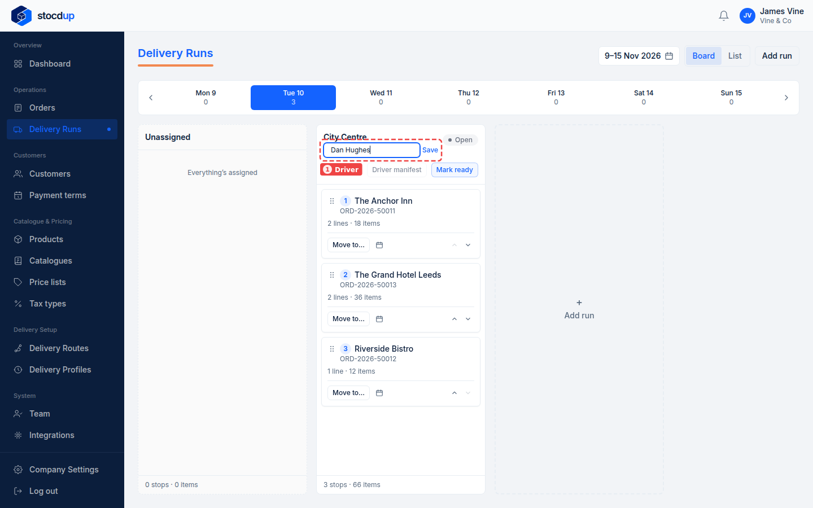
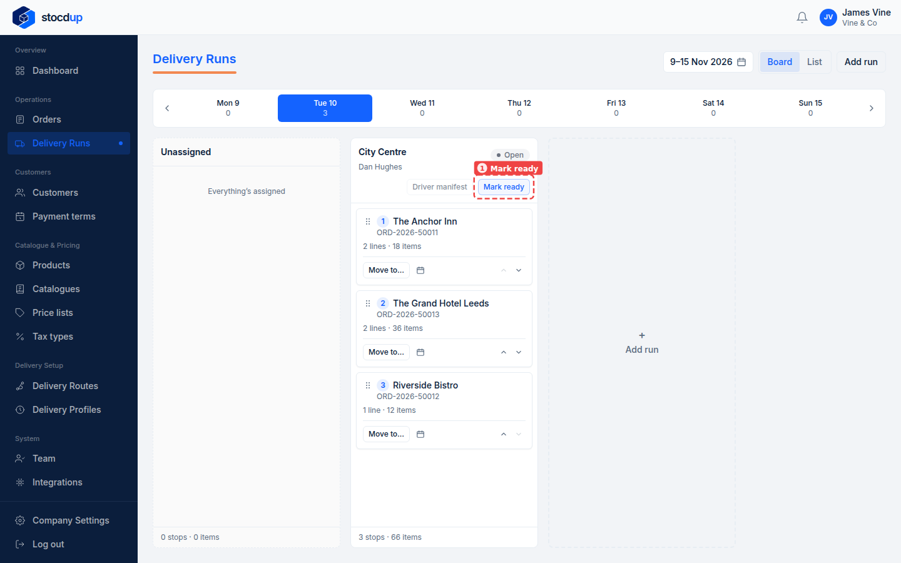
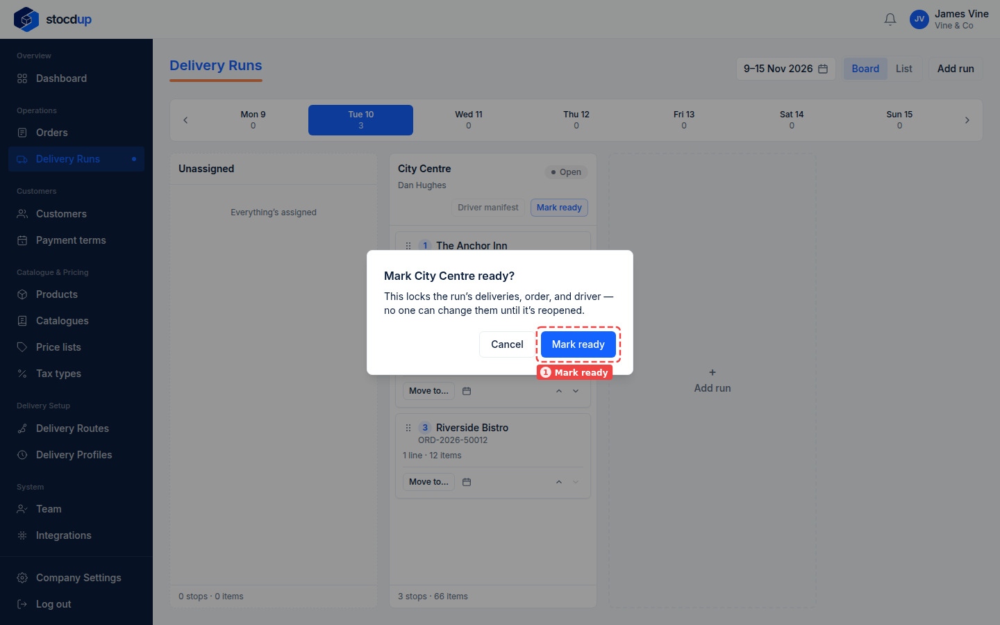
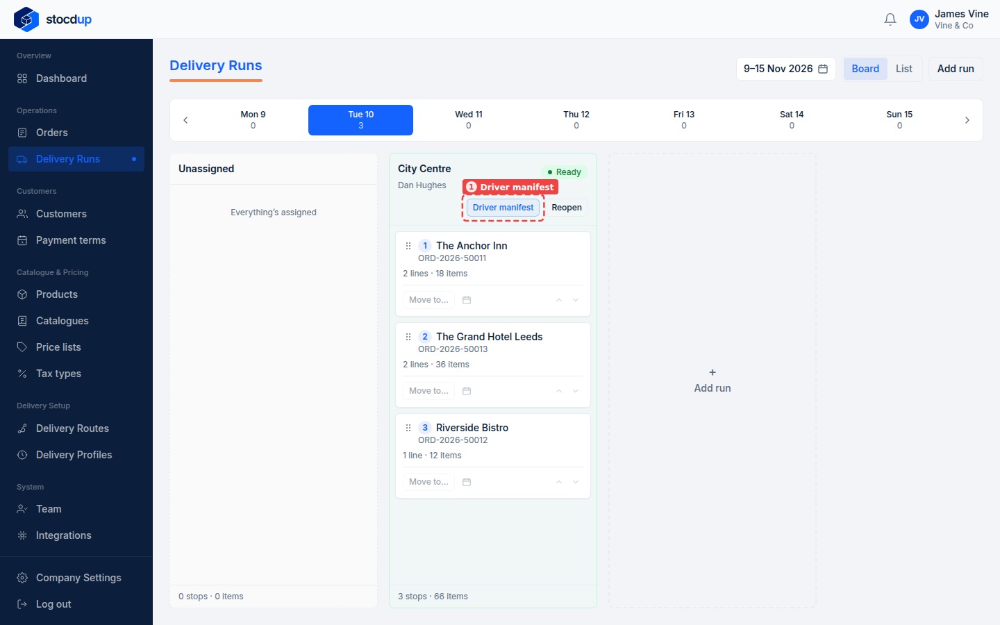
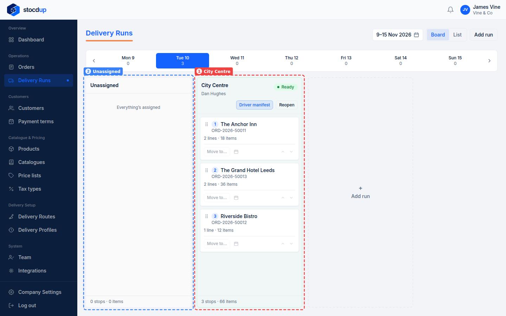

{/* Generated by scenario-docs from documentation/scenarios/plan-delivery-runs.md. Edit the scenario and regenerate; changes here are overwritten. */}

In this task you'll check a delivery day's runs, put any unassigned deliveries into a run,
set the order of the day's drops, and choose who drives. Then you'll mark the run ready and
download the driver manifest.

## About planning a day's deliveries

**Delivery Runs** shows one day at a time: a column for each run, and an **Unassigned**
column for deliveries that aren't on a run yet.

Most planning is already done for you. When you accept an order, it goes into that day's
run for the customer's delivery route, in the route's drop order, and the run starts with
the route's default driver.

A delivery lands in **Unassigned** when:

- its customer isn't on a delivery route, or
- its route's run was already marked ready.

The card says which. Planning the day means moving those deliveries into a run, putting
each run's drops in the order the driver should do them, and setting the driver for the
day. These changes only affect that day's run, not the route.

When a run is planned, you mark it ready. That locks its deliveries, their order and the
driver until someone reopens it, and unlocks the **driver manifest**: a PDF listing the
run's drops in order, for the driver to take with them.

## Before you start

- You'll need an Owner account.
- You'll need accepted orders for the day you're planning.

## 1. Open Delivery Runs for the day

Go to **Delivery Runs**. Use **Next week** (1) to move to the week you want, then select
the day, for example **Tue 10** (2). Each day shows how many deliveries it has.

## 2. Move an unassigned delivery into a run

Find the delivery in **Unassigned**, for example **The Grand Hotel Leeds** (1). Its card
says why it's unassigned, here **No delivery route**. Select **Move to…** on the card and
choose the run, for example **City Centre** (2).

The delivery joins the end of the run.

## 3. Put it in the right place in the drop order

The number on each card is its place in the run: **1** is the driver's first drop. Move the
delivery to where the driver should visit it, by dragging it by its handle (1) or with the
**Move up** (2) and **Move down** arrows. For example, move **The Grand Hotel Leeds** up
once, so it's the second drop, between The Anchor Inn and Riverside Bistro.

This changes the order for this day's run only. The route's drop order stays as it is.

## 4. Change the driver for the day

The run's driver is shown under its name (1). It starts as the route's default driver.

Select the driver's name, enter the driver for this day (1), for example **Dan Hughes**,
and select **Save**.

This changes the driver for this day's run only. The route keeps its default driver.

## 5. Mark the run ready

When the run is planned, select **Mark ready** (1) on the run.

Check the message, then select **Mark ready** (1) to confirm.

:::note

This locks the run's deliveries, their order and the driver. No one can change them until
the run is reopened.

:::

## 6. Download the driver manifest

The run is now marked **Ready**, and **Driver manifest** (1) is available. Select it to
download the manifest.

The manifest starts with the run, its driver and delivery date, and a list of the stops in
order with each customer's town, postcode and order number. After that, each stop has its
own page with the delivery address, the products and quantities, and a QR code.

## Result

The run (1) is marked **Ready**, with its drops in the order the driver will do them and
the day's driver under its name, and **Unassigned** (2) is empty. The driver manifest lists
the same stops in the same order.

:::note

A route can only have one run per day. To add a run for a route that has none that day,
select **Add run** and choose the route. The run starts empty, with the route's default
driver, and you can move deliveries into it.

:::

:::note

If something changes, select **Reopen** on the run to unlock it, make your changes, and
mark it ready again. While a run is ready, an order you accept for its route that day goes
to **Unassigned**, marked **Run already marked ready**.

:::

To have a customer's future orders added to a run automatically, add them to a delivery
route.

## Related

- [Create a delivery route](../delivery-setup/create-delivery-route.mdx)
- [Accept an order](./accept-order.mdx)
