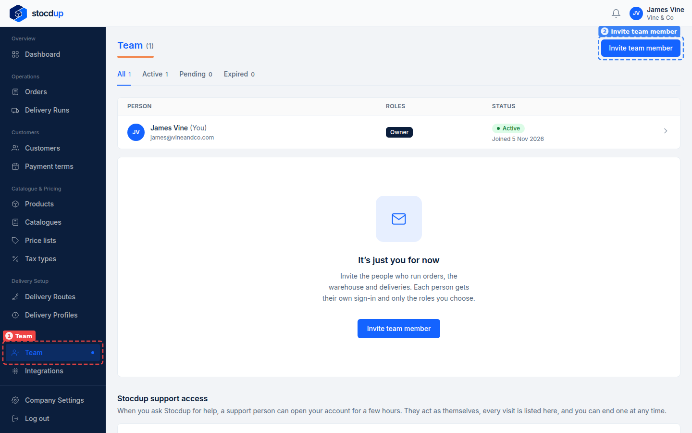
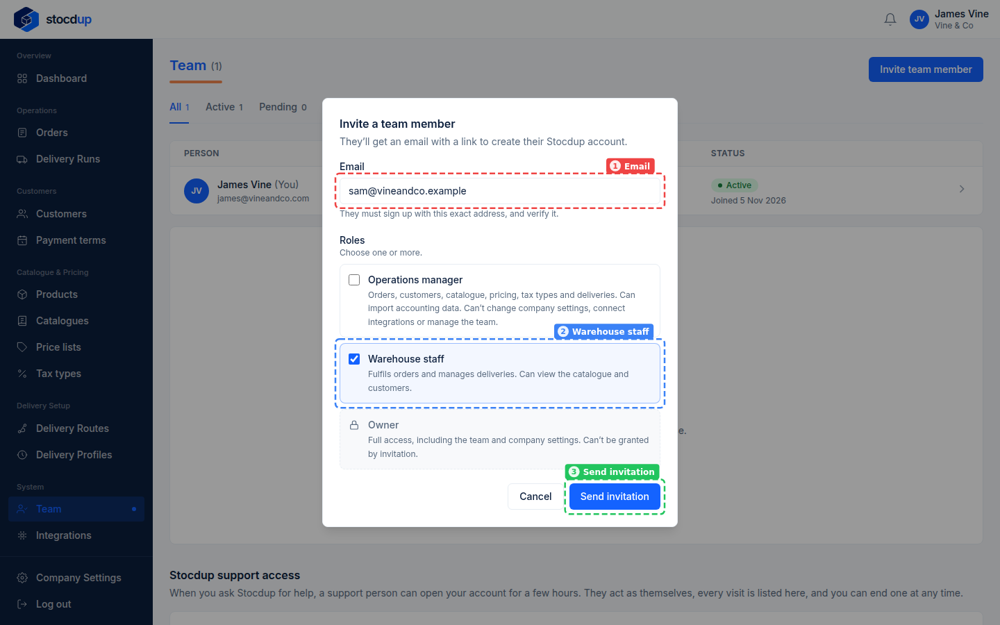
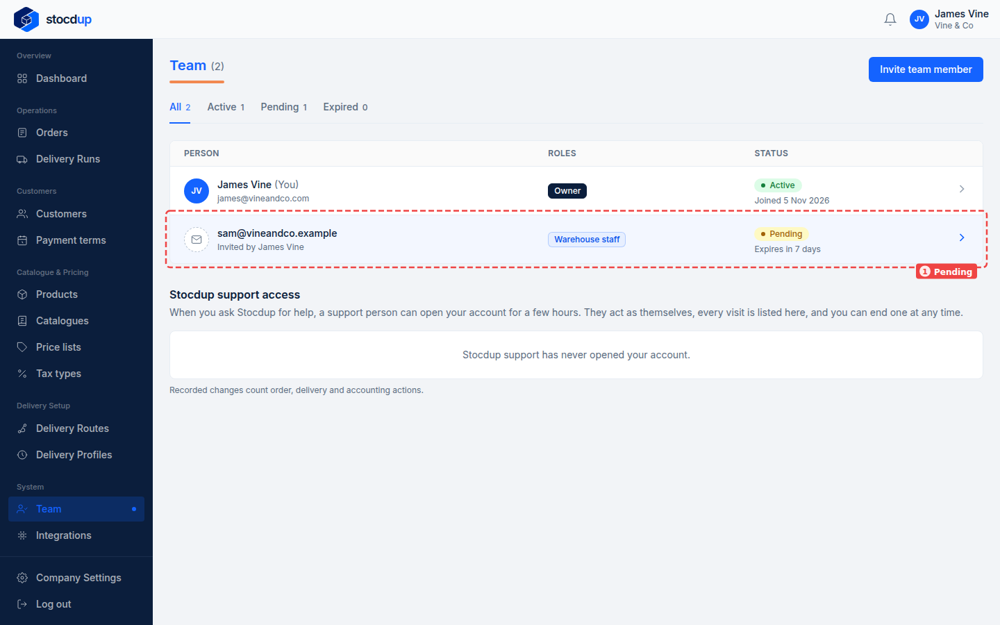

{/* Generated by scenario-docs from documentation/scenarios/invite-team-member.md. Edit the scenario and regenerate; changes here are overwritten. */}

In this task you'll invite someone to your team: enter their email address, choose their
roles, and send the invitation.

## About team members and roles

Everyone who works on your account gets their own Stocdup sign-in, and their roles decide
what they can do:

- An **Operations manager** handles orders, customers, the catalogue, pricing and
  deliveries, but can't change company settings, connect integrations or manage the team.
- **Warehouse staff** fulfil orders and manage deliveries, and can only view the catalogue
  and customers.

You can give someone more than one role. Only the Owner manages the team, and the Owner
role can't be given by invitation. The invitation is an email with a link that lasts 7
days, and the person must sign up with exactly that email address.

## Before you start

- You'll need an Owner account.

## 1. Open the team

Select **Team** (1) in the menu. **Invite team member** (2) is at the top right.

## 2. Start inviting a team member

Select **Invite team member**. The **Invite a team member** window opens.

## 3. Enter their email address

In **Email**, enter the address they'll sign up with, for example
**sam@vineandco.example**.

## 4. Give them the Warehouse staff role

With the email address in **Email** (1), go to **Roles** and tick **Warehouse staff** (2).
**Send invitation** (3) is at the bottom of the window.

## 5. Send the invitation

Select **Send invitation**.

## Result

The person appears on your team as **Pending** (1), with the role you gave them and the
date the invitation expires: they haven't accepted yet. Once they join, they show as
**Active**; if the invitation runs out first, it shows **Expired** and you can invite them
again.

Select their row to open the invitation. Until they accept, you can change their roles
there, select **Resend invitation** to send a fresh link, or select **Revoke invitation**
to cancel it.
